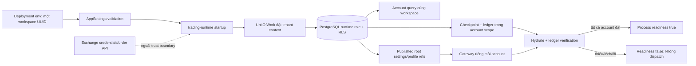

# ADR — Khởi động PAPER runtime trong một workspace

- **Trạng thái:** Đã chốt phạm vi tối thiểu cho RB2–RB4
- **Ngày:** 2026-10-23
- **Liên quan:** [WBS runtime bootstrap](../../implementation/wp02e-runtime-bootstrap-wbs.md), [ADR phục hồi PAPER](./2026-10-23-paper-recovery.md)

## Bối cảnh

Checkpoint/recovery service có thể hydrate một PAPER account và đối soát snapshot với ledger, nhưng `app.py` chưa gọi service này trong startup. Mọi dữ liệu business được bảo vệ bằng Row-Level Security (RLS); runtime DB role yêu cầu tenant context `app.workspace_id`, và không có quyền enumerate chéo workspace. Cần nối recovery vào một app process mà không tạo cơ chế quyền mới để quét tenant.

## Quyết định

1. Mỗi `trading-runtime` process được cấu hình đúng **một workspace UUID deployment identity** qua `TRADING_BOT_RUNTIME_WORKSPACE_ID`. Đây là ranh giới deployment do operator cấp; không đưa vào `WorkspaceSettings`, Admin API, profile business hoặc cấu hình có thể publish.
2. Runtime process chỉ query `TradingAccount` với `workspace_id` deployment đó, `mode=PAPER`, `status=ENABLED`, dưới `UnitOfWork` đã đặt tenant context và runtime DB role/RLS. Không cross-tenant dispatcher, registry đặc quyền, admin DB role hay RLS bypass trong slice này.
3. Với mỗi account, startup tải root `WorkspaceSettings` PUBLISHED/effective và kiểm hash; resolve execution profile đã tham chiếu; tạo gateway/coordinator riêng theo account; gọi hydrate/ledger verifier trước khi công bố account sẵn sàng. Cấu hình runtime không được gửi trong task payload hoặc dùng thay business settings.
4. Thiếu account ENABLED, effective settings/profile, checkpoint, sai policy/hash/ledger/seed, hoặc bất kỳ lỗi DB nào đều làm process `not_ready`. Checkpoint thiếu không được hiểu thành state trống; khởi tạo genesis phải xảy ra qua một initialization workflow riêng có audit.
5. Readiness nội bộ theo account và readiness process-level. Với `trading-runtime`, `/health/ready` chỉ khẳng định database sẵn sàng và mọi account PAPER ENABLED đã hydrate/đối soát; điều đó **không** bật dispatch hay giao dịch. Response ghi `market_dispatch=not_configured`, `exchange_execution=disabled` cho tới khi các pipeline tương ứng được nối và có gate readiness riêng. Nếu một account lỗi, không account nào được công bố active. Liveness không phụ thuộc trạng thái recovery.
6. Health endpoint chỉ trả safe status/counts; không trả workspace/account UUID, settings, profile hashes đầy đủ hoặc secrets. Diagnostic chi tiết phải đi qua audit/log có kiểm soát và không chứa credential.
7. PAPER-only; không tạo exchange client, không tải API credential và không gửi order. Runtime market/lifecycle dispatch chỉ được nối khi các mutation đều đi qua coordinator/UoW checkpoint boundary. Startup failure trả safe diagnostic code và log code tĩnh; không ghi exception text có thể chứa URL/credential.

## Trust boundary

RLS là ranh giới bảo vệ dữ liệu. Env UUID chỉ thu hẹp truy vấn trong phạm vi quyền đã có, không tăng quyền. Một process không thể đổi workspace lúc chạy; đổi tenant yêu cầu triển khai process mới với deployment identity khác.

## Hệ quả

- Một workspace/account lỗi sẽ giữ toàn process chưa sẵn sàng. Đây là lựa chọn an toàn; vận hành nhiều workspace có thể chạy nhiều deployment độc lập với UUID riêng.
- Workspace chưa có PAPER account ENABLED không được xem là runtime trading-ready.
- Account mới chưa có checkpoint cần được khởi tạo qua workflow riêng trước khi runtime deploy; startup không tự suy luận rằng trạng thái trống là an toàn.
- WP-02E vẫn mở đến khi startup recovery và lifecycle dispatch đầy đủ được chứng minh bằng Compose E2E; ADR này không đóng các acceptance report/backtest/runtime khác của WP-02.

## Kiểm chứng bắt buộc

- Unit: role/mode/UUID validation; account selection scope; bootstrap tất-cả-hoặc-không; recovery readiness 503 khi DB hoặc một account lỗi; recovery readiness 200 không hàm ý dispatch; response chỉ nêu capability/diagnostic code an toàn và không lộ ID/settings/exception/secret.
- PostgreSQL Compose runtime role: chỉ enumerate workspace deployment; hai accounts cùng workspace hydrate; account tenant khác không được truy vấn; corruption ở một account giữ process not-ready và không có active gateway map.
- Ruff/mypy/unit liên quan, Compose E2E restart/startup, teardown sạch và memory được cập nhật/đọc lại.
