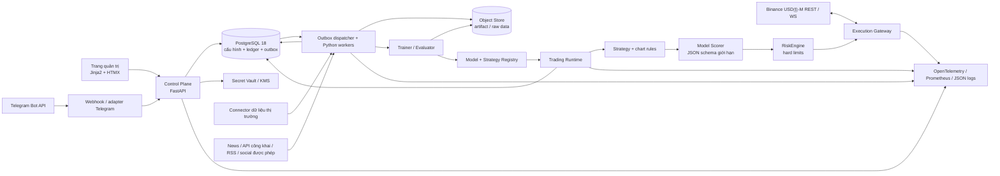
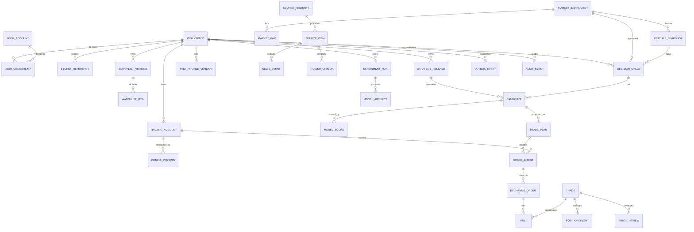
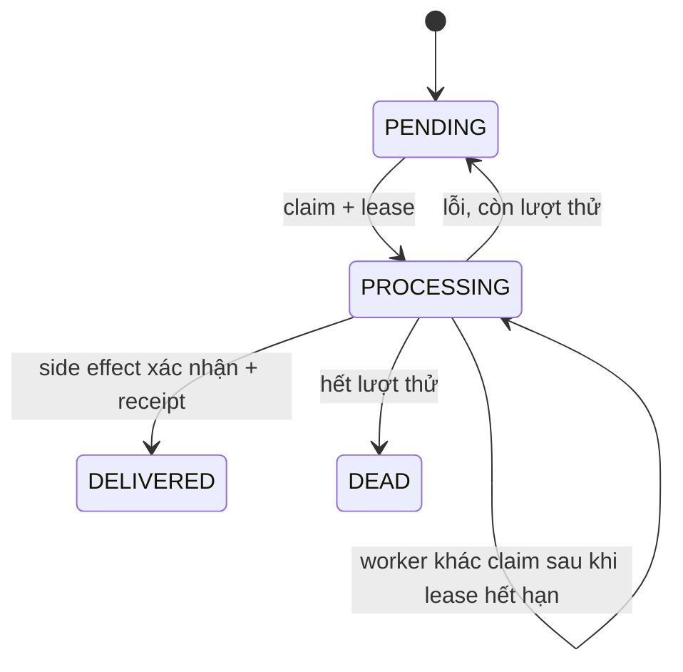

# Thiết kế kỹ thuật — Bot Binance Futures độc lập

**Phiên bản:** 1.1 · **Ngày:** 21/10/2026 · **Trạng thái:** thiết kế cho review \
Tài liệu sản phẩm: [use case](../product/use-cases.md) · [sequence diagram](../product/sequence-diagrams.md) · [user story](../product/user-stories.md) · [từ điển thuật ngữ](../research/glossary-vi.md) · [quy ước ngôn ngữ](../standards/language-policy.md) · thiết kế gốc: [overall system design](../superpowers/specs/2026-10-07-independent-binance-futures-bot-design.md).

<a id="design-goals"></a>
## 1. Mục tiêu và nguyên tắc

1. Xây một ứng dụng độc lập bằng Python; dùng Freqtrade làm tài liệu tham khảo về cách tổ chức strategy/backtest, không fork hoặc dùng Freqtrade làm runtime sản phẩm.
2. Mặc định chạy PAPER, sau đó Binance Demo; LIVE bị khóa tới khi có bằng chứng readiness và phê duyệt riêng.
3. Tái tạo được mỗi quyết định bằng snapshot dữ liệu point-in-time, version strategy/model/risk/config, lineage và recipe thực thi.
4. Khi kết quả gửi lệnh chưa rõ, đối soát với sàn trước khi retry; không coi timeout là thất bại.
5. Tách quyền và credential của trainer, admin, connector, trading runtime và Execution Gateway.
6. Giai đoạn đầu vận hành bằng PostgreSQL và Python workers; chỉ thêm broker/cache khi số đo tải cho thấy thực sự cần.

Các thuật ngữ như [PAPER, Demo, Live](../research/glossary-vi.md#c-futures-dòng-lệnh-và-quản-trị-lệnh), [point-in-time](../research/glossary-vi.md#e-dữ-liệu-và-chiến-lược-huấn-luyện-ai) và [UNKNOWN order](../research/glossary-vi.md#h-nguồn-gốc-thời-gian-và-vận-hành) có định nghĩa thống nhất trong glossary.

## 2. Kiến trúc tổng thể



### Ranh giới tin cậy

- Chỉ `Execution Gateway` được truy cập credential giao dịch Binance và gửi/hủy/thay order.
- `RiskEngine` là ranh giới policy xác định: LLM, nguồn tin, chart pattern và Telegram command không thể vượt hard limit.
- `Trainer` chỉ đọc dataset đủ điều kiện và ghi experiment/artifact metadata; không đọc secret sàn và không ghi bảng order/position đang hoạt động.
- `Admin API` nhận yêu cầu thay đổi nhưng không giữ trading key; cấu hình cần version, kiểm tra quyền và phê duyệt trước khi runtime áp dụng.
- Nội dung bên ngoài và model output là dữ liệu không tin cậy; extractor phải kiểm tra schema, evidence và quyền nguồn.

## 3. Stack khuyến nghị

| Lớp | Công nghệ | Lý do và giới hạn |
| --- | --- | --- |
| Ngôn ngữ/runtime | CPython 3.14.8, bản có GIL | Một ngôn ngữ chính; chưa dùng bản free-threaded cho tới khi thư viện native và yêu cầu tải được xác minh. Phiên bản này là snapshot security release tại 21/10/2026. |
| Web/API | FastAPI 0.156.x + Pydantic v2 | API async, kiểm tra schema và OpenAPI. Phiên bản cần được kiểm tra lại lúc bắt đầu implementation. |
| Giao diện admin | Jinja2 + HTMX + JavaScript nhỏ | Render phía server để giảm số công nghệ vận hành; biểu đồ có thể cần thư viện giao diện phía browser. Nội dung giao diện/giải thích bằng tiếng Việt. |
| Database | PostgreSQL 18.x ổn định; SQLAlchemy 2.1.5 async + psycopg 3.3.6; Alembic 1.20.0 | Một nguồn sự thật cho transaction, ledger, audit và outbox; không dùng PostgreSQL 19 khi còn là bản chưa phát hành chính thức. |
| Worker/runtime | Python `asyncio`, các process riêng; outbox SQL với lease/`SKIP LOCKED` | Giao nhận at-least-once, ít dịch vụ phụ thuộc; chỉ tách broker sau khi đo thấy queue là nút thắt. |
| Binance | Adapter interface; SDK Python chính thức khi khớp semantics; HTTPX giới hạn cho endpoint SDK chưa mô hình hóa | Pin version và contract-test order/conditional order ở Demo. Strategy không import kiểu dữ liệu SDK. |
| Telegram | Telegram Bot API qua adapter `httpx` async | Dùng webhook secret header, deduplicate `update_id`, map identity và RBAC phía server. Không cấp quyền từ dữ liệu client chưa xác thực. |
| Phân tích dữ liệu | NumPy 2.5, pandas 3.0, scikit-learn 1.9; PyArrow/Parquet + DuckDB cho nghiên cứu offline | Bắt đầu từ baseline CPU; tách môi trường train khỏi image execution khi có thể; kiểm tra wheel/compatibility trước khi pin. |
| Model artifact | Object store tương thích S3 (Garage local một node; cloud sau này); metadata registry trong PostgreSQL | Lưu model, manifest, report, checksum và URI bất biến ngoài database nóng. Garage dùng AGPL-3.0; cấu hình local chưa phù hợp HA, cần rà soát giấy phép trước phân phối. |
| Secret | Interface tương thích KMS/Vault; local chỉ dùng secret mã hóa dành riêng dev | DB giữ `secret_ref`, status và fingerprint đã che; key Binance không có withdrawal và giới hạn IP nếu sàn/hạ tầng hỗ trợ. |
| Xác thực | Session phía server, Argon2id cho mật khẩu local, TOTP MFA; để cổng tích hợp OIDC | Server kiểm tra mọi function/resource/workspace; ẩn nút trên UI không phải biện pháp authorization. |
| Quan sát hệ thống | OpenTelemetry trace/metric + Prometheus endpoint + JSON log có cấu trúc; error sink tùy chọn | Nối decision tới intent/order/fill; loại secret và payload nhạy cảm khỏi trace. |
| Đóng gói | Docker Compose cho development/single host MVP | Chưa cần Kubernetes trước khi có yêu cầu tải/HA; tách role DB và process cho web, runtime, gateway, ingestion, trainer. |

Nguồn chính thức đã rà soát ngày 21/10/2026: [Python 3.14.8](https://www.python.org/downloads/release/python-3148/), [FastAPI release notes](https://fastapi.tiangolo.com/release-notes/), [PostgreSQL releases](https://www.postgresql.org/docs/release/), [SQLAlchemy 2.1 asyncio](https://docs.sqlalchemy.org/en/21/orm/extensions/asyncio.html), [SQLAlchemy Numeric/Decimal](https://docs.sqlalchemy.org/en/21/core/type_basics.html), [Psycopg async](https://www.psycopg.org/psycopg3/docs/advanced/async.html), [Alembic changelog](https://alembic.sqlalchemy.org/en/latest/changelog.html), [PostgreSQL row security](https://www.postgresql.org/docs/18/ddl-rowsecurity.html), [NumPy news](https://numpy.org/news/), [pandas release notes](https://pandas.pydata.org/docs/whatsnew/index.html), [scikit-learn compatibility](https://scikit-learn.org/stable/install.html), [Binance USDⓈ-M SDK](https://github.com/binance/binance-connector-python/blob/master/clients/derivatives_trading_usds_futures/README.md), [Telegram Bot API](https://core.telegram.org/bots/api), [Telegram Mini App validation](https://core.telegram.org/bots/webapps), [OWASP function authorization](https://api-security.owasp.org/editions/2023/en/0xa5-broken-function-level-authorization/), [NIST key management](https://csrc.nist.gov/Projects/Key-Management/Key-Management-Guidelines).

Đây là mốc phiên bản tham khảo, không phải lock file. Khi code phải kiểm tra compatibility, pin dependency + hash, ghi SDK support cho từng order type. Nếu SDK thiếu semantics, cô lập phần HTTPX trong adapter và contract-test; không gọi HTTP trực tiếp từ strategy.

Kiểm tra trước WP-01A ngày 21/10/2026 xác nhận CPython 3.14.8 có bản phát hành chính thức; FastAPI 0.156.4 là bản hiện hành trong release notes; SQLAlchemy 2.1.5 được dùng với extra `asyncio` vì từ nhánh 2.1 `greenlet` không còn được cài mặc định; Psycopg 3.3.6 cung cấp giao diện async; Alembic 1.20.0 là bản phát hành ổn định được lock. PostgreSQL RLS mặc định từ chối nếu thiếu policy nhưng chủ bảng/superuser hoặc role `BYPASSRLS` có thể vượt qua; do đó các process dùng login không superuser và repository luôn truyền workspace. `pydantic-settings` 2.16.0 khắc phục advisory đã công bố trong nhánh 2.14.2. `uv` 0.13.4 là bản phát hành ngày 20/10/2026; bản này cập nhật CA gốc và có thể quản lý Python 3.14.8. Chỉ dependency thực sự dùng được đưa vào lock. [uv releases](https://github.com/astral-sh/uv/releases), [Pydantic Settings releases](https://github.com/pydantic/pydantic-settings/releases/tag/v2.16.0), [SQLAlchemy 2.1 changelog](https://docs.sqlalchemy.org/en/21/changelog/changelog_21.html), [FastAPI release notes](https://fastapi.tiangolo.com/release-notes/).

## 4. Cấu trúc package Python

```text
src/trading_bot/
  app.py                         # Chỉ ghép nối FastAPI và cấu hình ứng dụng
  common/                        # Mã định danh, clock, lỗi, kiểu kết quả, log/redaction
  config/                        # Settings có schema; nạp ConfigVersion bất biến
  auth/                           # Session, MFA, RBAC và workspace scope
  admin/                          # Router, form, dashboard, phê duyệt config
  telegram/                       # Webhook, parser command, notifier, khử update lặp
  domain/
    market/                       # Bar, funding, open interest và snapshot
    strategy/                     # Candidate, chart geometry, recipe, DSL compiler
    risk/                         # Hard limits, sizing, reservation, circuit breaker
    execution/                    # Order intent/state machine/fill/reconciliation
    portfolio/                    # Position, trade ledger và PnL attribution
    research/                      # Source, event, trader opinion, attention
    learning/                      # Label, experiment, model registry, drift
  application/                    # Dịch vụ xử lý use case/command/query
  ports/                          # ExchangeGateway, SecretProvider, SourceClient, ModelScorer
  adapters/
    binance_usdm/                 # Wrapper SDK + HTTP adapter có giới hạn
    database/                     # SQLAlchemy repository, Unit of Work, outbox
    sources/                      # Adapter RSS/API chính thức/nguồn social được phép
    telegram/                     # HTTP implementation của Telegram Bot API
    secrets/                      # Tích hợp vault/KMS
    models/                       # Scorer local/remote
  workers/                        # Outbox, market, sources, monitor, trainer, reports
  observability/                  # Metrics, tracing, health/readiness
  cli.py                          # Lệnh quản trị/migration; không chứa trading logic
migrations/                       # Alembic migrations
tests/                            # Kiểm thử sẽ được tạo trong giai đoạn implementation
```

Dependency hướng vào trong: adapter gọi application port; application dùng domain object; domain không import FastAPI, SQLAlchemy, Binance SDK, Telegram SDK hay thư viện model provider. Identifier trong cây thư mục là tiếng Anh; mọi comment hướng dẫn trong source sẽ viết tiếng Việt theo [quy ước](../standards/language-policy.md).

<a id="database-schema"></a>
## 5. Thiết kế database

### 5.1 ER diagram



<a id="table-groups"></a>
### 5.2 Nhóm bảng và trường chính

Mọi hàng thuộc tenant có `workspace_id`; khóa ngoại/unique nên chứa workspace scope để giảm nguy cơ liên kết chéo. ID dùng UUID có thứ tự thời gian hoặc UUID do ứng dụng tạo. Timestamp dùng UTC `timestamptz`.

| Nhóm | Bảng | Trường/chức năng chính |
| --- | --- | --- |
| Identity/control | `workspace`, `user_account`, `user_membership`, `role_binding`, `session`, `mfa_factor`, `telegram_binding` | Phạm vi workspace, subject, role, trạng thái, MFA, Telegram IDs, thời điểm tạo/vô hiệu hóa. Unique theo workspace + user; liên kết Telegram được audit. |
| Cấu hình/bảo mật | `trading_account`, `secret_reference`, `config_version`, `risk_profile_version`, `approval_request` | Venue/mode/environment/capability; opaque secret ref; config JSON immutable + hash + parent version + publish time; hard cap; principal phê duyệt. Không lưu raw key/secret. |
| Universe/strategy | `market_instrument`, `watchlist_version`, `watchlist_item`, `strategy_definition`, `strategy_release`, `strategy_rule` | Metadata symbol/precision/contract status; symbol được phép theo mode; strategy/recipe/DSL immutable. |
| Thị trường | `market_event_raw_ref`, `market_bar`, `funding_rate`, `open_interest`, `orderbook_snapshot_ref`, `ingestion_cursor`, `ingestion_gap`, `feature_snapshot` | Source, `event_at`, `available_at`, cursor, giá trị chuẩn hóa, quality flags, object URI/checksum; feature có formula/code hash và input IDs. |
| Nghiên cứu | `source_registry`, `source_fetch`, `source_item`, `news_event`, `trader_profile`, `trader_opinion`, `attention_snapshot`, `source_review` | Trạng thái quyền/retention; quota/cursor/error; canonical URL/hash/version/timestamp; extraction có evidence/model version/review. |
| Quyết định | `decision_cycle`, `candidate`, `model_score`, `trade_plan`, `risk_decision`, `risk_reservation` | As-of/snapshot IDs; điều kiện/invalidations; score/calibration/OOD/abstain; entry/stop/target/cost/recipe; approve/reject reason và risk reserved. |
| Execution ledger | `order_intent`, `exchange_order`, `exchange_event`, `fill`, `position`, `position_event`, `protective_order_link`, `trade`, `trade_cost`, `reconciliation_run`, `incident` | Client ID/idempotency key theo account; local/exchange status; external event dedup; fills bất biến; projection position; funding/fee; reconcile diff và mức stop coverage. |
| Evaluation/learning | `trade_review`, `outcome_label`, `dataset_manifest`, `experiment_run`, `evaluation_report`, `model_artifact`, `strategy_promotion`, `drift_event` | Review append-only; label replay recipe; snapshot/query dataset; temporal splits/metrics/cost/seed; checksum/URI; promotion/rollback và approvals. |
| Nền tảng | `outbox_event`, `consumer_receipt`, `audit_event`, `notification`, `metric_rollup` | Outbox có lease/retry/dead-letter; receipt duy nhất theo workspace/event/consumer; audit ghi nối tiếp với actor/action/hash. |

Trong schema nền, session giữ token_hash, thời hạn, thời điểm revoke, csrf_token_hash và mfa_verified_at; mfa_factor giữ secret_reference, verified_at và last_used_counter để chặn phát lại TOTP. Các hash được lưu SHA-256 vì token gốc có entropy ngẫu nhiên cao; password_hash dùng định dạng Argon2id. RLS vẫn áp dụng cho session/MFA/role theo workspace.

### 5.3 Ràng buộc, khóa và index

- Unique: `(trading_account_id, client_order_id)`, `(trading_account_id, idempotency_key)`, `(source_id, canonical_item_key)`, `(exchange, external_event_id)`, `(consumer_name, outbox_event_id)`, `(workspace_id, telegram_update_id)`.
- Order state là state machine hữu hạn: `CREATED → SUBMITTING → ACKNOWLEDGED/PARTIALLY_FILLED/FILLED/CANCELED/REJECTED/UNKNOWN`; chỉ reconcile evidence mới được giải quyết `UNKNOWN`.
- Index truy vấn tenant/time: `(workspace_id, created_at DESC)`, `(workspace_id, symbol, event_at DESC)`, `(workspace_id, mode, status, created_at DESC)`, `(workspace_id, strategy_release_id, closed_at DESC)`.
- Partition theo tháng UTC khi lưu lượng chứng minh cần thiết: `market_bar`, `feature_snapshot`, `exchange_event`, `fill`, `audit_event`, `source_item`. Thiết kế dedup/unique phải tính tới giới hạn của partition key.
- Dùng BRIN cho bảng append-only lớn theo thời gian, B-tree cho tenant/entity lookup. JSONB chỉ cho payload versioned không hot query; tiền, trạng thái, thời gian và identity là cột riêng.
- Giá/quantity/cost dùng decimal chính xác; không dùng binary float cho tiền. Lưu exchange precision và chuỗi gốc nếu cần kiểm toán.
- Projection `position` và dashboard rollup dựng lại được từ fills/events bất biến, có `updated_from_event_id` và version.

<a id="transaction-queue"></a>
### 5.4 Transaction và queue

1. Ghi domain update, audit và outbox trong cùng transaction SQL.
2. Worker claim outbox bằng lease/`FOR UPDATE SKIP LOCKED`, commit claim, xử lý side effect, rồi lưu consumer receipt và hoàn tất event.
3. Không giữ transaction DB mở trong khi gọi API ngoài. Ghi intent/idempotency key trước; sau đó gọi sàn và ghi ack/UNKNOWN.
4. Consumer at-least-once và idempotent; không tuyên bố exactly-once giữa PostgreSQL và Binance.
5. Kiểm tra exposure/reservation bằng khóa/transaction để candidate đồng thời không giữ chỗ vượt ngân sách risk.

### 5.5 Retention và quyền riêng tư

Trước production phải chốt retention cho exchange ledger/audit, raw source, derived feature/model artifact, Telegram update, user export/delete và training label correction. Giữ bằng chứng giao dịch tối thiểu theo policy vận hành; xóa/redact raw content khi license yêu cầu. Việc xóa phải cập nhật object store manifest và dataset eligibility. Không crawl tràn lan; chỉ ingest endpoint đã được duyệt.

<a id="service-contracts"></a>
## 6. API và service contract

### Khu vực Admin API

`/api/v1/auth`, `/workspaces`, `/members`, `/accounts`, `/secrets`, `/configs`, `/risk-profiles`, `/watchlists`, `/sources`, `/strategies`, `/decisions`, `/trades`, `/incidents`, `/reports`, `/experiments`, `/releases`, `/audit`, `/telegram/webhook`.

Mọi mutation phải có principal, workspace scope, authorization theo function/object, schema validation, idempotency khi retry và audit link. Cookie session cần CSRF. API không trả secret. Thao tác nhạy cảm mang `request_id`, `actor_id` và `reason` phù hợp.

### Hợp đồng xác thực MVP

API hiện có POST /auth/bootstrap, POST /auth/bootstrap/verify, POST /auth/login, GET /auth/me, GET /auth/csrf, POST /auth/reauthenticate, POST /auth/logout và POST /risk-profiles. Bootstrap cần header X-Bootstrap-Token. Role được đọc lại từ DB ở mỗi request; cookie chứa định danh workspace và token ngẫu nhiên, DB chỉ lưu SHA-256 của token. Mọi mutation dùng token CSRF theo session qua header X-CSRF-Token. Audit nền đã được ghi append-only từ Unit of Work; giao diện xem audit và invite/member CRUD thuộc Plan 04.

| Role | Quyền nền tảng MVP |
| --- | --- |
| Owner | Mọi capability hiện có; thao tác risk yêu cầu MFA gần đây. |
| Operator | Đọc workspace/trade; pause/resume runtime. |
| Strategy Admin | Đọc workspace; sửa strategy/watchlist. |
| Risk Admin | Đọc workspace/trade; tạo risk profile draft; pause/resume runtime. |
| Analyst/Reviewer | Đọc workspace/trade; ghi nhận review. Không sửa risk, strategy, watchlist, member hoặc secret. |

Vai trò chưa được gán cho endpoint nghiệp vụ thì mặc định bị từ chối. Mọi query tenant gắn workspace lấy từ session server, không lấy workspace ID do client tự khai báo.

### Domain ports

```python
class ExchangeGateway(Protocol):
    async def capabilities(self, account_id: UUID) -> ExchangeCapabilities: ...
    async def submit_order(self, intent: OrderIntent) -> ExchangeOrderState: ...
    async def cancel_order(self, account_id: UUID, client_order_id: str) -> ExchangeOrderState: ...
    async def fetch_account_state(self, account_id: UUID) -> AccountSnapshot: ...
    async def reconcile(self, account_id: UUID, since: datetime) -> ReconciliationSnapshot: ...


class ModelScorer(Protocol):
    async def score(
        self, request: ScoreRequest
    ) -> ScoreResult: ...  # Kết quả có schema; chỉ approve/veto/abstain


class SecretProvider(Protocol):
    async def resolve_for_gateway(self, secret_ref: SecretRef) -> SecretLease: ...
```

Chỉ process identity của gateway được resolve secret lease. `SecretLease` có thời hạn ngắn, giá trị secret không được repr/log serialize và không đưa vào domain event.

Adapter LocalMfaSecretProvider dùng AES-GCM để mã hóa seed TOTP thành file ciphertext trong named volume, gắn associated data với workspace/reference. Khóa mã hóa được mount riêng cho admin-web; adapter local chỉ nhận secret MFA và từ chối resolve secret giao dịch. Không dùng adapter này cho Binance key. Gateway sẽ nhận adapter/KMS riêng ở Plan 03 và chỉ có quyền resolve lease giao dịch.

### Envelope của outbox event

```json
{
  "event_id": "uuid",
  "event_type": "order.intent.created.v1",
  "workspace_id": "uuid",
  "aggregate_type": "order_intent",
  "aggregate_id": "uuid",
  "occurred_at": "UTC timestamp",
  "correlation_id": "uuid",
  "idempotency_key": "opaque key",
  "schema_version": 1,
  "payload": {"intent_id": "uuid"}
}
```

Payload nên mang ID, không sao chép secret, raw body lớn hay cấu hình mutable. Consumer lấy version bất biến theo tham chiếu.

### 6.1 Unit of Work, audit và outbox MVP

`UnitOfWork` mở một `AsyncSession`, đặt workspace context trong transaction, rồi commit hoặc rollback khi thoát context. Caller dùng cùng session để ghi thay đổi nghiệp vụ, `AuditEvent` và `OutboxEvent`; không gọi network trong transaction. Audit chỉ lưu `before_hash`/`after_hash` của trạng thái JSON chuẩn hóa, không lưu snapshot. PostgreSQL RLS bắt buộc `app.workspace_id`; `crypidian_app` chỉ có SELECT/INSERT trên audit, các process có INSERT trực tiếp, còn SELECT audit chỉ được cấp cho `admin-web`. Trigger từ chối UPDATE/DELETE.

Trạng thái `outbox_event`: `PENDING → PROCESSING → DELIVERED`; lỗi có thể chuyển `PROCESSING → PENDING` với exponential backoff hoặc `PROCESSING → DEAD` khi hết số lần thử. Lease lưu worker và thời hạn; worker claim bằng `FOR UPDATE SKIP LOCKED` trong transaction ngắn rồi commit trước side effect. `available_at`, `attempts`, `lease_expires_at` cho phép worker khác lấy lại event sau khi lease hết. Mã lỗi được lưu theo tên loại exception, không lưu message/traceback. MVP định tuyến một event type tới một consumer; fan-out nhiều consumer cần bảng delivery riêng.

`ConsumerReceipt` có unique `(workspace_id, outbox_event_id, consumer_name)`. Receipt làm cho thao tác ghi nhận xử lý trong DB có thể deduplicate; nó không ngăn side effect ngoài DB lặp nếu worker chết sau side effect nhưng trước receipt. Consumer phải truyền event/idempotency key vào API đích và đối soát trạng thái mơ hồ. Không tuyên bố exactly-once xuyên PostgreSQL và hệ thống ngoài.



<a id="decision-risk-formulas"></a>
## 7. Công thức quyết định và risk

Đây là hợp đồng tính toán, không phải tuyên bố sinh lời. Ngưỡng cần hiệu chỉnh bằng dữ liệu PAPER và kiểm định độc lập.

### 7.1 Chấm candidate

Với feature vector `x_t`, regime `r_t`, candidate `c`, xác suất classifier đã hiệu chuẩn `p̂` và các điểm rule xác định:

```text
score(c,t) = w_model * calibrated_logit(p̂(c | x_t, r_t))
           + w_trend * trend_score
           + w_pattern * pattern_quality
           + w_flow * orderflow_score
           + w_context * event_context_score
           - w_uncertainty * uncertainty
```

Mọi input phải có dải chuẩn hóa và version. `event_context_score` có thể unknown/zero nhưng phải kèm coverage; thiếu dữ liệu không mặc định là sentiment xấu. `score` chỉ xếp hạng candidate; không vượt data-quality gate, hard risk hoặc trạng thái sàn. Nếu giá, stop, target, recipe, fee, funding hay slippage đổi sau scoring thì chấm lại hoặc reject.

<a id="position-size"></a>
### 7.2 Tính khối lượng vị thế

```text
equity_risk_budget = min(equity * per_trade_risk_pct, remaining_open_risk_budget)
loss_per_unit = abs(entry_reference - stop_price) * contract_multiplier
               + estimated_entry_fee_per_unit + estimated_exit_fee_per_unit
               + adverse_funding_per_unit + slippage_stress_per_unit
raw_qty = equity_risk_budget / loss_per_unit
unit_notional = entry_reference * contract_multiplier
max_qty_by_margin = available_margin * selected_leverage / unit_notional
qty = floor_to_step(min(raw_qty, max_notional / unit_notional,
                        max_qty_by_margin, exchange_max_qty))
notional = qty * unit_notional
initial_margin = notional / selected_leverage
```

Reject nếu quantity/notional dưới minimum của sàn, snapshot tài khoản stale, stop sai hoặc `selected_leverage > leverage_cap`; áp dụng `available_margin` và aggregate exposure trước khi phát hành plan. Leverage không làm tăng ngân sách lỗ được phép.

<a id="entry-exit-price-contract"></a>
### 7.3 Hợp đồng entry/exit price

`E0` là giá tham chiếu chưa trượt từ snapshot quyết định. Kịch bản fill dự kiến áp dụng slippage đúng một lần trên `E0`, sau đó tính phí/funding/risk. PnL thực tế dùng fill/cost được sàn xác nhận, không trừ slippage dự kiến thêm lần nữa. Label phải replay exit recipe thực tế của trade (partial, stop/target, trailing, time/opposing exit), không đổi sang một nhãn thời hạn cố định khác.

<a id="security-operations"></a>
## 8. Bảo mật, authorization và vận hành

- Kiểm soát nhiều lớp: workspace/role/function/object check phía server, MFA cho thao tác nhạy cảm, CSRF, secure/HttpOnly/SameSite cookie, rate limit và throttling đăng nhập.
- Binance key theo least privilege, không withdrawal, tách môi trường và IP allowlist khi được hỗ trợ. Giá trị key không xuất hiện trong admin DB, log, exception, AI prompt hay artifact train.
- Telegram webhook xác minh `X-Telegram-Bot-Api-Secret-Token`, deduplicate update, map identity đã bind rồi kiểm RBAC từng command. Nếu dùng Mini App, server xác minh signed raw `initData` và độ mới; dữ liệu client không tự cấp quyền.
- Khi control plane lỗi, runtime không mất bảo vệ. Runtime nạp ConfigVersion được duyệt gần nhất; từ chối config stale; hành vi emergency vẫn deterministic.
- Readiness gồm migration tương thích, restore test, clock sync, source rights, secret rotation, demo order, UNKNOWN reconcile, partial fill protection, pause/resume RBAC và incident/alert test.
- Log/trace có correlation từ decision→plan→intent→exchange order→fill→trade; loại credential, cookie, Telegram token, private message body và PII không cần thiết.

- Local bootstrap cần token sinh trong .secrets/bootstrap_token; token hợp lệ chỉ có tác dụng khi DB chưa có workspace/user. Owner và workspace ở trạng thái SETUP cho tới khi mã TOTP đầu tiên được xác minh. Session hết hạn sau 12 giờ; cookie có HttpOnly/SameSite=Strict, Secure ở production; mutation cần CSRF token theo session. Thao tác risk kiểm tra MFA trong 15 phút gần nhất.
- Argon2id dùng tham số mặc định đã công bố của argon2-cffi; cần benchmark trên tài nguyên production trước khi đặt concurrency. TOTP dùng cửa sổ một chu kỳ lệch và counter đã dùng để chặn replay. Rate limiter hiện nằm trong bộ nhớ một process; production nhiều replica cần kho dùng chung và ngưỡng vận hành được hiệu chỉnh.
- Seed TOTP local được mã hóa AES-256-GCM trong volume riêng; backup cần giữ cả PostgreSQL, volume MFA và key file được bảo vệ. Mất key thì phải khôi phục qua quy trình MFA recovery; giao diện recovery chưa có ở MVP.

## 9. Process có thể triển khai riêng

Docker Compose ban đầu gồm các role restart riêng được. Cấu hình local khóa digest image; network bridge được gán theo quyền truy cập nhưng không thực thi allowlist egress theo domain/IP:

1. `admin-web`: FastAPI + Jinja2/HTMX; không có credential giao dịch Binance. Nối `backend` nội bộ và `web_ingress` để cổng loopback của host truy cập được; đây cũng là đường egress chung, cần policy tường lửa khi triển khai.
2. `trading-runtime`: lịch/watchlist/strategy/AI/risk/position monitor.
3. `execution-gateway`: REST/user stream Binance, truy cập trading secret; outbound network giới hạn.
4. `ingestion-worker`: market/news/source connectors; chỉ credential đọc cần thiết.
5. `trainer-worker`: dataset và model artifact; không có exchange secret, có giới hạn tài nguyên riêng.
6. `postgres`, `object-store`, và tùy chọn `otel-collector`/metrics. Local object store dùng Garage với replication factor 1; chỉ dùng cho dev, không chịu lỗi node và license AGPL-3.0 cần được đánh giá.

`backend` đặt `internal` để cô lập dịch vụ dữ liệu; riêng `admin-web` cần `web_ingress` để Docker Desktop publish cổng loopback. `exchange_egress` chỉ gắn vào gateway và `source_egress` chỉ gắn vào ingestion. Cấu hình Garage local đặt `allow_world_readable_secrets = true` vì Docker Desktop trên Windows trình bày file secret mount với mode `0777`; secret chỉ mount vào object-store và ACL gốc do host quản lý. Không dùng cài đặt này ở môi trường triển khai; nơi đó cần secret provider cùng quyền file chặt.

Ban đầu có thể dùng cùng repository/image với entrypoint và DB role khác nhau. Chỉ tách deployable khi ranh giới bảo mật/tải đã được xác minh. Single-host local không tương đương HA production.

## 10. Quyết định để mở

Chốt trong giai đoạn implementation: một hay nhiều admin cho live governance; vault self-managed hay cloud; managed hay tự vận hành Postgres; entitlement market/news cụ thể; tập nguồn 100–200 được duyệt; retention/jurisdiction; provider và ngân sách model; OIDC; ngưỡng cần broker/time-series store; topology production. Các mục này không chặn vertical slice PAPER dùng watchlist thủ công và dữ liệu thị trường Binance.
