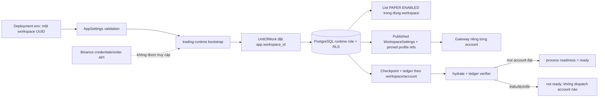

# WBS — Khởi động PAPER runtime theo workspace deployment

**Mục tiêu:** tích hợp recovery PAPER vào `trading-runtime` để process chỉ sẵn sàng sau khi đã tìm, xác minh cấu hình và hydrate toàn bộ account PAPER của đúng một workspace deployment. WBS này là gate tiếp theo của [WP-02E recovery](./wp02e-paper-recovery-wbs.md); chưa cho phép exchange execution.

## Quyết định phạm vi an toàn

1. Mỗi `trading-runtime` instance nhận đúng một `runtime_workspace_id` (UUID) từ deployment environment `TRADING_BOT_RUNTIME_WORKSPACE_ID`. Đây là **deployment identity** để giới hạn phạm vi process, không phải business setting, không lưu/version qua `WorkspaceSettings`, và không cho Admin UI sửa.
2. Instance chỉ enumerate account bằng `workspace_id == runtime_workspace_id`, `mode == PAPER`, `status == ENABLED`, qua runtime DB role và RLS hiện hành. Không tạo cross-tenant dispatcher, tenant registry đặc quyền hoặc query bypass RLS trong WP này.
3. Với mỗi account, runtime tải bản root `WorkspaceSettings` PUBLISHED đã effective trong cùng workspace; resolve execution profile từ catalog versioned; khởi tạo gateway/coordinator đúng profile; hydrate bằng `PaperLifecycleCoordinator.hydrate_account()` để kiểm snapshot với ledger trước khi account sẵn sàng.
4. Không có checkpoint, settings/profile không resolve, account seed lệch, checkpoint/ledger mismatch hoặc lỗi DB đều làm account `RECOVERY_REQUIRED`. Nếu **bất kỳ account ENABLED nào** trong workspace lỗi, toàn bộ process readiness là false và không có account nào được dispatch. Không tự tạo snapshot genesis từ trạng thái trống; khởi tạo account/checkpoint phải là thao tác riêng có audit/transaction.
5. Readiness nội bộ lưu trạng thái từng account. Với `trading-runtime`, `/health/ready` có nghĩa là **database sẵn sàng và PAPER recovery đã hydrate/đối soát đủ account**, không có nghĩa pipeline đã được phép giao dịch. Response công khai rõ `market_dispatch=not_configured` và `exchange_execution=disabled`; khi nối market dispatch sẽ thêm gate riêng. Health chỉ trả trạng thái/tổng số account theo trạng thái và mã chẩn đoán an toàn, không trả UUID workspace/account, settings JSON, lineage đầy đủ, exception text hoặc secret. `/health/live` vẫn chỉ phản ánh process còn sống.

## Trust boundary



RLS vẫn là ranh giới dữ liệu cuối cùng; UUID từ env chỉ là bộ lọc deployment bổ sung và không cấp thêm quyền DB. Runtime không được dùng `admin-web` DB identity hoặc elevated cross-tenant role. Workspace ID không được đọc từ `WorkspaceSettings` để tự mở rộng scope.

## WBS và nghiệm thu

| ID | Đầu việc | Bàn giao | Điều kiện nghiệm thu |
|---|---|---|---|
| RB1 | Chốt trust boundary/ADR cho một workspace deployment identity và fail-closed readiness. | [ADR runtime bootstrap](../architecture/decisions/2026-10-23-paper-runtime-bootstrap.md), sơ đồ trên. | Không có cross-tenant dispatcher/registry/bypass; workspace UUID lấy từ deployment config, không nằm trong root business settings. |
| RB2 | Validate `AppSettings.runtime_workspace_id` cho process role `trading-runtime`. | Pydantic setting `TRADING_BOT_RUNTIME_WORKSPACE_ID` (UUID); các role khác không bắt buộc trường này. | Thiếu/sai UUID hoặc `trading-runtime` chạy mode khác PAPER bị từ chối trước khi mở app; admin/worker không cần identity này. |
| RB3 | Tạo account enumerator tenant-scoped và bootstrap service. | Repository lọc đúng workspace + PAPER + ENABLED; service trả map account→status/diagnostic. | Thử bằng runtime DB role; workspace khác không enumerate được; không account enabled thì không READY; mọi account dùng settings/profile cùng đúng workspace. |
| RB4 | Nối app lifespan: published settings → profile → gateway/coordinator → hydrate/verify cho từng account. | `PaperRuntimeBootstrap` và `app.state.paper_accounts`. | Không gateway active trước khi hydrate/verification và transaction đọc commit xong; thiếu checkpoint hoặc mismatch không bị sửa/đoán; profile/settings/version mismatch fail-closed. |
| RB5 | Thêm readiness theo vai trò và per-account state. | `readiness.paper_runtime`, trạng thái `READY`/`RECOVERY_REQUIRED`, safe counts và capability status trong `/health/ready`. | Runtime trả 200 chỉ khi DB + recovery toàn workspace đạt; response ghi rõ market dispatch chưa cấu hình và exchange execution đang tắt. Một account lỗi trả 503 và chặn mọi gateway; chỉ diagnostic code an toàn được trả, không exception text/UUID/config/secret; liveness vẫn OK. |
| RB6 | TDD unit tests cho config validation, account filtering, profile resolution, mixed-account outcome, no-account, hydrate failure, readiness response. | Unit tests ở test modules riêng. | Mỗi invariant có RED→GREEN; test xác nhận valid account state không được publish khi account khác cùng workspace lỗi. |
| RB7 | Compose E2E riêng bằng chung app image/Postgres runtime role. | `tests/e2e/test_paper_runtime_bootstrap.py`; không tạo image riêng và không sửa E2E boundary dùng chung. | Trước Compose phải compile thành công mọi Python snippet sau `dedent()`. Khởi chạy process `trading-runtime` thật với deployment workspace UUID, không publish port runtime ra host; dùng `docker exec` probe `/health/live` và `/health/ready` với nguyên status/body assertions. Account PAPER có checkpoint hydrate; account PAPER ENABLED tenant khác không xuất hiện trong readiness; account thiếu checkpoint làm liveness 200 nhưng recovery readiness 503 và không công bố gateway nào; health không lộ UUID. Khi probe/assertion lỗi, giữ container để thu `docker inspect` + `docker logs` và in-container health. Dù test pass, fail hay timeout, `finally` phải dừng/xóa one-off container và dọn project/volume. |
| RB8 | Kiểm tra static/regression và ghi memory/status. | Ruff, format, mypy, unit, Compose E2E, memory đọc lại. | RB2–RB5 và các integration gates đạt; independent review không còn P0/P1/source P2. WP-02 được nghiệm thu trong phạm vi MVP. |

## Sequence khởi động

```mermaid
sequenceDiagram
    participant D as Deployment
    participant A as trading-runtime app
    participant U as UnitOfWork / RLS
    participant DB as PostgreSQL
    participant S as Settings + profile resolver
    participant B as PAPER bootstrapper
    participant G as Gateway per account
    participant H as Readiness

    D->>A: TRADING_BOT_RUNTIME_WORKSPACE_ID = UUID đơn
    A->>A: Validate role=trading-runtime, mode=PAPER
    A->>U: Mở transaction với đúng workspace UUID
    U->>DB: SET LOCAL app.workspace_id; query PAPER ENABLED accounts
    DB-->>B: Chỉ account trong workspace scope
    loop mỗi account ENABLED
        B->>S: Tải root settings published/effective trong workspace
        S->>DB: Đọc settings version và profile refs tenant-scoped
        DB-->>S: Config/version/hash
        S-->>B: Published settings + execution profile đã resolve
        B->>G: Tạo gateway/coordinator theo profile đã pin
        B->>U: hydrate_account(account_id)
        U->>DB: Đọc latest checkpoint và đối soát ledger
        DB-->>B: Snapshot + scoped ledger hoặc conflict
    end
    alt Tất cả account đạt
        B-->>H: Publish account map sau commit; process READY
    else Có account lỗi hoặc danh sách rỗng
        B-->>H: Xóa active account map; per-account diagnostics; process NOT_READY
    end
```

## Test plan chi tiết

### Kết quả bootstrap ban đầu — 2026-10-24

- RB7 nằm trong full Compose suite ban đầu: `tests/e2e` **13 passed / 375.64s**; readiness/hydrate/fail-closed và teardown được xác minh trên runtime thật.
- Unit tại thời điểm đó: **512 passed / 7.71s**. Đây là evidence lịch sử trước PP2/RP4/PP6; hiện unit suite **520 passed**.
- Current quality evidence: Ruff check đạt; format **227 files already formatted**; mypy `src` thành công trên 94 files.
- Alembic có một head `b2e7a9d4c631`; full E2E chạy migration checks. Không còn `crypidian-e2e*` containers/volumes/networks sau teardown; giữ nguyên `crypidian-postgres-1` vì đây là dịch vụ user/dev-owned.
- PP6 publish/decision concurrency Compose target **1 passed / 109.47s**; PP2 provider/profile pin coverage nằm trong target. Final full `tests/e2e` sau các thay đổi cuối đạt **13 passed / 381.82s**. Các lỗi fixture/host probe phía dưới là lịch sử đã xử lý.

- **Settings unit:** role `trading-runtime` thiếu UUID, sai UUID, mode != PAPER bị từ chối; UUID hợp lệ chấp nhận; các role khác tiếp tục hoạt động không cần UUID. Chứng minh workspace ID không xuất hiện trong schema `WorkspaceSettings`.
- **Enumerator unit/Compose:** truy vấn luôn thêm `TradingAccount.workspace_id == deployment_workspace_id`; PAPER+ENABLED filter; DB RLS ngăn workspace khác; status DISABLED/non-PAPER bị loại.
- **Bootstrap unit:** không account ⇒ not-ready; cấu hình không có effective PUBLISHED version hoặc profile resolve lỗi ⇒ account fail; hydrate thành công ⇒ gateway/coordinator map chỉ được publish sau commit; hydrate/reconcile lỗi ở một account ⇒ không publish bất kỳ gateway nào.
- **Readiness unit:** liveness vẫn 200; readiness 503 khi DB hoặc `paper_runtime` chưa đạt; mọi account hợp lệ thì recovery readiness 200 kể cả khi market-data/exchange pipeline chưa nối. Response nêu `market_dispatch=not_configured`, `exchange_execution=disabled`; lỗi chỉ lộ diagnostic code an toàn, không exception text, UUID hay settings/secret.
- **Lịch sử lỗi đã xử lý — host probe:** runtime container ở trạng thái `running`, Docker health `healthy`, log xác nhận Uvicorn lắng nghe `0.0.0.0:8000`, và `/health/live` bên trong container trả HTTP 200. Inspect hiển thị `8000/tcp: []` (không có host port mapping), nên host probe lỗi `URLError`; probe đã chuyển vào container.
- **Lịch sử lỗi đã xử lý — seed lặp:** luồng seed lần hai đã gọi fixture với `runtime-good`, append genesis lại với cùng event key nhưng thời gian mới, dẫn tới `PaperCheckpointConflict`. Fixture hiện chỉ append genesis khi account vừa được tạo; giữ nguyên contract dedupe.
- **Compose E2E — phương án RB7 đã điều chỉnh:** dùng Compose config và content-addressed image dùng chung; tạo workspace/settings qua Admin API, seed account/checkpoint qua runtime DB role, rồi chạy process `trading-runtime` thật với UUID deployment. Không publish port runtime ra host. Fixture genesis chỉ được append lúc account vừa được tạo; lần seed thứ hai chỉ tạo account ENABLED không checkpoint và không phát lại event genesis của account đã có. Dùng `docker exec` để probe `/health/live` và `/health/ready` trong container, giữ nguyên kỳ vọng status và body: account hợp lệ trả liveness 200/readiness 200; sau khi thêm account ENABLED không có checkpoint và khởi động lại process, liveness 200/readiness 503, trạng thái account là `RECOVERY_REQUIRED`/`BLOCKED_BY_WORKSPACE`, không gateway nào được công bố và không UUID rò trong output. Giữ one-off container tới khi cả hai endpoint và body được kiểm tra; nếu probe hoặc assertion lỗi thì thu `docker inspect`, `docker logs` đã lọc secret và probe trong container để chẩn đoán. Dù test pass, fail hay timeout, `finally` phải dừng/xóa one-off container và dọn project/volume. Không thay bằng gọi service bootstrap trực tiếp trên host.
- **Lịch sử lỗi đã xử lý — snippet:** một lần chạy dừng ở `IndentationError` trong Python snippet tạo bằng `dedent()`; đã sửa indentation và thêm compile check snippet trước Compose.
- **Regression:** test Admin Settings API, WorkspaceSettings, readiness, PAPER recovery/lifecycle, unit suite bị ảnh hưởng; Ruff, format, mypy, `git diff --check`; E2E rerun và xác nhận container test teardown sạch.

## Thứ tự implement

1. Review và lưu ADR/WBS này trước code.
2. Thêm tests đỏ cho UUID validation, bootstrap coordinator và readiness map.
3. Implement settings + pure bootstrap orchestration + focused DB repository; không thêm role đặc quyền/migration trừ khi RLS hiện tại chứng minh thiếu quyền tối thiểu.
4. Nối lifespan của `trading-runtime`; xử lý lỗi thành `RECOVERY_REQUIRED`, giữ liveness nhưng recovery readiness false. Readiness này không bật signal dispatch hay exchange execution.
5. Thêm Compose E2E runtime role, chạy unit/static/E2E, kiểm teardown, cập nhật/reread memory. Đã đạt theo kết quả cuối ở trên.

## Còn ngoài phạm vi và gates mở

- Không dispatcher/registry xuyên tenant; scale-out nhiều workspace cần WBS/ADR riêng, không dùng một runtime process để quét workspace.
- Không Binance order client/API, không credentials sàn, không mở PAPER mutation chưa được coordinator/UoW bảo vệ.
- Không tự chữa checkpoint mismatch, không tự tạo genesis nếu checkpoint thiếu; cần account initialization workflow có audit.
- Runtime bootstrap này chỉ chứng minh một workspace deployment; không xác nhận routing mọi lifecycle event của dispatcher tự động. WP-02 chỉ đóng sau review cuối và mọi cổng còn lại trong master plan.
