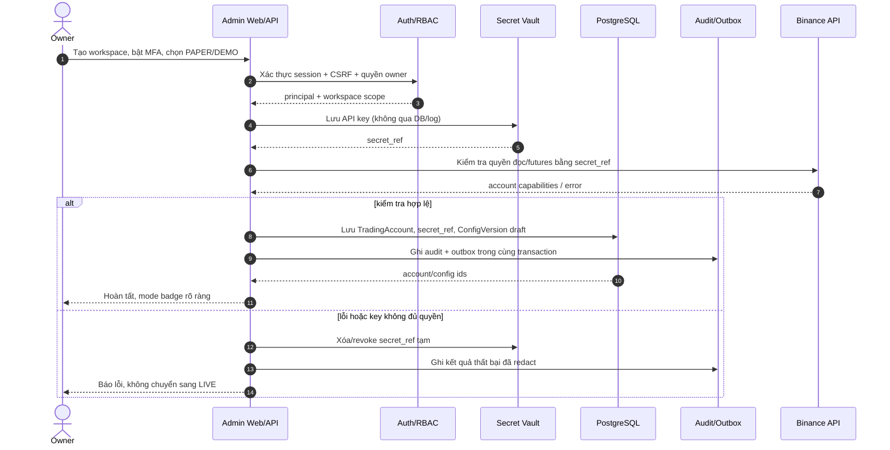
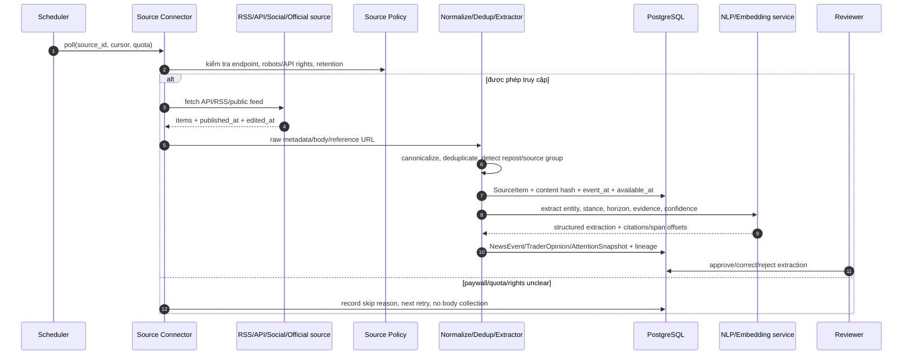
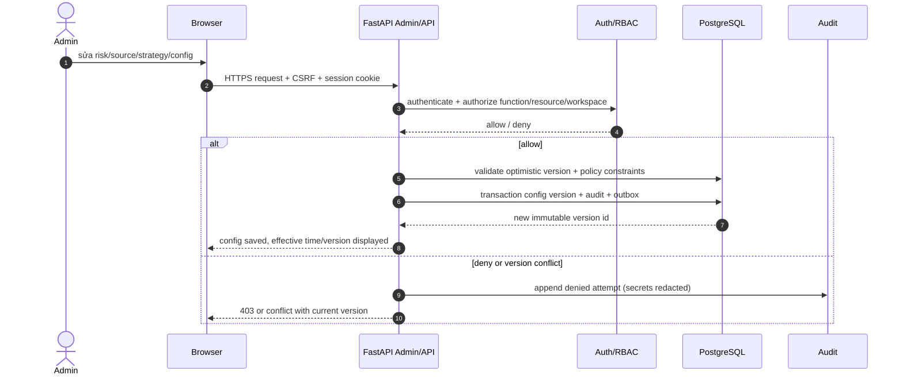
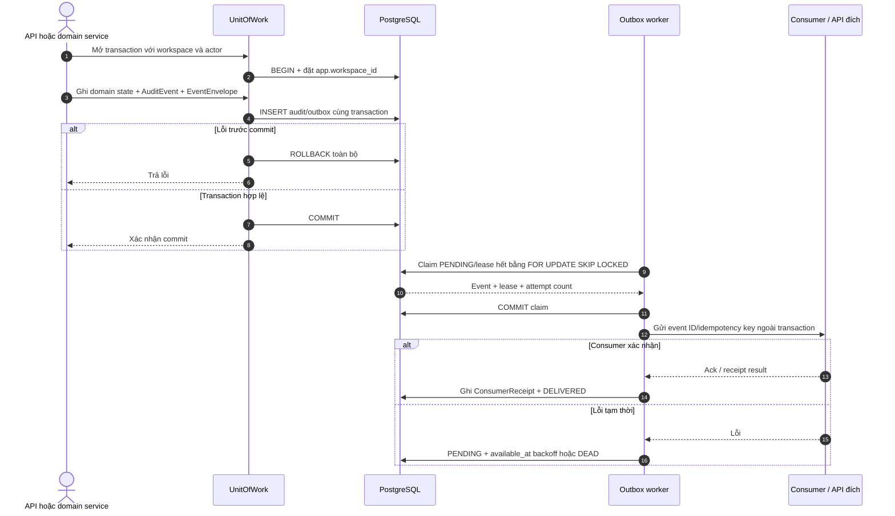

# Sequence diagrams — Independent Binance Futures Bot

**Version:** 1.0 · **Ngày:** 21/10/2026 · **Trạng thái:** thiết kế cho review \
**Quy ước:** `DB` lưu sự thật nội bộ; `Outbox` phát việc sau commit; mỗi side effect có idempotency key; mọi thời điểm dữ liệu dùng `event_at` và `available_at`.

Các luồng dưới đây triển khai use case trong [use-cases.md](./use-cases.md). Strategy và AI không gọi Binance trực tiếp. Chỉ `RiskEngine` tạo `TradePlan` đủ điều kiện; `ExecutionGateway` mới được gửi intent ra sàn. Thuật ngữ giao dịch/AI có bản dịch và định nghĩa tại [glossary EN→VI](../research/glossary-vi.md); nhãn participant/code giữ English để khớp identifier.

## SD-00 — Bootstrap Owner, xác thực MFA và session

```mermaid
sequenceDiagram
    autonumber
    actor Owner
    participant Client as Admin Client
    participant API as FastAPI Auth API
    participant Auth as AuthService
    participant Vault as Local MFA Secret Provider
    participant DB as PostgreSQL
    Owner->>Client: Nhập bootstrap token, email, mật khẩu và mode PAPER/DEMO
    Client->>API: POST /auth/bootstrap + X-Bootstrap-Token
    API->>Auth: Kiểm tra token và giới hạn thử
    Auth->>DB: Khóa bootstrap; tạo workspace SETUP, user PENDING_MFA, membership/Owner
    Auth->>Vault: Sinh và lưu seed TOTP đã mã hóa
    Auth->>DB: Lưu secret_reference, MFA factor chưa xác minh
    API-->>Client: Trả workspace ID và otpauth URI, Cache-Control no-store
    Owner->>Client: Đăng ký URI trong ứng dụng TOTP
    Client->>API: POST /auth/bootstrap/verify + mã TOTP
    API->>Auth: Xác minh mã và counter chưa dùng
    Auth->>DB: Kích hoạt MFA, Owner và workspace
    Client->>API: POST /auth/login với workspace, email, password, TOTP
    API->>Auth: Xác minh mật khẩu Argon2id, MFA và trạng thái membership
    Auth->>DB: Lưu hash session/CSRF; đặt thời hạn và MFA freshness
    API-->>Client: Set-Cookie HttpOnly/SameSite + CSRF token trong JSON
    Client->>API: POST mutation + cookie + X-CSRF-Token
    API->>Auth: Nạp lại role/workspace, kiểm CSRF và permission
    Auth-->>API: allow/deny
    Client->>API: POST /auth/logout + X-CSRF-Token
    Auth->>DB: Đánh dấu session revoked
    API-->>Client: Xóa cookie session
```

## SD-01 — Khởi tạo workspace, credential và cấu hình



## SD-02 — Telegram bind identity, webhook và command có phân quyền

```mermaid
sequenceDiagram
    autonumber
    actor Operator
    participant TG as Telegram
    participant Hook as Telegram Webhook
    participant Auth as Identity/RBAC
    participant DB as PostgreSQL
    participant Risk as Risk Control
    participant Audit as Audit/Outbox
    Operator->>TG: /bind <one-time-code>
    TG->>Hook: Update + X-Telegram-Bot-Api-Secret-Token
    Hook->>Hook: So sánh secret constant-time, kiểm tra payload
    Hook->>DB: Insert update_id nếu chưa tồn tại
    Hook->>Auth: Đổi one-time code lấy identity binding
    Auth->>DB: Bind telegram_user_id/chat_id với user/workspace
    Auth-->>Hook: Kết quả binding
    Operator->>TG: /pause_entries
    TG->>Hook: Update lệnh có update_id
    Hook->>Auth: Kiểm tra binding, role, workspace, trạng thái account
    alt có quyền operator/owner
      Hook->>Risk: pause_entries(reason, actor, idempotency_key)
      Risk->>DB: Cập nhật entry gate; giữ protective orders
      Risk->>Audit: Audit + outbox alert
      Hook-->>TG: Đã pause; vị thế đang mở vẫn được bảo vệ
    else không có quyền / update lặp
      Hook->>Audit: Ghi deny hoặc trả lại kết quả idempotent
      Hook-->>TG: Không có quyền / lệnh đã nhận
    end
```

## SD-03 — Market data ingest, chuẩn hóa và snapshot point-in-time

```mermaid
sequenceDiagram
    autonumber
    participant Binance as Binance REST/WS
    participant Ingest as MarketData Connector
    participant Norm as Normalizer/Validator
    participant DB as PostgreSQL/partitioned bars
    participant Obj as Object Store
    participant Feature as Feature Worker
    participant Bus as DB Outbox/Worker queue
    Binance-->>Ingest: kline/trade/funding/OI event
    Ingest->>Norm: raw payload + receive time + source cursor
    Norm->>Norm: schema, symbol, sequence, clock skew, duplicate checks
    alt hợp lệ
      Norm->>DB: raw pointer + normalized event/bar + available_at
      Norm->>Bus: market_data.available (same DB transaction)
      Bus-->>Feature: event (at least once)
      Feature->>DB: đọc dữ liệu chỉ có sẵn tại as_of
      Feature->>Feature: tính indicator/order-flow/regime features
      Feature->>DB: FeatureSnapshot + lineage/version + quality flags
    else gap/stale/schema lỗi
      Norm->>DB: IngestionGap hoặc rejected event + metric
      Norm->>Binance: REST backfill / WS resubscribe khi được phép
      Norm->>DB: đánh dấu khoảng dữ liệu incomplete đến khi lấp đủ
    end
    opt payload lớn / raw retention
      Norm->>Obj: ghi blob bất biến; DB lưu checksum/object key
    end
```

## SD-04 — Thu thập news, event, trending và trader opinion



## SD-05 — Watchlist → strategy/chart candidate → AI score/abstain

```mermaid
sequenceDiagram
    autonumber
    participant Scheduler
    participant Watch as Watchlist Service
    participant DB as PostgreSQL
    participant Strategy as Strategy Engine
    participant Feature as Feature Snapshot Store
    participant AI as Model Scorer
    participant Policy as Model/Strategy Policy
    Scheduler->>Watch: evaluate enabled symbols/timeframes
    Watch->>DB: load watchlist + eligibility + active versions
    Watch->>Feature: get point-in-time features(as_of)
    Feature-->>Strategy: snapshot + freshness + quality
    alt required feature missing/stale
      Strategy->>DB: persist NO_TRADE reason=DATA_QUALITY
    else inputs valid
      Strategy->>Strategy: evaluate deterministic rules/chart-pattern hypotheses
      Strategy->>DB: persist Candidate + recipe + feature lineage
      Strategy->>AI: score candidate with bounded structured context
      AI->>Policy: validate schema, model version, source references, timeout
      alt confidence/OOD/freshness policy passes
        Policy->>DB: persist score, calibration, explanation refs
      else model timeout/OOD/invalid output
        Policy->>DB: persist ABSTAIN; deterministic fallback only if enabled
      end
    end
```

## SD-06 — Tính entry/exit/size, risk gate và gửi entry idempotent

```mermaid
sequenceDiagram
    autonumber
    participant Candidate as Candidate/AI Policy
    participant Planner as Trade Planner
    participant Risk as RiskEngine
    participant DB as PostgreSQL
    participant Exec as Execution Gateway
    participant Binance as Binance USDⓈ-M
    Candidate->>Planner: approved candidate + immutable versions
    Planner->>Planner: E0 reference, stop/target/exit recipe, fees/funding/slippage
    Planner->>Risk: proposed TradePlan + proposed max loss/exposure
    Risk->>DB: load hard limits, open risk, exchange state, pause gates
    alt hard limit, stale account state, circuit breaker hoặc duplicate
      Risk->>DB: persist REJECTED plan + reason + audit
    else risk checks pass
      Risk->>DB: transaction: reserve risk + OrderIntent + Outbox
      DB-->>Exec: committed outbox intent (idempotency key)
      Exec->>Binance: submit entry with clientOrderId
      alt ack / accepted
        Binance-->>Exec: order id/status
        Exec->>DB: persist exchange order + status; emit order event
      else timeout/503 UNKNOWN
        Exec->>DB: mark UNKNOWN, keep reservation; do not resubmit
        Exec->>Binance: query by clientOrderId / user stream / open orders
        Binance-->>Exec: found / not found / unresolved
        Exec->>DB: reconcile state; retry only after authoritative not-found policy
      end
    end
```

## SD-07 — Partial fill và xác nhận protective stop trước khi tiếp tục

```mermaid
sequenceDiagram
    autonumber
    participant Binance
    participant Exec as Execution Gateway
    participant Portfolio
    participant Risk as RiskEngine
    participant DB as PostgreSQL
    Binance-->>Exec: order update / partial fill / trade update
    Exec->>DB: deduplicate exchange event; persist fills
    Exec->>Portfolio: recompute filled quantity, average price, fee
    Portfolio->>Risk: actual exposure + required stop quantity
    alt partial/full fill
      Risk->>Exec: ensure protective stop covers actual filled quantity
      Exec->>Binance: create/update protective conditional order
      Binance-->>Exec: stop accepted/rejected
      alt stop confirmed
        Exec->>DB: link stop to position; mark protected quantity
      else stop rejected or missing
        Exec->>DB: set protection incident; block new entries
        Exec->>Binance: retry safe replacement or reduce-only flatten per policy
        Exec->>DB: record remediation result + alert outbox
      end
    end
```

## SD-08 — Monitor vị thế, trailing/exit và đóng trade

```mermaid
sequenceDiagram
    autonumber
    participant Stream as Binance User/Market Stream
    participant Monitor as Position Monitor
    participant Recipe as Exit Recipe Engine
    participant Risk as RiskEngine
    participant Exec as Execution Gateway
    participant Binance
    participant DB as PostgreSQL
    Stream-->>Monitor: mark/last price + order/fill/funding update
    Monitor->>DB: load position, confirmed protection, versioned recipe
    Monitor->>Recipe: evaluate stop/target/trailing/time/opposing signal
    Recipe-->>Monitor: hold / tighten / reduce / close + reason
    alt hold
      Monitor->>DB: persist evaluation summary and next due time
    else tighten/close
      Monitor->>Risk: validate monotonic stop and reduce-only quantity
      Risk-->>Exec: approved protective order change/exit intent
      Exec->>Binance: cancel/replace or reduce-only close
      Binance-->>Exec: ack/fill/reject
      Exec->>DB: persist order, fill, fee, realized PnL, reason
      opt position reaches zero
        Exec->>DB: close Trade; enqueue outcome/attribution job
      end
    end
```

## SD-09 — Restart, stream gap và reconcile trạng thái UNKNOWN

```mermaid
sequenceDiagram
    autonumber
    participant Runtime as Bot Runtime
    participant DB as PostgreSQL
    participant Binance
    participant Risk as RiskEngine
    participant Ops as Alert/Outbox
    Runtime->>DB: load active account/config/version; entry gate=closed
    Runtime->>Binance: query positions, open orders, balances, recent trades
    Binance-->>Runtime: exchange snapshot
    Runtime->>DB: compare local intent/order/fill/position vs exchange truth
    alt khớp và protection hợp lệ
      Runtime->>DB: mark reconciled; reopen entries only if health/policy allow
    else order UNKNOWN, orphan order, quantity mismatch, missing stop
      Runtime->>Risk: keep entries closed; classify discrepancy
      Risk->>DB: persist reconciliation incident and safe action plan
      Runtime->>Binance: query client ids / install missing protection / reduce risk
      Runtime->>DB: record action outcome and reconciliation status
      Runtime->>Ops: alert operator with actionable reason
    end
```

## SD-10 — Trade review, outcome label và attribution

```mermaid
sequenceDiagram
    autonumber
    actor Reviewer
    participant Web as Admin Web
    participant DB as PostgreSQL
    participant Label as Outcome/Attribution Worker
    participant Ledger as Trade/Decision Ledger
    Reviewer->>Web: mở trade, chọn review label/comment
    Web->>DB: kiểm tra scope + quyền reviewer
    Web->>DB: ghi review append-only + actor + timestamp
    DB-->>Label: trade closed / review changed event
    Label->>Ledger: lấy fills, funding, fees, entry/exit recipe, as-of features
    Label->>Label: replay đúng recipe; labels không được nhìn dữ liệu tương lai
    Label->>DB: lưu outcome, attribution, quality flags, label version
    Label->>DB: phát event dataset eligible nếu đạt policy
```

## SD-11 — Hypothesis → training → sealed evaluation → promotion/rollback

```mermaid
sequenceDiagram
    autonumber
    actor StrategyAdmin
    actor RiskAdmin
    participant Web as Admin Web
    participant DSL as Strategy DSL Compiler
    participant Train as Trainer
    participant DB as PostgreSQL
    participant Store as Artifact Store
    participant Registry as Model/Strategy Registry
    participant Paper as Paper Runtime
    StrategyAdmin->>Web: tạo hypothesis/challenger từ DSL hoặc model config
    Web->>DSL: validate grammar, limits, data dependencies
    DSL-->>Web: compiled spec/hash hoặc lỗi có vị trí
    Web->>DB: persist immutable experiment spec
    Train->>DB: lấy dataset eligible theo as-of/label version
    Train->>Train: split theo thời gian; purged walk-forward; costs/fees/funding
    Train->>Store: lưu model, metrics, data manifest, code/config hash
    Train->>DB: lưu eval report và failure reasons
    alt đạt promotion gates
      StrategyAdmin->>Web: đề xuất paper promotion
      RiskAdmin->>Web: phê duyệt theo role/dual approval policy
      Web->>Registry: tạo immutable release mới
      Registry->>Paper: activate ở PAPER/canary; giữ prior release
      Paper->>DB: ghi live-forward decisions và risk metrics
    else không đạt hoặc drift/regression
      Train->>DB: mark rejected; nêu gate thất bại
    end
    opt rollback
      RiskAdmin->>Web: rollback release
      Web->>Registry: restore prior version; audit actor/reason
      Registry->>Paper: activate known-good release
    end
```

## SD-12 — Admin audit, RBAC và xem cấu hình/hiệu suất



## SD-13 — Circuit breaker và recovery

```mermaid
sequenceDiagram
    autonumber
    participant Monitor as Health/Risk Monitor
    participant Risk as RiskEngine
    participant DB as PostgreSQL
    participant Exec as Execution Gateway
    participant Binance
    participant Ops as Web/Telegram Alert
    Monitor->>Risk: stale feed / loss cap / API errors / protection failure
    Risk->>DB: atomically set breaker + pause new entries + reason
    Risk->>Ops: alert + incident id
    Note over Risk,Exec: protective exits/reconciliation remain enabled by policy
    Monitor->>Risk: health recovered evidence + cooldown elapsed
    Risk->>DB: keep paused until authorized resume policy passes
    Ops->>Risk: owner/operator authorized resume request
    Risk->>DB: verify health, reconciliation, risk state, approval
    alt gates pass
      Risk->>DB: clear breaker for entries; audit
    else unresolved position/order/data issue
      Risk-->>Ops: retain pause with blocking reasons
    end
```

## SD-14 — Unit of Work, audit và transactional outbox



**Giới hạn:** một event type được route tới một consumer trong MVP. Consumer ngoài DB phải tự dùng idempotency key và reconcile vì crash sau side effect nhưng trước receipt có thể làm event được gửi lại. Thuật ngữ: [Unit of Work, lease, retry và receipt](../research/glossary-vi.md#k-transaction-audit-và-hàng-đợi-sự-kiện).

## Quy tắc consistency dùng chung

1. Ghi intent, idempotency key, audit và outbox trong một transaction trước side effect.
2. Connector và worker chạy at-least-once; consumer deduplicate bằng unique key, không giả định exactly-once.
3. Chỉ exchange ack/fill/reconcile xác nhận trạng thái order/position; timeout không đồng nghĩa thất bại.
4. `pause_entries` đóng cửa tạo entry mới; không xoá stop/TP đã xác nhận và không bỏ reconcile.
5. Training chỉ dùng label từ recipe đã replay, dữ liệu có lineage và được phép dùng; promotion là quyết định có audit.
