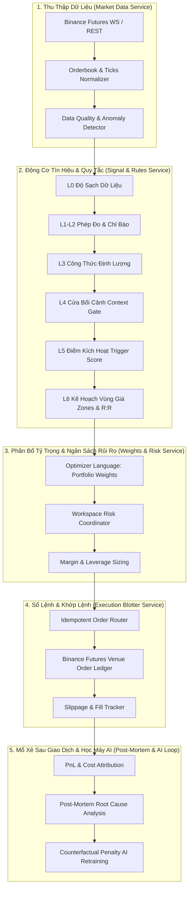

# Nghiên Cứu Kiến Trúc Hệ Thống Giao Dịch Bằng Vi Dịch Vụ (Microservices Trading Architecture)

> **Tài liệu tham khảo chính:** *"Trading System Design using MicroServices"* — Bhavin (DataJedi)  
> **Nguồn:** [Medium - DataJedi](https://medium.com/@datajedi/trading-system-design-using-microservices-256cda0dc60a)  
> **Ngày nghiên cứu & chuẩn hóa:** 10/11/2026  
> **Áp dụng:** Kiến trúc hệ thống độc lập Crypidian Binance Futures Trading Platform  

---

## 1. Bối Cảnh & Vấn Đề Của Kiến Trúc Khối Đơn (Monolithic Trading Pitfalls)

Trong phát triển hệ thống định lượng (Quant Trading), phương pháp phổ biến ban đầu thường là gom toàn bộ quy trình vào một ứng dụng nguyên khối (Monolith) sử dụng các thư viện như Pandas/NumPy:
1. **Khớp nối quá chặt (Tight Coupling):** Bộ thu thập dữ liệu (Data Ingestion), bộ tính toán chỉ báo (Signals), bộ phân bổ tỷ trọng (Weights) và bộ khớp lệnh (Execution) chạy chung một tiến trình. Khi một khâu bị trễ (ví dụ mạng chập chờn khi đẩy lệnh) sẽ làm nghẽn toàn bộ chu trình xử lý tín hiệu của các cặp giao dịch khác.
2. **Khó kiểm thử & Khó cô lập lỗi:** Khi một chiến lược bị thua lỗ hoặc lệnh bị trượt giá lớn, hệ thống không thể bóc tách rõ ràng: lỗi do dữ liệu vào bị trễ (Stale Data), do logic chỉ báo tính sai, do bộ phân bổ vốn tính sai Margin, hay do lỗi kết nối sàn (Venue Execution Error).
3. **Ảo giác đồng thuận & Khó mở rộng đa Bot (Multi-Bot Scalability):** Việc chạy nhiều chiến lược đồng thời trên cùng một tài khoản ký quỹ dễ dẫn đến xung đột rủi ro (Risk Contention), vượt trần đòn bẩy hoặc tranh chấp số dư ký quỹ nếu không có dịch vụ kiểm soát hạn mức độc lập.

---

## 2. Kiến Trúc Vi Dịch Vụ Phân Tầng Theo DataJedi (Bhavin)

Theo phân tích kiến trúc của Bhavin, một hệ thống giao dịch tổ chức chuẩn mực cần được bóc tách thành các dịch vụ độc lập, giao tiếp thông qua cơ chế bất đồng bộ (Message Bus / Event-Driven):

### 2.1. Dịch Vụ Thu Thập & Chuẩn Hóa Dữ Liệu (Market Data Ingestion Service)
- **Nhiệm vụ:** Kết nối đa luồng WebSocket/REST tới sàn (Binance Futures), duy trì dòng nến (OHLCV), sổ lệnh cấp 2 (Depth L2), Funding Rate và Open Interest.
- **Dịch vụ kiểm soát chất lượng (Data Quality Service):** Đối soát dữ liệu thị trường và dữ liệu thay thế (Alternative Data). Phát hiện kịp thời các hiện tượng nến khuyết (Missing Bars), gai giá bất thường (Price Spikes), hoặc nến chưa đóng (Unclosed Candles) trước khi đưa vào ống dẫn tín hiệu.

### 2.2. Dịch Vụ Tín Hiệu & Chiến Lược Phân Lớp (Signal & Strategy Rules Service)
- Tách bạch logic ra quyết định thành 6 tầng chuẩn hóa (L0 đến L6), đảm bảo tính toán thuần túy (Stateless & Deterministic):
  - **L0 Data Cleansing:** Kiểm định tính toàn vẹn và độ sạch dữ liệu.
  - **L1-L2 Measurements:** Tính toán các thước đo khách quan (ATR, EMA, Donchian, Volume Profile).
  - **L3 Formulas:** Công thức định lượng diễn giải hình học nến và động lượng.
  - **L4 Context Gate:** Bộ lọc môi trường thị trường (bắt buộc đứng ngoài khi thị trường đi ngang / chop hoặc spread giãn).
  - **L5 Strategy Logic:** Điểm kích hoạt vào lệnh (Trigger Score).
  - **L6 Zones & Exits:** Mô phỏng vùng cắt lỗ (SL), chốt lời (TP) và tỷ lệ Lợi nhuận/Rủi ro (R:R Ratio).

### 2.3. Dịch Vụ Phân Bổ Tỷ Trọng & Ngân Sách Rủi Ro (Portfolio Weights & Risk Service)
- **Chuẩn hóa ngôn ngữ tối ưu (Optimizer Language):** Chiến lược không phát lệnh mua/bán một cách tùy tiện mà phát ra **tỷ trọng danh mục mong muốn (Target Portfolio Weights)** và mức độ tin cậy (Conviction).
- **Bộ điều phối rủi ro không gian làm việc (Workspace Risk Coordinator):** Kiểm tra hạn mức Margin tổng, trần đòn bẩy cho phép, giới hạn Drawdown trong ngày trước khi phê duyệt chuyển đổi tỷ trọng thành khối lượng vị thế cụ thể.

### 2.4. Sổ Lệnh & Thực Thi Sàn (Execution Blotter & Venue Order Ledger)
- **Tính lũy đẳng (Idempotency):** Đảm bảo mỗi ý định giao dịch (Intent) có một Client Order ID duy nhất, ngăn chặn tuyệt đối việc đặt lệnh trùng khi gặp lỗi mạng timeout.
- **Sổ cái thực thi (Order Ledger):** Ghi nhận từng lần khớp từng phần (Partial Fills), phí giao dịch thực tế (Commission), phí tài trợ (Funding Fees) và trượt giá thực tế (Realized Slippage) so với giá kỳ vọng.

### 2.5. Phân Tích Sau Khớp Lệnh & Vòng Phản Hồi AI (Post-Mortem & AI Retraining Loop)
- **Mổ xẻ nguyên nhân (Root Cause Attribution):** Bóc tách từng giao dịch sau khi đóng vị thế:
  - Lệnh thắng do đâu (đúng xu hướng L4, lực kích hoạt L5 mạnh, hay may mắn do tin tức)?
  - Lệnh thua do đâu (sai bối cảnh L4, vào sớm đón đầu, hay bị trượt giá quá mức ở khâu khớp lệnh)?
- **Học máy phản thực nghiệm (Counterfactual Penalty Learning):** Tiếp nhận các trường hợp vào lệnh sai lệch, gắn nhãn dữ liệu phạt (Penalty Dataset) để huấn luyện lại các mô hình Scorer/Ranker của AI, giúp hệ thống ngày càng tiến hóa.

---

## 3. Bản Đồ Hiện Thực Hóa Vào Nền Tảng Crypidian

| Khái Niệm Vi Dịch Vụ (DataJedi) | Mô-đun Trong Nền Tảng Crypidian | Trạng Thái Triển Khai |
| :--- | :--- | :--- |
| **Market Data Ingestion** | `trading_bot.market_data` & Binance Futures WS Ingestion | Đã hoàn thành, lưu trữ nến và sổ lệnh độc lập. |
| **Data Quality & Anomaly** | `trading_bot.domain.strategy_card.verification` (L0 Layer) | Đã hoàn thành xác minh cấu trúc dữ liệu L0. |
| **Signal & Strategy Rules** | `trading_bot.domain.strategy_pipeline` (L1-L6) & `StrategyCard` | Đã hoàn thành 6 tầng tính toán minh bạch. |
| **Weights & Risk Allocation** | `WorkspaceRiskCoordinator` & `RiskReservationGuard` | Đã hoàn thành cách ly rủi ro đa tenant/đa bot. |
| **Execution Blotter** | `VenueOrderLedger` & `PaperRuntimeBootstrap` | Đã hoàn thành chế độ PAPER an toàn, chống duplicate fill. |
| **PnL & Reporting** | `BotLedgerSnapshot` & `build_bot_report` | Đã hoàn thành tính toán PnL, Drawdown, Profit Factor. |
| **Post-Mortem & AI Loop** | `LearningPostMortemService` & `CandidateUniverse` | Đã hoàn thành API tiếp nhận ca phạt AI 1-chạm. |
| **Cockpit UI / HUD** | `trading_bot.admin.web_router` & Obsidian Design System | Đang nâng cấp toàn diện theo chuẩn UI/UX Pro Max. |

---

## 4. Kết Luận & Hướng Mở Rộng Tiếp Theo

Việc áp dụng mô hình vi dịch vụ phân tầng từ nghiên cứu của Bhavin kết hợp với thiết kế L0-L6 từ QUANTSMART mang lại cho Crypidian những ưu thế vượt trội:
1. **Minh bạch 100%:** Mọi quyết định Long/Short đều có thể giải phẫu ngược lại từ L4 (Bối cảnh), L5 (Điểm kích hoạt) đến L6 (Vùng giá R:R).
2. **Khả năng chịu lỗi cao:** Tách rời khâu tính toán chỉ báo khỏi khâu khớp lệnh giúp bot không bao giờ bị khóa luồng (thread lock) khi sàn Binance phản hồi chậm.
3. **Tiến hóa liên tục:** Mỗi thất bại trong giao dịch không bị lãng phí mà trở thành dữ liệu phạt quý giá nuôi dưỡng bộ phân tích định lượng AI.
