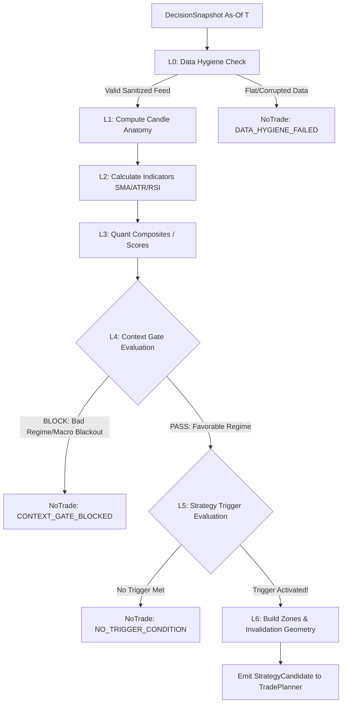

# Báo cáo Chuyên sâu: Nghiên cứu Kiến trúc QUANTSMART và Kế hoạch Hợp nhất vào Trading Crypidian

**Ngày hoàn thành:** 04/11/2026  
**Tác giả:** Quantitative Systems Architect  
**Trạng thái:** Kiến trúc đề xuất (Draft Proposal / Architectural Blueprint)  
**Tài liệu liên quan:**  
- [`docs/implementation/implementation-memory.md`](../implementation/implementation-memory.md)  
- [`docs/implementation/02-trading-core-paper.md`](../implementation/02-trading-core-paper.md)  
- [`docs/implementation/06-ai-learning.md`](../implementation/06-ai-learning.md)  
- [`docs/research/strategies-2026.md`](./strategies-2026.md)  
- [`docs/research/glossary-vi.md`](./glossary-vi.md)  
- Repository tham chiếu: [`github.com/Jokejoker-designer/QUANTSMART`](https://github.com/Jokejoker-designer/QUANTSMART)

---

## 1. TỔNG QUAN & TÓM TẮT ĐIỀU HÀNH (EXECUTIVE SUMMARY)

### 1.1. Bối cảnh
Dự án **Trading Crypidian** đã hoàn thành xuất sắc các cấu phần hạ tầng phòng thủ tối quan trọng cấp doanh nghiệp (Enterprise Bank-Grade Infrastructure):
- Hệ thống cơ sở dữ liệu PostgreSQL phân vùng với bảo mật cấp hàng (Row-Level Security - RLS) cô lập không gian làm việc (multi-tenant workspace isolation).
- Sổ cái tài chính kép chỉ ghi thêm bất biến (Append-Only Double-Entry Ledger) truy vết mọi biến động số dư, ký quỹ, fill và PnL.
- Động cơ quản trị rủi ro độc lập (Risk Engine) với cơ chế đặt chỗ rủi ro nguyên tử (Atomic Risk Reservation) và các chốt chặn cứng (Hard Gates) bảo vệ vốn tối thượng.
- Cổng kết nối Binance Futures USDⓈ-M an toàn, phân tách bí mật, kiểm soát độ lệch đồng hồ (clock drift) và phân biệt endpoint Algo Order chuyên biệt.
- Cơ chế giám sát vị thế, cứu cánh khẩn cấp (Flatten All / Emergency Halt), phục hồi sau sự cố (Crash Recovery Checkpoint), giao diện quản trị realtime 5s và bot Telegram tương tác 2 chiều có kiểm soát OTP/RBAC.
- Khung học máy AI (WP-06) với quy trình Walk-Forward Fold v2 phân tách triệt để vùng phát triển (Development) và vùng niêm phong (Holdout Seal), loại trừ rò rỉ dữ liệu (data leakage) theo thời gian.

Tuy nhiên, khi nhìn vào **tầng định nghĩa và phát triển chiến lược (Strategy Core - WP-02C)**, Crypidian vẫn đang tồn tại một số điểm nghẽn về mặt kiến trúc định lượng:
1. **Chiến lược dạng nguyên khối (Monolithic Hardcoded Python):** Các giả thuyết chiến lược (H01 Trend-Following, H03 Breakout, H06 Mean-Reversion) hiện được lập trình cứng trong các class Python. Mọi thay đổi về chỉ báo, logic hay tham số đều đòi hỏi sửa code nguồn và kiểm thử lại toàn bộ runtime.
2. **Trộn lẫn các tầng trừu tượng:** Dữ liệu nến thô, tính toán chỉ báo, kiểm tra bối cảnh thị trường và quy tắc kích hoạt lệnh thường bị đan xen trong cùng một hàm `evaluate()`.
3. **Thiếu sự tách bạch giữa Cổng bối cảnh (Context Gate) và Bộ kích hoạt (Strategy Trigger):** Không thể đánh giá độc lập xem một chiến lược thất bại là do "chọn sai thời điểm thị trường" (Regime Filter hỏng) hay do "điểm vào lệnh kém" (Trigger hỏng).
4. **Hiện tượng ảo giác đồng thuận (Consensus Illusion / Multicollinearity):** Chưa có công cụ toán học tự động cảnh báo khi một chiến lược kết hợp nhiều chỉ báo thực chất đo lường cùng một biến tiềm ẩn (ví dụ: gộp RSI, Stochastic và MACD cùng đo lường động lượng giá đóng cửa).
5. **Thiếu bản kê khai báo chuẩn hóa (Declarative Strategy Card DSL):** Chưa có schema độc lập với ngôn ngữ để đóng gói một chiến lược định lượng thành một đơn vị có thể lưu trữ, lập phiên bản, kiểm tra hình học và luân chuyển giữa các môi trường.

### 1.2. Giá trị từ QUANTSMART
Nghiên cứu kho lưu trữ mã nguồn mở **QUANTSMART** (`github.com/Jokejoker-designer/QUANTSMART`, bản quyền Apache-2.0) cho thấy đây là một phòng thí nghiệm nghiên cứu định lượng ưu tiên cục bộ (Local-first Quantitative Research Workspace) giải quyết các bài toán trên một cách rất khoa học. 

QUANTSMART không tập trung vào tầng sổ cái hay kết nối sàn giao dịch tốc độ cao, mà tập trung vào **phương pháp luận phân rã tín hiệu toán học**:
- Mô hình hóa chiến lược thành đồ thị có hướng không chu trình (DAG) phân tầng 7 lớp rõ rệt (**L0 đến L6**).
- Đóng gói toàn bộ chiến lược vào **Bản kê chiến lược (Strategy Card)** tự thân, có hash kiểm tra toàn vẹn và bản đồ tương thích dữ liệu.
- Phòng thí nghiệm tọa độ (**Coordinate Lab**) khảo sát hình học công thức (mặt cong, độ nhạy, điểm kỳ dị toán học) trước khi chạy bất kỳ dòng dữ liệu nào.
- Công cụ kiểm tra trực giao nhân tố nhằm loại bỏ **Ảo giác đồng thuận (Anti-Consensus Illusion)** và thuật toán quét **Nút chết (Dead Node Detection)**.
- Kính hiển vi soi vết lịch sử (**Microscope Replay**) cho phép tua lại từng sự kiện giá để giải phẫu trạng thái của từng khối tính toán.

### 1.3. Mục tiêu của Báo cáo này
1. Đối soát và giải mã chi tiết 5 giá trị tinh hoa của QUANTSMART dưới lăng kính kiến trúc định lượng chuẩn mực.
2. So sánh đối chiếu toàn diện giữa thế mạnh phòng thủ thực thi của Crypidian và năng lực nghiên cứu giải thuật của QUANTSMART.
3. Thiết kế kiến trúc hợp nhất: Đưa mô hình Strategy Card và Pipeline L0-L6 vào Crypidian thông qua 2 gói module mới: `trading_bot.domain.strategy_card` và `trading_bot.application.strategy_pipeline`, bảo toàn 100% các bất biến an toàn vốn của Crypidian.
4. Lập lộ trình triển khai WBS 5 giai đoạn, kế hoạch kiểm thử TDD và cập nhật bảng thuật ngữ chuẩn hóa Việt - Anh.

---

## 2. ĐỐI SOÁT & CHẮT LỌC 5 GIÁ TRỊ TINH HOA CỦA QUANTSMART

```
+----------------------------------------------------------------------------------------------------+
|                                      QUANTSMART CORE VALUES                                         |
+----------------------------------------------------------------------------------------------------+
|  1. Atomic Modules & Custom Formula      2. L0 -> L6 Layered Architecture                          |
|     - Primitives (Body, Wick, Location)     - L0: Data Hygiene        - L4: Context Gate (Filter)  |
|     - Math, Windows, State memory           - L1: Features / Anatomy  - L5: Strategy Trigger (Exec)|
|     - Typed Ports & Flow DAG                - L2: Indicators          - L6: Zones (SL/TP Geometry) |
|                                             - L3: Algorithms/Quant                                 |
+----------------------------------------------------------------------------------------------------+
|  3. Anti-Consensus & Dead Node           4. Coordinate Lab Geometry       5. Strategy Card (DSL)   |
|     - Multicollinearity detection           - 2D Curves / 3D Surfaces        - Self-Contained Spec |
|     - Factor Orthogonality (PCA)            - Sensitivity (Gradients)        - Canonical SHA-256   |
|     - Dead Node static pruning              - Singularity (Div/0, step)      - Compatibility Map   |
+----------------------------------------------------------------------------------------------------+
```

### 2.1. Khái niệm "Module" Nguyên tử (Atomic Processing Blocks) & Tự dựng Module (Custom Formula Blocks)

#### Nguyên lý thiết kế:
Trong QUANTSMART, một chiến lược không được xem như một khối code liền mạch mà là sự kết hợp của các khối tính toán nguyên tử (Atomic Blocks). Mỗi khối có:
- **Cổng vào/ra có kiểu dữ liệu rõ ràng (Typed Ports):** Đầu vào và đầu ra được quy định chặt chẽ: `PriceSeries`, `ScalarFloat`, `BooleanFlag`, `CategoricalState`. Không thể nối một chuỗi giá vào cổng nhận cờ logic nếu chưa qua khối so sánh (Comparator).
- **Trạng thái nội tại (Statefulness):** Phân biệt rành mạch giữa khối thuần túy (Pure Stateless Blocks: phép tính số học, tỷ lệ nến) và khối có bộ nhớ trạng thái (Stateful Blocks: cửa sổ trượt n nến, chốt nhớ trạng thái - Latch, bộ đếm tăng dần - Monotonic Counter).
- **Kiểm tra giá trị trung gian theo thời gian thực (Intermediate Value Flow):** Mọi nhánh trong đồ thị tính toán đều có thể trích xuất giá trị tại từng nến để kiểm tra tính đúng đắn ngay trong quá trình dựng mô hình.

#### Thư viện nguyên tử giải phẫu nến (Candle Anatomy Primitives):
Thay vì chỉ dùng giá Close hay các chỉ báo kinh điển, QUANTSMART chuẩn hóa các khối đo lường cấu trúc nến:
- `lower_wick_ratio = (min(open, close) - low) / (high - low + eps)`
- `upper_wick_ratio = (high - max(open, close)) / (high - low + eps)`
- `body_ratio = abs(close - open) / (high - low + eps)`
- `close_location = (close - low) / (high - low + eps)`

Ví dụ công thức tạo đặc trưng **Sức mạnh từ chối giá (Wick Rejection Strength)**:
$$\text{WickRejection} = \text{lower\_wick\_ratio} \times \text{close\_location} \times (1 - \text{body\_ratio})$$
Công thức này cho phép phát hiện lực mua bắt đáy một cách thuần túy về mặt hình học nến, hoàn toàn độc lập với các chỉ báo trễ.

---

### 2.2. Hệ thống Phân tầng 7 Lớp (L0 -> L6)

Sự phân tách trách nhiệm (Separation of Concerns) trong QUANTSMART đạt đến độ chuẩn mực thông qua 7 làn phân tầng (Composition Lanes):

```
[ L0: Data Hygiene ] ──────> [ L1: Features / Anatomy ] ──────> [ L2: Indicators ]
                                                                       │
                                                                       ▼
[ L6: Zones (SL/TP) ] <───── [ L5: Strategy Trigger ] <────── [ L4: Context Gate ] <── [ L3: Algorithms ]
```

| Tầng | Tên gọi chuẩn hóa | Nhiệm vụ chính | Đầu vào | Đầu ra |
| :--- | :--- | :--- | :--- | :--- |
| **L0** | **Data Hygiene** *(Làm sạch dữ liệu)* | Lọc nến lỗi, phát hiện nguồn cấp phẳng (flat feed), nến rỗng ($H = L$), kiểm tra bước nhảy thời gian (gap), đối soát tính đầy đủ point-in-time. | Raw Market Data (OHLCV, Ticks, Cursors) | Normalized, Sanitized Series |
| **L1** | **Features / Candle Anatomy** *(Đặc trưng giải phẫu nến)* | Bóc tách hình học từng thanh nến (râu trên, râu dưới, thân, vị trí đóng, độ biến động nến), chuẩn hóa khoảng giá. | Sanitized OHLCV | Primitive Geometric Features |
| **L2** | **Indicators** *(Chỉ báo phái sinh)* | Áp dụng các toán tử lọc và làm mượt theo chuỗi thời gian: SMA, EMA, ATR, RSI, Bollinger Bands, VWAP. | L0 Bars + L1 Features | Mathematical Indicator Series |
| **L3** | **Algorithms / Quantitative Composites** *(Thuật toán lượng hóa)* | Mô hình thống kê nâng cao, Z-score đa khung thời gian, phân tích phân kỳ (divergence), phân cụm động lượng, chấm điểm tổng hợp (composite score). | L1 Features + L2 Indicators | Quant Signals & Normalized Scores |
| **L4** | **Context Gate** *(Cổng bối cảnh thị trường)* | **Bộ lọc môi trường (Environment Filter):** Xác định chế độ thị trường (Regime: Trend / Range / Extreme Volatility), cửa sổ phiên giao dịch (Session), bộ lọc vĩ mô (Macro Blackout). | L2 + L3 Scores | **Gate Status: PASS / BLOCK** |
| **L5** | **Strategy Logic / Trigger** *(Bộ kích hoạt chiến lược)* | **Bộ kích hoạt hành động (Action Trigger):** Chỉ được đánh giá khi L4 là PASS. Kiểm tra điều kiện vào lệnh (Breakout, Golden Cross, Pullback confirm). | L1/L2/L3 Inputs + L4 Approval | **Candidate Signal: LONG / SHORT** |
| **L6** | **Zones / Execution Zones** *(Vùng thực thi & hình học giá)* | Xác định tọa độ vào lệnh (Entry Zone), điểm dừng lỗ bảo vệ (Initial Stop Loss), điểm vô hiệu luận điểm (Invalidation Level), các bậc chốt lời (Take-Profit Ladders) và tỷ lệ Risk/Reward. | Signal L5 + Giá hiện tại + ATR | **Structured Execution Zone** |

> [!IMPORTANT]
> **Điểm đột phá: Phân định triệt để giữa L4 (Context Gate) và L5 (Strategy Trigger)**  
> Trong nhiều hệ thống giao dịch, hai tầng này bị gộp làm một. Khi hiệu suất giảm sút, nhà phát triển không thể xác định được nguyên nhân: Là do bộ lọc bối cảnh thị trường (L4) hoạt động kém (cho phép giao dịch trong vùng thị trường đi ngang ngẫu nhiên), hay do quy tắc kích hoạt lệnh (L5) bị trễ pha? Sự phân tách L4/L5 của QUANTSMART cho phép tối ưu hóa và kiểm định độc lập từng tầng.

---

### 2.3. Cơ chế Chống Ảo giác Đồng thuận (Anti-Consensus Illusion) và Phát hiện Nút chết (Dead Node Detection)

#### A. Chống Ảo giác Đồng thuận (Anti-Consensus Illusion):
- **Bản chất vấn đề:** Nhiều nhà giao dịch và kỹ sư thuật toán mắc bẫy "sự hội tụ giả tạo" (False Confluence). Họ thiết lập quy tắc vào lệnh: `Khi RSI < 30 VÀ Stochastic %K < 20 VÀ Williams %R < -80 VÀ CCI < -100`. Họ tin rằng có 4 chỉ báo độc lập cùng đồng thuận xác nhận tín hiệu "quá bán" (Oversold), tạo ra độ tin cậy cực cao.
- **Thực tế toán học:** Cả 4 chỉ báo trên đều là các hàm biến đổi phi tuyến dựa trên cùng một chuỗi giá đóng cửa gần đây ($Close_t$). Hệ số tương quan đa biến (Multicollinearity / Pearson Correlation) giữa chúng thường vượt quá $0.90$. Chúng không phải là 4 quan sát độc lập mà chỉ là 4 "tiếng vọng" của cùng một đại lượng vật lý.
- **Giải pháp của QUANTSMART:**
  1. **Ma trận tương quan nhân tố (Factor Correlation Matrix):** Khi người dùng kéo các khối vào đồ thị chiến lược, hệ thống tự động tính toán ma trận tương quan giữa các node đầu vào dựa trên tập dữ liệu kiểm định.
  2. **Cảnh báo độ trùng lặp thông tin (Information Redundancy Warning):** Nếu hai hoặc nhiều node đầu vào có hệ số tương quan $|r| > 0.85$, hệ thống sẽ gắn nhãn cảnh báo đỏ: *"Consensus Illusion Detected: Indicators are collinear"*.
  3. **Trực giao hóa nhân tố (Factor Orthogonality):** Khuyến khích sử dụng các nguồn thông tin thực sự độc lập: Giá (Price Anatomy) + Khối lượng (Volume Profile / OBV) + Cấu trúc phái sinh (Open Interest / Funding Rate) + Độ biến động (Realized Volatility).

#### B. Phát hiện Nút chết (Dead Node Detection):
Trong quá trình thiết kế đồ thị (DAG), người thiết kế có thể vô tình tạo ra các lỗi logic tĩnh:
1. **Mâu thuẫn điều kiện không bao giờ thỏa mãn (Unreachable Conditions):** Ví dụ: nhánh logic yêu cầu $(RSI > 70) \land (RSI < 30)$ hoặc $(EMA_{20} > EMA_{50}) \land (Close < EMA_{100})$ trong một cấu trúc tham số mà điều kiện này không thể xảy ra về mặt toán học.
2. **Nút có giá trị hằng số bất biến (Constant Invariant Nodes):** Do cấu hình tham số triệt tiêu hoặc phép chia giới hạn, đầu ra của một node luôn trả về một giá trị duy nhất (ví dụ luôn là `0` hoặc luôn là `False`).
3. **Nhánh đồ thị mồ côi (Orphan / Dead Branches):** Các node được tính toán tốn kém tài nguyên nhưng đầu ra không nối tới bất kỳ điều kiện nào của L4, L5 hay L6.
QUANTSMART áp dụng kỹ thuật **Static Dataflow Graph Analysis** để duyệt đồ thị từ các lá (Sink nodes - L6) ngược về gốc (Source nodes - L0). Mọi node không tạo ra đạo hàm ảnh hưởng tới kết quả cuối cùng hoặc có tập giá trị rỗng ($Domain = \emptyset$) đều bị cảnh báo và cắt tỉa (pruning).

---

### 2.4. Phòng Thí nghiệm Hình học Công thức (Coordinate Lab)

Thay vì kiểm tra công thức bằng cách nạp toàn bộ dữ liệu lịch sử vào backtest (dễ dẫn đến việc nhìn dữ liệu rồi sửa công thức - Data Snooping Bias), QUANTSMART cung cấp **Coordinate Lab** để giải phẫu công thức trên không gian hình học trừu tượng:

```
          Coordinate Lab Analysis Dimensions
       ┌──────────────────────────────────────┐
       │ 1. 2D Response Curves (Slice)        │
       │ 2. 3D Manifolds & Surfaces           │
       │ 3. Sensitivity & Gradients (∂y/∂x)   │
       │ 4. Singularity Detection (Div by 0)  │
       └──────────────────────────────────────┘
```

1. **Khảo sát Bề mặt Đa chiều (3D Manifolds & 2D Curves):**
   - Biểu diễn công thức dưới dạng hàm số $z = f(x_1, x_2)$ với các biến đầu vào được quét qua toàn bộ miền giá trị khả dĩ (ví dụ: $x_1 \in [0, 100]$ là RSI, $x_2 \in [0, 5]$ là ATR Ratio).
   - Cho phép cắt lát (Cross-section Slice) cố định một biến để xem sự biến thiên cục bộ của biến còn lại.
2. **Phân tích Độ nhạy & Độ dốc (Sensitivity & Gradient Analysis):**
   - Tính toán đạo hàm riêng $\frac{\partial f}{\partial x_i}$.
   - **Nhận diện tính mỏng manh (Fragility / Knife-Edge):** Nếu bề mặt công thức có những "vách đá dựng đứng" (độ dốc quá lớn khi tham số thay đổi rất nhỏ), công thức này chắc chắn sẽ thất bại trong thực tế vì rất nhạy với nhiễu thị trường (Overfitted / Fragile). Ngược lại, một bề mặt thoải, mịn màng (Smooth Manifold) chứng minh tính bền vững (Robustness) cao.
3. **Phát hiện Điểm kỳ dị Toán học (Singularity Detection):**
   - Tự động tìm kiếm các điểm gián đoạn hoặc bùng nổ tiệm cận:
     + Lỗi chia cho 0 khi nến không có biên độ: $High - Low = 0$ (thường gặp khi thị trường đóng băng hoặc thanh khoản kiệt quệ).
     + Lỗi căn bậc hai của số âm: $\sqrt{\text{Variance}}$ khi sai số dấu chấm động làm variance âm nhẹ.
     + Bước nhảy gián đoạn (Discontinuous Step Functions) không mong muốn.

---

### 2.5. Khái niệm Bản kê Chiến lược Đóng gói Toàn diện (Strategy Card)

Trong QUANTSMART, một chiến lược hoàn chỉnh được đóng gói thành **Strategy Card** — một thực thể phần mềm tự thân (Self-Contained Executable Specification):

```json
{
  "card_id": "SC-BINANCE-USDM-VOL-BREAKOUT-001",
  "version": "1.0.0",
  "metadata": {
    "name": "Volume-Confirmed Dynamic Range Breakout",
    "author": "Crypidian Quant Lab",
    "hypothesis_vi": "Phá vỡ biên Donchian kèm xác nhận khối lượng và râu nến trong chế độ biến động mở rộng."
  },
  "content_hash": "e3b0c44298fc1c149afbf4c8996fb92427ae41e4649b934ca495991b7852b855",
  "layers": {
    "L0_data_hygiene": { ... },
    "L1_features": [ ... ],
    "L2_indicators": [ ... ],
    "L3_algorithms": [ ... ],
    "L4_context_gate": { ... },
    "L5_triggers": { ... },
    "L6_zones": { ... }
  },
  "parameter_space": {
    "lookback_period": { "type": "int", "default": 20, "bounds": [10, 100] },
    "atr_multiplier": { "type": "float", "default": 2.0, "bounds": [1.0, 4.0] }
  },
  "compatibility_map": {
    "venues": ["BINANCE_USDM"],
    "supported_symbols": ["BTCUSDT", "ETHUSDT"],
    "supported_timeframes": ["15m", "1h"],
    "validated_manifest_hashes": ["9f83...a1"]
  },
  "execution_profile": {
    "assumed_taker_fee": "0.0005",
    "assumed_slippage_model": "linear_spread_impact",
    "min_risk_reward_ratio": "1.5"
  }
}
```

Các thuộc tính cốt lõi của Strategy Card:
1. **Tính bất biến & Mã băm nội dung chuẩn hóa (Canonical SHA-256 Content Hash):** Toàn bộ định nghĩa đồ thị, công thức và tham số được tuần tự hóa thành chuỗi JSON chuẩn hóa (sorted keys, stripped whitespaces). Bất kỳ sự thay đổi nào dù chỉ một tham số cũng sẽ sinh ra một Content Hash mới.
2. **Bản đồ Tương thích (Compatibility Map):** Ghi rõ chiến lược đã được kiểm định trên những tập dữ liệu nào, khung thời gian nào, sàn giao dịch nào. Ngăn chặn việc chạy một chiến lược được thiết kế cho khung 4h trên khung 1m.
3. **Cấu hình Thực thi Định kèm (Embedded Execution Profile):** Không để chiến lược tồn tại trừu tượng tách rời thực tế; Strategy Card mang theo các giả định về phí, trượt giá và độ trễ chấp nhận được.

---

## 3. SO SÁNH ĐỐI CHIẾU: TRADING CRYPIDIAN VS. QUANTSMART

| Tiêu chí Đánh giá | Trading Crypidian (Hiện tại) | QUANTSMART | Nhận xét Kiến trúc sư |
| :--- | :--- | :--- | :--- |
| **Kiến trúc Tổng thể** | Phân tán, Microservices/Modular Monolith, Server-first, PostgreSQL-centric. | Tập trung nghiên cứu, Local-first, Client-side (Node.js/TypeScript/React), nhẹ và cô lập. | Crypidian mạnh về vận hành sản xuất thực tế; QUANTSMART mạnh về trải nghiệm sáng tạo thuật toán. |
| **Sổ cái & Lưu vết (Ledger & Audit)** | **Rất mạnh:** Sổ cái tài chính kép (Double-Entry Ledger) chỉ ghi thêm; RLS phân quyền tenant; Hash Chain phát hiện giả mạo. | **Hạn chế:** Chỉ lưu kết quả backtest cục bộ dạng JSON/CSV, không có sổ cái tài chính kép hay RLS. | Crypidian vượt trội hoàn toàn về an toàn số dư và tính bất biến của lịch sử giao dịch. |
| **Quản trị Rủi ro (Risk Engine)** | **Rất mạnh:** Động cơ Risk Engine độc lập tuyệt đối; Hard Risk Gates; Đặt chỗ rủi ro nguyên tử (Atomic Reservation); Cấm model/strategy sửa đổi cap. | **Cơ bản:** Quy tắc tính size cơ bản gắn trong card; không có chốt chặn rủi ro độc lập bảo vệ toàn bộ tài khoản/sàn. | Giữ nguyên 100% Risk Engine của Crypidian làm chốt chặn cuối cùng; không bao giờ để Strategy tự quyết rủi ro. |
| **Tương tác Sàn (Exchange Venue)** | **Rất mạnh:** Cổng kết nối Binance USDⓈ-M Futures; Host Boundary allowlist; Secret Masking; Clock Drift; Algo Service riêng biệt. | **Giới hạn:** Chỉ có connector Windows MT5 (tắt mặc định, manual ticket); không có adapter Binance Futures cấp sản xuất. | Crypidian giữ vị thế số 1 về khả năng kết nối và thực thi lệnh phái sinh an toàn. |
| **Mô hình Hóa Chiến lược (Strategy Definition)** | **Hạn chế:** Nguyên khối (Monolithic), viết cứng bằng mã Python (`rules.py`), khó mở rộng, cần deploy lại server khi sửa logic. | **Rất mạnh:** Phân rã 7 lớp (L0-L6), Canvas trực quan, Module hóa nguyên tử, biểu diễn dạng Declarative JSON Schema. | **Crypidian cần học hỏi triệt để mô hình L0-L6 và Strategy Card của QUANTSMART.** |
| **Tách biệt Context Gate vs. Trigger** | **Hạn chế:** L4 (Regime) và L5 (Trigger) bị lồng ghép chung trong điều kiện `if/else` của hàm Python. | **Rất mạnh:** Tách riêng biệt: L4 Gate quyết định PASS/BLOCK; L5 Trigger quyết định tín hiệu lệnh. | Cần áp dụng ngay sự phân tách này để cải thiện khả năng chẩn đoán nguyên nhân lỗi chiến lược. |
| **Kiểm tra Đa cộng tuyến (Anti-Consensus)** | **Chưa có:** Chỉ kiểm tra trùng lặp ID đặc trưng, chưa tính ma trận tương quan giữa các indicator trong một giả thuyết. | **Rất mạnh:** Tự động tính ma trận tương quan đầu vào, cảnh báo "Ảo giác đồng thuận", trực giao hóa nhân tố. | Tích hợp vào bước thẩm định (Validation Step) của Strategy Card trước khi cho phép kích hoạt. |
| **Phân tích Nút chết (Dead Node)** | **Chưa có:** Logic sai trong Python chỉ được phát hiện khi chạy unit test hoặc chạy thực tế. | **Rất mạnh:** Thuật toán Static Graph Analysis tự động phát hiện điều kiện mâu thuẫn, nút hằng số và nhánh mồ côi. | Tích hợp vào DAG Validator của Crypidian. |
| **Khảo sát Hình học (Coordinate Lab)** | **Chưa có:** Muốn biết công thức nhạy cảm hay không phải chạy backtest quét tham số (Grid/Random Search). | **Rất mạnh:** Khảo sát hình học bề mặt 3D, mặt cắt 2D, đạo hàm riêng đo độ nhạy, phát hiện chia cho 0 trước khi nạp dữ liệu. | Tích hợp thư viện tính toán hình học vào Domain Model của Crypidian. |
| **Học máy & Đánh giá Dữ liệu (AI Learning)** | **Rất mạnh (WP-06):** Walk-Forward v2, Holdout Isolation Seal, Database Verifier chỉ đọc, loại bỏ Data Leakage triệt để. | **Cơ bản:** Compatibility Map theo dõi khoảng thời gian backtest; không có quy trình AI Holdout Seal nghiêm ngặt như Crypidian. | Kết hợp Strategy Card của QUANTSMART làm đầu vào mô tả giả thuyết cho hệ thống huấn luyện AI WP-06 của Crypidian. |
| **Vận hành & Giám sát (Operations)** | **Rất mạnh:** Dashboard Admin thời gian thực 5s, Flatten All khẩn cấp, Telegram bot 2 chiều với OTP/RBAC. | **Cục bộ:** UI nghiên cứu React cục bộ; không có cơ chế điều khiển khẩn cấp từ xa. | Giữ nguyên hạ tầng vận hành của Crypidian; tích hợp giao diện Strategy Card vào Dashboard hiện tại. |

---

## 4. ĐỀ XUẤT MÔ HÌNH HỢP NHẤT KIẾN TRÚC (UNIFIED INTEGRATION ARCHITECTURE)

### 4.1. Bất biến Cốt lõi và Ranh giới Bảo mật (Core Invariants & Security Boundaries)

Khi đưa các khái niệm tinh hoa của QUANTSMART vào Crypidian, chúng ta phải giữ vững các **Bất biến Bất khả Xâm phạm (Inviolable Invariants)** của hệ thống:

```
+───────────────────────────────────────────────────────────────────────────────────────────────+
|                                  INVIOLABLE SAFETY BOUNDARY                                    |
|                                                                                               |
|  [ Strategy Card L0->L6 Pipeline ]                                                            |
|                 │                                                                             |
|                 ▼                                                                             |
|       StrategyCandidate (Unapproved Raw Hypothesis Signal)                                    |
|                 │                                                                             |
|                 ▼                                                                             |
|  ============================================================= HARD DEFENSE LINE               |
|                 │                                                                             |
|                 ▼                                                                             |
|         [ Trade Planner ]  ──────────> Validates Precision, Sizes by Stop Distance            |
|                 │                                                                             |
|                 ▼                                                                             |
|         [ Risk Engine ]    ──────────> Hard Risk Gates, Daily Loss Cap, Atomic Reservation     |
|                 │                                                                             |
|                 ▼                                                                             |
|        Approved TradePlan + Immutable RiskReservation                                         |
|                 │                                                                             |
|                 ▼                                                                             |
|    [ Paper / Live Execution ] ───────> Double-Entry Ledger, Binance USDⓈ-M Venue Gateway      |
+───────────────────────────────────────────────────────────────────────────────────────────────+
```

1. **Strategy Card KHÔNG BAO GIỜ có quyền sinh lệnh trực tiếp:** Đầu ra cao nhất của Pipeline L0-L6 chỉ là một đối tượng `StrategyCandidate` (tín hiệu giả định thô).
2. **Không bỏ qua Risk Engine:** Mọi `StrategyCandidate` bắt buộc phải đi qua `TradePlanner` để tính toán khối lượng dựa trên khoảng cách tới điểm dừng lỗ (Stop Distance), sau đó chuyển tới `RiskEngine` để kiểm tra các chốt chặn cứng (Hard Gates) và tạo `RiskReservation`.
3. **Tính toán Point-in-time tuyệt đối:** Tầng L0 (Data Hygiene) và toàn bộ các node L1-L6 chỉ được phép đọc dữ liệu có mốc thời gian khả dụng $available\_at \le decision\_time$. Cấm tuyệt đối việc sử dụng nến chưa đóng hoặc dữ liệu từ tương lai.
4. **Không chạy mã tùy ý (No Arbitrary Code Execution):** Pipeline thực thi Strategy Card theo mô hình đồ thị khai báo (Declarative AST/DAG) với một tập toán tử được phép sẵn (Allowlisted Operators). Tuyệt đối không sử dụng `eval()`, `exec()` hoặc import động các module ngoài luồng.

---

### 4.2. Thiết kế Cấu trúc Module Mới

Chúng ta đề xuất bổ sung 2 gói module chuyên trách vào Crypidian:
1. `src/trading_bot/domain/strategy_card/` (Tầng Domain: Chứa định nghĩa thực thể, Schema, DAG, cổng kiểm tra hình học và kiểm tra trực giao).
2. `src/trading_bot/application/strategy_pipeline/` (Tầng Application: Chứa động cơ biên dịch và thực thi đồ thị L0-L6 từ `DecisionSnapshot`).

```
src/trading_bot/
├── domain/
│   └── strategy_card/
│       ├── __init__.py
│       ├── models.py              # Entity StrategyCard, GraphNode, GraphEdge, TypedPort
│       ├── enums.py               # LayerType (L0..L6), PortDataType, NodeType
│       ├── schema.py              # Pydantic v2 schemas & Canonical JSON Serializer
│       ├── geometry_lab.py        # Coordinate Lab math: Surfaces, Sensitivity, Singularity
│       ├── graph_verifier.py      # Dead Node Detector & DAG Cycle/Orphan Checker
│       └── orthogonality.py       # Anti-Consensus Illusion: Multicollinearity & PCA Analyzer
└── application/
    └── strategy_pipeline/
        ├── __init__.py
        ├── pipeline_engine.py     # Runtime Executor duyệt đồ thị L0 -> L6
        ├── context_gate.py        # L4 Evaluator (Gate PASS / BLOCK)
        ├── trigger_evaluator.py   # L5 Evaluator (Candidate Generation)
        ├── zone_builder.py        # L6 Evaluator (Stop/Target/Recipe Mapping)
        └── strategy_card_service.py # Application Service: Thẩm định, Lưu trữ, Publish
```

---

### 4.3. Thiết kế Schema Chi tiết cho `StrategyCard` (Pydantic v2)

Định nghĩa Schema chuẩn hóa cho Strategy Card trong tầng Domain:

```python
"""Mô hình dữ liệu bất biến và Schema cho Strategy Card theo tinh hoa QUANTSMART."""

from __future__ import annotations

import hashlib
import json
from decimal import Decimal
from enum import StrEnum
from typing import Annotated, Any
from pydantic import BaseModel, Field, StringConstraints

Sha256Hash = Annotated[str, StringConstraints(pattern=r"^[0-9a-f]{64}$")]
SemVerStr = Annotated[str, StringConstraints(pattern=r"^\d+\.\d+\.\d+$")]


class LayerType(StrEnum):
    """Phân tầng 7 lớp chuẩn mực L0 đến L6."""

    L0_DATA_HYGIENE = "L0_DATA_HYGIENE"
    L1_ANATOMY_FEATURE = "L1_ANATOMY_FEATURE"
    L2_INDICATOR = "L2_INDICATOR"
    L3_QUANT_ALGORITHM = "L3_QUANT_ALGORITHM"
    L4_CONTEXT_GATE = "L4_CONTEXT_GATE"
    L5_STRATEGY_TRIGGER = "L5_STRATEGY_TRIGGER"
    L6_EXECUTION_ZONE = "L6_EXECUTION_ZONE"


class PortDataType(StrEnum):
    """Kiểu dữ liệu cổng kết nối giữa các node."""

    PRICE_SERIES = "price_series"
    NUMERIC_SCALAR = "numeric_scalar"
    BOOLEAN_FLAG = "boolean_flag"
    CATEGORICAL_STATE = "categorical_state"


class GraphNode(BaseModel):
    """Khối xử lý nguyên tử trong đồ thị chiến lược."""

    node_id: str
    layer: LayerType
    operator_name: str
    parameters: dict[str, Any] = Field(default_factory=dict)
    input_ports: list[str] = Field(default_factory=list)
    output_ports: list[str] = Field(default_factory=list)

    model_config = {"frozen": True}


class GraphEdge(BaseModel):
    """Đường truyền dữ liệu giữa các cổng của node."""

    from_node: str
    from_port: str
    to_node: str
    to_port: str
    data_type: PortDataType

    model_config = {"frozen": True}


class ParameterBound(BaseModel):
    """Miền giá trị hợp lệ của tham số phục vụ Coordinate Lab và Hyperopt."""

    name: str
    param_type: str  # "int" | "float"
    min_value: float
    max_value: float
    default_value: float
    step: float | None = None

    model_config = {"frozen": True}


class CompatibilitySpec(BaseModel):
    """Bản đồ tương thích dữ liệu và môi trường đã kiểm nghiệm."""

    target_venues: list[str] = Field(default_factory=lambda: ["BINANCE_USDM"])
    supported_symbols: list[str] = Field(default_factory=list)
    supported_timeframes: list[str] = Field(default_factory=lambda: ["15m", "1h"])
    verified_dataset_manifest_hashes: list[Sha256Hash] = Field(default_factory=list)

    model_config = {"frozen": True}


class ExecutionProfileSpec(BaseModel):
    """Hồ sơ giả định thực thi được gắn liền với chiến lược."""

    assumed_taker_fee: Decimal = Decimal("0.0005")
    assumed_slippage_bps: Decimal = Decimal("2.0")
    max_execution_latency_ms: int = 500
    min_risk_reward_ratio: Decimal = Decimal("1.5")

    model_config = {"frozen": True}


class StrategyCard(BaseModel):
    """Bản kê chiến lược đóng gói toàn diện, có phiên bản và băm xác thực."""

    card_id: str
    workspace_id: str
    version: SemVerStr
    name: str
    hypothesis_vi: str
    nodes: list[GraphNode]
    edges: list[GraphEdge]
    parameter_space: list[ParameterBound]
    compatibility: CompatibilitySpec
    execution_profile: ExecutionProfileSpec

    model_config = {"frozen": True}

    def compute_canonical_hash(self) -> str:
        """Tính SHA-256 trên biểu diễn JSON chuẩn hóa (sorted keys, compact)."""
        dumped = self.model_dump(mode="json")
        canonical_str = json.dumps(dumped, sort_keys=True, separators=(",", ":"))
        return hashlib.sha256(canonical_str.encode("utf-8")).hexdigest()
```

---

### 4.4. Cơ chế Động cơ Thực thi Pipeline (Application Pipeline Engine)

Khi nhận được `DecisionSnapshot` tại một thời điểm $T$, `StrategyPipelineEngine` sẽ thực thi theo tuần tự phân tầng:



1. **Bước 1 (L0):** Kiểm tra độ sạch dữ liệu. Nếu nến bị flat hoặc thiếu dữ liệu, trả ngay `NoTrade(code="DATA_HYGIENE_FAILED")`.
2. **Bước 2 (L1 -> L3):** Tính toán các đặc trưng hình học nến, chỉ báo và điểm số lượng hóa theo đúng thứ tự topo (Topological Order) của DAG.
3. **Bước 3 (L4 - Context Gate):** Đánh giá cổng bối cảnh. Nếu thị trường rơi vào giai đoạn cấm kỵ (ví dụ: biến động co hẹp cực độ, tin tức vĩ mô lớn, hoặc ngược xu hướng khung lớn), trả về `NoTrade(code="CONTEXT_GATE_BLOCKED")`. **Không cần tốn tài nguyên đánh giá L5.**
4. **Bước 4 (L5 - Strategy Trigger):** Nếu cổng L4 mở (PASS), kiểm tra các quy tắc kích hoạt lệnh. Nếu không có mẫu hình vào lệnh, trả về `NoTrade(code="NO_TRIGGER_CONDITION")`.
5. **Bước 5 (L6 - Execution Zones):** Khi L5 phát tín hiệu mua/bán, L6 sẽ tính toán chính xác mức dừng lỗ ban đầu ($StopLoss$), mức vô hiệu ($Invalidation$), và tỷ lệ $R:R$. Đóng gói thành đối tượng `StrategyCandidate` hợp lệ và chuyển tiếp sang `TradePlanner`.

---

## 5. THIẾT KẾ PHÒNG THÍ NGHIỆM HÌNH HỌC & KIỂM TRA TRỰC GIAO (COORDINATE LAB & ANTI-CONSENSUS ENGINES)

### 5.1. Thuật toán Phát hiện Ảo giác Đồng thuận (Anti-Consensus Engine)

Module `src/trading_bot/domain/strategy_card/orthogonality.py`:
- Đầu vào: Danh sách các node chỉ báo đầu vào $I_1, I_2, ..., I_m$ nối vào một cổng quyết định chung.
- Tập mẫu: Ma trận lịch sử nến gần nhất $X \in \mathbb{R}^{N \times m}$.
- Xử lý:
  1. Chuẩn hóa $Z$-score cho từng cột.
  2. Tính ma trận tương quan Pearson $R \in \mathbb{R}^{m \times m}$.
  3. Phân tích thành phần chính (PCA) trên $R$: Tính các giá trị riêng $\lambda_1 \ge \lambda_2 \ge ... \ge \lambda_m$.
  4. Tính toán **Tỷ lệ Phương sai Tích lũy của Thành phần thứ nhất (Explained Variance Ratio of PC1)**:
     $$EVR_1 = \frac{\lambda_1}{\sum_{j=1}^m \lambda_j}$$
  5. **Quy tắc phán quyết:**
     - Nếu $\max_{j \ne k} |R_{jk}| > 0.85$ hoặc $EVR_1 > 0.80$: Phát hiện **Ảo giác đồng thuận (Consensus Illusion)**. Hệ thống cảnh báo rằng nhóm chỉ báo này thực chất chỉ đại diện cho một chiều thông tin duy nhất, không có giá trị đa dạng hóa.

### 5.2. Thuật toán Phát hiện Nút chết (Dead Node Engine)

Module `src/trading_bot/domain/strategy_card/graph_verifier.py`:
- Duyệt đồ thị theo thuật toán Tarjan / DFS để kiểm tra chu trình (Cycle Detection). Đồ thị phải là DAG thuần túy.
- Tìm kiếm các nút mồ côi (Unreachable / Orphan Nodes):
  1. Tập $S_{source}$: các node thuộc L0 (dữ liệu vào).
  2. Tập $S_{sink}$: các node thuộc L6 (vùng thực thi).
  3. Mọi node $u$ phải nằm trên ít nhất một đường đi từ $S_{source}$ tới $S_{sink}$. Nếu không, node $u$ là nút chết (Dead Node).
- Phân tích miền giá trị (Interval Arithmetic):
  + Với mỗi node số học $z = f(x, y)$, tính khoảng chặn $[z_{min}, z_{max}]$ từ miền giá trị của tham số đầu vào.
  + Nếu một node so sánh logic $z > threshold$ mà $threshold > z_{max}$, node này luôn trả về `False` trong mọi điều kiện. Đây là một **Logic Dead Node**.

### 5.3. Toán học Phòng thí nghiệm Tọa độ (Coordinate Lab Engine)

Module `src/trading_bot/domain/strategy_card/geometry_lab.py`:
- Cung cấp hàm khảo sát lưới 2D/3D trên công thức:
  + Lưới $x_1 \in [a, b]$, $x_2 \in [c, d]$ với bước nhảy $\Delta$.
  + Tính ma trận giá trị $Z = f(X_1, X_2)$.
- Kiểm tra điểm kỳ dị (Singularity Sweep):
  + Quét qua các điểm biên (zero, eps, max float).
  + Kiểm tra `np.isinf(Z)` và `np.isnan(Z)`.
- Đo độ nhạy (Gradient Sensitivity):
  + Tính xấp xỉ đạo hàm riêng bằng sai phân hữu hạn:
    $$\nabla f \approx \left[ \frac{f(x_1 + h, x_2) - f(x_1 - h, x_2)}{2h}, \frac{f(x_1, x_2 + h) - f(x_1, x_2 - h)}{2h} \right]$$
  + Nếu $\|\nabla f\|_2 > \tau_{max}$ trên một vùng hẹp: Đánh dấu **Bề mặt nhạy cảm nguy hiểm (Fragile Knife-Edge)**.

---

## 6. THIẾT KẾ CƠ SỞ DỮ LIỆU & LƯU TRỮ POSTGRESQL

Để tích hợp `StrategyCard` vào cơ sở dữ liệu PostgreSQL của Crypidian, tuân thủ nghiêm ngặt nguyên tắc cách ly không gian làm việc bằng RLS (Row-Level Security) và lưu vết bất biến:

```sql
-- Migration: Create strategy_cards table with RLS
CREATE TABLE IF NOT EXISTS strategy_cards (
    card_id VARCHAR(64) NOT NULL,
    workspace_id VARCHAR(64) NOT NULL,
    version VARCHAR(32) NOT NULL,
    name VARCHAR(255) NOT NULL,
    hypothesis_vi TEXT NOT NULL,
    content_hash CHAR(64) NOT NULL,
    is_active BOOLEAN NOT NULL DEFAULT FALSE,
    card_payload JSONB NOT NULL,
    created_at TIMESTAMPTZ NOT NULL DEFAULT NOW(),
    created_by VARCHAR(64) NOT NULL,
    PRIMARY KEY (card_id, version),
    CONSTRAINT fk_strategy_cards_workspace FOREIGN KEY (workspace_id) 
        REFERENCES workspaces(workspace_id) ON DELETE RESTRICT
);

-- Bật Row-Level Security
ALTER TABLE strategy_cards ENABLE ROW LEVEL SECURITY;

-- Chính sách cách ly workspace
CREATE POLICY strategy_cards_workspace_isolation ON strategy_cards
    FOR ALL
    USING (workspace_id = current_setting('app.current_workspace_id', true));

-- Index phục vụ tra cứu
CREATE INDEX idx_strategy_cards_lookup ON strategy_cards(workspace_id, is_active);
CREATE INDEX idx_strategy_cards_hash ON strategy_cards(content_hash);
```

---

## 7. KẾ HOẠCH TRIỂN KHAI WBS CHI TIẾT (WORK BREAKDOWN STRUCTURE)

Kế hoạch tích hợp được chia thành 5 giai đoạn (Phases) tuần tự, tuân thủ phương pháp phát triển hướng kiểm thử (TDD), không làm gián đoạn hệ thống hiện hữu:

```
[ Phase 1: Domain Core & Schema ] ───────────┐
                                              │
[ Phase 2: Static Analysis & Geometry Lab ] ──┼──> [ Phase 4: DB & Admin Web ]
                                              │           │
[ Phase 3: Runtime Pipeline L0->L6 Engine ] ──┘           ▼
                                                  [ Phase 5: Microscope Replay ]
```

### Giai đoạn 1: Đặc tả Domain Model & Schema Chuẩn hóa (WP-SC.1)
- **Nhiệm vụ:**
  1. Định nghĩa enum `LayerType` (L0..L6), `PortDataType`, các dataclass/Pydantic `GraphNode`, `GraphEdge`, `ParameterBound`.
  2. Xây dựng model `StrategyCard` với bộ tuần tự hóa Canonical JSON và tính hash SHA-256 xác định.
  3. Định nghĩa hợp đồng Adapter chuyển đổi từ `StrategyCard` sang giao diện `Strategy` hiện có của Crypidian (`Strategy.evaluate`).
- **Nghiệm thu:** 100% Unit test bao phủ tính ổn định của hash (cùng payload cho cùng hash, không phụ thuộc thứ tự key).

### Giai đoạn 2: Trình Phân tích Kiểm định Tĩnh & Hình học Công thức (WP-SC.2)
- **Nhiệm vụ:**
  1. Triển khai `GraphVerifier`: Phát hiện chu trình (Cycle), phát hiện nút mồ côi (Orphan/Dead nodes), kiểm tra tính tương thích của cổng (Port Type Safety).
  2. Triển khai `OrthogonalityAnalyzer`: Tính toán ma trận tương quan giữa các node chỉ báo, cảnh báo Ảo giác đồng thuận khi $|r| > 0.85$.
  3. Triển khai `CoordinateLabEngine`: Quét điểm kỳ dị (chia cho 0, NaN), tính độ dốc bề mặt và phát hiện bề mặt răng cưa (Knife-edge fragility).
- **Nghiệm thu:** Phát hiện chính xác các biểu thức lỗi mẫu trong bộ test fixture mà không cần nạp nến thật.

### Giai đoạn 3: Động cơ Thực thi Pipeline Runtime L0-L6 (WP-SC.3)
- **Nhiệm vụ:**
  1. Xây dựng `StrategyPipelineEngine`: Duyệt DAG theo thứ tự topo từ `DecisionSnapshot`.
  2. Tách biệt `ContextGateEvaluator` (L4) trả về `GateStatus.PASS / BLOCK`.
  3. Triển khai `TriggerEvaluator` (L5) và `ZoneBuilder` (L6) để sinh `StrategyCandidate`.
  4. Đảm bảo cầu nối thông suốt sang `TradePlanner` và `RiskEngine` của Crypidian.
- **Nghiệm thu:** Chạy thử nghiệm chiến lược mẫu (ví dụ: Dynamic Donchian Breakout L0-L6) trên bộ nến QA Fixture, sinh đúng `StrategyCandidate` và đi qua `RiskEngine` an toàn.

### Giai đoạn 4: Lưu trữ Cơ sở Dữ liệu & Giao diện Quản trị (WP-SC.4)
- **Nhiệm vụ:**
  1. Viết script di chuyển schema (SQL Migration) tạo bảng `strategy_cards` với RLS.
  2. Xây dựng `StrategyCardRepository` trên PostgreSQL có kiểm tra phân quyền tenant.
  3. Mở rộng REST API quản trị trong `admin_web`: Upload Strategy Card JSON, kiểm tra tính hợp lệ, xem kết quả phân tích trực giao, kích hoạt/vô hiệu hóa Card.
- **Nghiệm thu:** E2E test trên Docker Compose: Upload Card hợp lệ -> Xác thực RLS -> Xem trên Admin API -> Thử upload Card lỗi (Dead Node) bị chặn fail-closed.

### Giai đoạn 5: Kính hiển vi Soi vết Lịch sử (Microscope Replay Integration - WP-SC.5)
- **Nhiệm vụ:**
  1. Xây dựng endpoint trích xuất vết tính toán từng nến (Observation Trace) cho một giao dịch cụ thể từ kết quả Backtest/Paper.
  2. Hiển thị trực quan trên giao diện Admin: Đồ thị nến kèm giá trị của từng node L1, L2, trạng thái cổng L4 và tín hiệu L5 tại đúng thời điểm vào lệnh.
- **Nghiệm thu:** Reviewer có thể bấm vào một trade bất kỳ trong lịch sử để xem giải trình nguyên nhân kích hoạt lệnh đến từng node nguyên tử.

---

## 8. KẾT LUẬN & KHUYẾN NGHỊ HÀNH ĐỘNG

Kiến trúc 7 lớp L0-L6, Strategy Card và các công cụ toán học (Anti-Consensus Illusion, Dead Node Detection, Coordinate Lab) của **QUANTSMART** là mảnh ghép hoàn hảo cho **Trading Crypidian**.

Sự kết hợp giữa:
- **"Tấm khiên phòng thủ thép" của Crypidian:** Sổ cái kép bất biến PostgreSQL RLS, Động cơ Risk Engine độc lập, kết nối Binance USDⓈ-M an toàn, chốt chặn khẩn cấp Flatten All.
- **"Bộ não giải phẫu định lượng" của QUANTSMART:** Phân tầng tín hiệu chuẩn mực, loại bỏ ảo giác đồng thuận, kiểm tra hình học bề mặt trước khi thực thi.

Sẽ nâng tầm Crypidian từ một bot giao dịch tự động thông thường trở thành một **Nền tảng Quản lý Định lượng Cấp Tổ chức (Institutional-Grade Quantitative Trading Platform)** toàn diện, minh bạch và an toàn tuyệt đối.

**Khuyến nghị bước tiếp theo:**
1. Trình Parent Agent và User phê duyệt bản kế hoạch kiến trúc này.
2. Cập nhật bảng thuật ngữ mới vào `docs/research/glossary-vi.md`.
3. Khởi tạo nhánh phát triển `feat/strategy-card-pipeline` và bắt đầu triển khai Phase 1 theo quy trình TDD của dự án.
