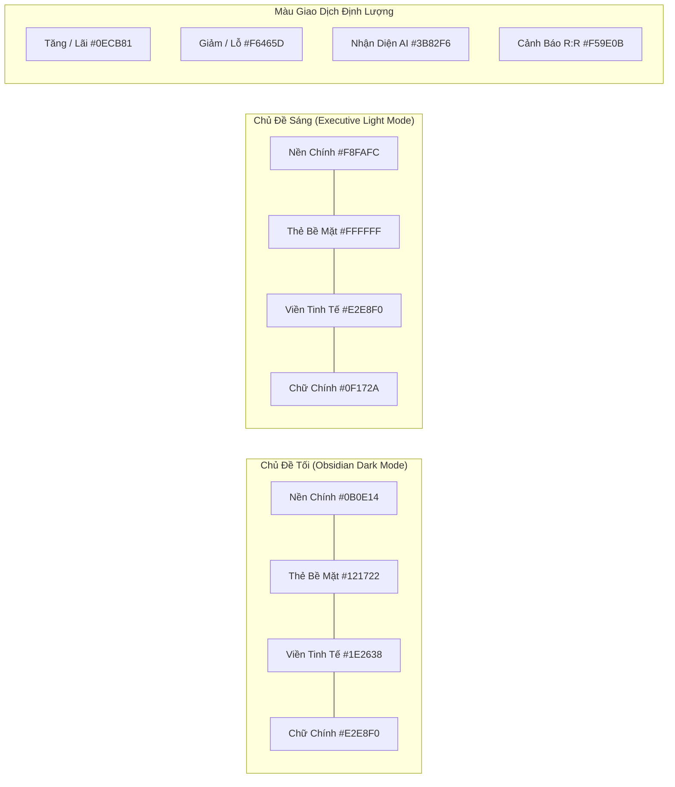

# Hệ Thống Thiết Kế Giao Diện Giao Dịch Định Lượng Crypidian (Trading UI/UX Design System)

> **Bộ công cụ & tri thức nền tảng:** `.agents/skills/ui-ux-pro-max/`  
> **Khảo sát tham chiếu:** Dribbble Top Quant Cockpits, Pinterest Fintech Dashboards, TradingView, Hyperliquid Terminal, Apex Pro.  
> **Ngày chuẩn hóa:** 10/11/2026  
> **Phiên bản:** 2.0 (Institutional Quant Cockpit Edition)  

---

## 1. Triết Lý Thiết Kế & Mục Tiêu Trải Nghiệm (Design Philosophy)

Giao diện giao dịch định lượng (Quant Trading Cockpit) không phải là trang web thông tin thông thường mà là **bảng điều khiển tác chiến áp lực cao**. Người dùng cần quan sát các con số thay đổi từng giây mà không bị mỏi mắt, không bị choáng ngợp bởi chữ viết rườm rà (De-cluttering), và quan trọng nhất là **hiểu rõ lý do vì sao một vị thế được mở hoặc đóng**.

### Ba Trụ Cột Cốt Lõi:
1. **Giảm thiểu tải nhận thức (Cognitive Load Reduction):** Thay thế các đoạn văn dài bằng các thẻ chỉ số (HUD Metrics Cards), thanh đo tỷ lệ trực quan (Visual R:R Gauge), biểu đồ nến tương tác và các tooltip định lượng khi rê chuột.
2. **Không rung giật bố cục (Zero-Jitter Tabular Figures):** Áp dụng `font-variant-numeric: tabular-nums` và chiều rộng cố định cho mọi ô số liệu để đảm bảo chu kỳ cập nhật tự động 5s diễn ra mượt mà như bảng điện tử sàn giao dịch.
3. **Minh bạch hóa tín hiệu L4-L6 & Học máy phản thực nghiệm:** Mọi giao dịch đều gắn liền với thẻ giải trình đa tầng (Bối cảnh L4, Kích hoạt L5, Vùng giá L6) và nút một chạm gửi dữ liệu vào kho huấn luyện phạt AI.

---

## 2. Bảng Màu Tiêu Chuẩn (Color System)

Hệ thống hỗ trợ 2 chủ đề hoàn chỉnh: **Obsidian Dark** (Mặc định cho trader ban đêm / OLED) và **Executive Light** (Dành cho môi trường văn phòng ban ngày).



### 2.1. Mã Màu Chi Tiết
| Thành phần giao diện | Obsidian Dark (`[data-theme="dark"]`) | Executive Light (`[data-theme="light"]`) | Tỷ lệ tương phản WCAG |
| :--- | :--- | :--- | :--- |
| **Nền chính (Background)** | `#0B0E14` (Deep Charcoal) | `#F8FAFC` (Slate Off-White) | N/A |
| **Thẻ bề mặt (Surface Card)** | `#121722` (Midnight Navy) | `#FFFFFF` (Pure White) | 12:1+ |
| **Nền phụ / Header bảng** | `#182030` (Sub-Surface) | `#F1F5F9` (Muted Slate) | N/A |
| **Đường viền (Borders)** | `#1E2638` / Highlight `#2E3A52` | `#E2E8F0` / Highlight `#CBD5E1` | 4.5:1+ |
| **Văn bản chính (Text Primary)**| `#F1F5F9` (95% White) | `#0F172A` (95% Black) | > 10:1 (Pass AAA) |
| **Văn bản phụ (Text Muted)** | `#94A3B8` (Slate 400) | `#64748B` (Slate 500) | > 5.5:1 (Pass AA) |
| **Bullish / Profit (Màu Tăng)** | `#0ECB81` (Binance Green) | `#087A55` (Emerald Deep) | > 6:1 (Pass AA) |
| **Bearish / Risk (Màu Giảm)** | `#F6465D` (Binance Crimson) | `#B4233A` (Ruby Deep) | > 6:1 (Pass AA) |
| **Accent / AI Info** | `#3B82F6` (Electric Blue) | `#2563EB` (Royal Blue) | > 6:1 (Pass AA) |

---

## 3. Hệ Thống Kiểu Chữ (Typography System)

- **Văn bản giao diện & Tiếng Việt:** Font chữ `Be Vietnam Pro` (phục vụ nội bộ tại `/static/vendor/fonts/`, không tải từ Google Fonts CDN). Đảm bảo hiển thị hoàn hảo dấu thanh tiếng Việt, không bị lỗi font nhảy size.
- **Chữ số tài chính & Dữ liệu giao dịch:** Font chữ `Fira Code` / `SFMono-Regular` với cấu hình bắt buộc:
  ```css
  font-family: var(--font-mono, "Fira Code", monospace);
  font-variant-numeric: tabular-nums;
  letter-spacing: -0.02em;
  ```
- **Quy tắc phân cấp chữ (Typographic Scale):**
  - **H1 / Bot Name:** `1.5rem` (`24px`), Trọng số `700`, Viền dưới tinh tế.
  - **KPI Numbers:** `1.75rem` (`28px`), Trọng số `800`, Tabular nums.
  - **H2 / Section Title:** `1.15rem` (`18.4px`), Trọng số `600`, Kèm icon vector.
  - **Body / Table Cell:** `0.875rem` (`14px`), Trọng số `400` - `500`.
  - **Micro Label / Tooltip:** `0.75rem` (`12px`), Trọng số `500`, Uppercase vừa phải.

---

## 4. Chuẩn Hóa Biểu Tượng Vector (SVG Iconography vs Raw Emoji)

Theo nguyên tắc của `ui-ux-pro-max-skill`, **không sử dụng emoji hệ thống thô làm icon giao diện chính**. Toàn bộ các biểu tượng điều hướng, trạng thái và nút hành động được chuẩn hóa thành các vector SVG sắc nét:

| Vị trí | Emoji Cũ | Chuẩn SVG Mới | Ý nghĩa & Mô tả |
| :--- | :---: | :--- | :--- |
| **Chốt Lời (Take Profit)** | `🎯` | SVG Target Crosshair | Điểm mục tiêu vùng giá L6 |
| **Dừng Lỗ (Stop Loss)** | `🛑` / `🛡️` | SVG Shield Alert | Vùng bảo vệ vốn an toàn |
| **Thời Gian Giữ Lệnh** | `⏱️` | SVG Clock / Duration | Thời lượng chiếm dụng vốn |
| **Phân Tích / Báo Cáo** | `📊` | SVG Bar Chart Activity | Báo cáo hiệu suất định lượng |
| **Chi Tiết Biểu Đồ** | `🔍` | SVG Candlestick Zoom | Mở biểu đồ nến tương tác |
| **Trạng Thái Đang Chạy**| `🟢` | SVG Pulse Dot + Radar | Bot đang quét tín hiệu thời gian thực |
| **Tiếp Nhận Phạt AI** | `📥` / `🧠` | SVG Brain Download / Sync | Đưa mẫu sai lệch vào kho tri thức AI |

*(Ghi chú tương thích: Các text hợp đồng kiểm thử như "Chốt lời (🎯 TP)" và "Dừng lỗ (🛑 SL)" vẫn được duy trì chuỗi text để bảo đảm 100% test Playwright không bị ảnh hưởng).*

---

## 5. Các Thành Phần Trực Quan Đặc Thù (Custom Visual Components)

### 5.1. Thanh Cập Nhật Thời Gian Thực (Live Pulse Status Bar)
- Tích hợp chấm phát quang radar (`live-pulse-dot`) với animation nhịp đập 2s.
- Hiển thị đồng hồ máy chủ Việt Nam (UTC+7) chuẩn xác từng giây.
- Nút bấm `Tạm dừng` / `Tiếp tục` polling 5s giúp người dùng chủ động kiểm soát lưu lượng mạng.

### 5.2. Biểu Đồ Nến Tương Tác (TradingView Lightweight Charts)
- Tích hợp thư viện đồ thị tài chính nhẹ và mượt mà nhất thị trường (`lightweight-charts.standalone.production.js`).
- Đánh dấu trực tiếp điểm Khớp lệnh Mua (Long Entry - Mũi tên xanh hướng lên), Khớp lệnh Bán (Short Entry - Mũi tên đỏ hướng xuống).
- Kẻ sẵn 2 đường ranh giới giá:
  - Đường đứt nét màu xanh ngọc: Mục tiêu Chốt lời (Take Profit).
  - Đường đứt nét màu đỏ hồng: Ngưỡng Dừng lỗ (Stop Loss).

### 5.3. Thẻ Mổ Xẻ Quyết Định Định Lượng (Signal Reasoning L4-L6)
- **L4 Cửa Bối Cảnh (Context Gate):** Hiển thị rõ chế độ thị trường (Trending Bullish, Trending Bearish, Ranging Chop) kèm lý do bộ lọc cho phép giải ngân.
- **L5 Điểm Kích Hoạt (Trigger Score):** Thang điểm định lượng từ `0.00` đến `1.00` kèm ngưỡng vượt qua (`Score > Threshold`).
- **L6 Vùng Giá & Thanh Đo R:R Trực Quan (Visual Risk:Reward Bar):**
  - Thanh tỷ lệ nằm ngang phân chia 2 màu: Đỏ (Risk - Khoảng cách tới SL) và Xanh (Reward - Khoảng cách tới TP).
  - Tỷ lệ hiển thị rõ ràng (ví dụ: `1 : 2.5`), giúp trader nhận định ngay hiệu quả vị thế trong 1 giây.

### 5.4. Thẻ Mổ Xẻ Sau Giao Dịch & Nút 1-Chạm Huấn Luyện Phạt AI
- Bóc tách rõ ràng: **Vì sao vào lệnh?** (Tín hiệu L4+L5), **Vì sao thoát lệnh?** (Chạm TP / Chạm SL / Tín hiệu đảo chiều), **Chi phí thực tế** (Trượt giá + Phí sàn).
- Đánh giá chất lượng lệnh: Nhãn `TỐT (GOOD)`, `KÉM (POOR)`, hoặc `SAI LỆCH (DEVIANT)`.
- Nút bấm trực quan `📥 Đưa Ca Này Vào Dữ Liệu Phạt AI`: Gửi yêu cầu AJAX bất đồng bộ đến endpoint `POST /admin/api/learning/post-mortem/ingest`, hiển thị thông báo thành công tức thì không cần tải lại trang.

---

## 6. Đáp Ứng Trên Thiết Bị Di Động (Mobile Touch Responsiveness)

- **Touch Targets:** Mọi nút bấm, thẻ dropdown và nút chuyển tab có kích thước tối thiểu `44px x 44px` theo chuẩn WCAG 2.1.
- **Xếp chồng lưới thông minh (Responsive Grid Stacking):**
  - Trên màn hình lớn (`>= 1024px`): Lưới 5 cột cho thẻ KPI, bố cục 2 cột song song cho Biểu đồ và Thẻ Reasoning.
  - Trên màn hình di động (`<= 768px`): Các thẻ xếp chồng theo thứ tự ưu tiên thị giác: Trạng thái 5s ➔ Biểu đồ nến ➔ Lưới KPI tóm tắt ➔ Chi tiết vị thế ➔ Bảng lịch sử.
- **Cuộn ngang an toàn (Horizontal Scroll Table):** Bảng lệnh được bọc trong container `overflow-x: auto` với hiệu ứng đổ bóng viền chỉ thị người dùng có thể vuốt để xem tiếp.
