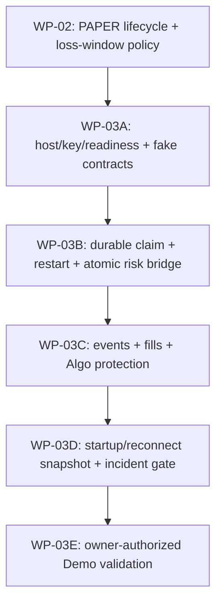

# WP-03 — Phân tích khoảng trống Binance USDⓈ-M

**Ngày kiểm tra:** 2026-11-04 (Asia/Ho_Chi_Minh).  
**Phạm vi:** đọc sâu WP-03A đến WP-03E, đối chiếu module, migration, kiểm thử và bằng chứng đã ghi trong implementation memory. Đây là đánh giá chỉ đọc; không chạy test, không gọi Binance, không dùng credential và không gửi lệnh.

## Kết luận điều hành

WP-03 hiện có nền tảng offline đáng kể cho vòng đời intent, bảo toàn reservation khi trạng thái chưa rõ, REST request qua transport giả, parser regular/Algo tách biệt và ledger DB có kiểm soát scope. Tuy vậy, đây chưa phải một adapter thực thi có thể chạy với Binance Demo: không có transport mạng riêng tư được wire vào runtime, không có secret/readiness lifecycle, không có stream riêng tư/Algo protection, chưa phục hồi ledger sau restart và chưa có đối soát snapshot venue.

WP-03E vẫn đóng. Các contract giả và test Compose không chứng minh Demo account, endpoint private hay Algo có thể dùng được. Theo lịch sử quyết định của người dùng, “demo” hiện cũng được dùng cho PAPER giả lập nội bộ; vì vậy không được coi lựa chọn đó là quyền gửi lệnh đến Binance Demo. Muốn chạy WP-03E phải có gate và quyết định riêng, cùng tài khoản/khóa Demo được chủ sở hữu cung cấp.

| Phần | Trạng thái có bằng chứng | Còn thiếu trước khi xem là hoàn tất |
|---|---|---|
| WP-03A — API/adapter | Audit tài liệu chính thức và contract parser/fixture offline đã ghi hoàn tất; `BinanceDemoTarget`, MARKET/LIMIT REST adapter với transport giả, taxonomy lỗi và parser regular/Algo đã có. | Transport private thật, secret provider, kiểm tra quyền/IP/clock/readiness, wire app boundary, và xác nhận endpoint/capability cụ thể trên Demo. |
| WP-03B — intent/UNKNOWN | Domain lifecycle/reservation, ledger durable, transition audit, DB adapter và reconciliation application/fake verifier có; reservation vẫn được giữ cho tình huống chưa giải quyết. | Claim submit đa tiến trình, rehydrate sau restart, wire worker/composition, verifier Binance thật, atomic bridge sang exposure, dedupe fill và giải quyết absent/rejected an toàn. |
| WP-03C — stream/protection | PAPER có các khái niệm partial fill/cancel/protective exit; parser fixture bao gồm một phần event order/Algo. | Private stream supervisor, `ACCOUNT_UPDATE`, event ledger/dedupe/reconnect, Algo create/cancel/query, bảo vệ đúng lượng fill và recovery khi trigger/reject. |
| WP-03D — khởi động/đối soát | Có nền PAPER recovery, activity guard/incident và contract snapshot/equity ở các module dùng chung. | Snapshot thật đầy đủ, đối soát orders/Algo/positions/trades, khép lỗ hổng lịch sử sau stream gap, venue readiness gate và runbook. |
| WP-03E — Demo run | Chưa có account/key/evidence; host testnet được tài liệu Binance công bố. | Chỉ bắt đầu sau khi gate PAPER/risk, offline isolation, recovery/protection và readiness đạt; cần owner cung cấp account/key theo phạm vi tối thiểu. |

## Bằng chứng đã triển khai và giới hạn của bằng chứng

### Nền adapter/parser offline

- [`demo_target.py`](../../../src/trading_bot/adapters/binance_usdm/demo_target.py) khóa cấu hình target vào chế độ Demo cùng cặp host REST/WebSocket đã allowlist; không tự fallback sang production.
- [`demo_rest.py`](../../../src/trading_bot/adapters/binance_usdm/demo_rest.py) tạo chữ ký cho submit MARKET/LIMIT và query theo client ID qua protocol transport được inject. Credential được ràng buộc với workspace/account/target. Đây chưa phải HTTP transport thật, secret store hay readiness probe.
- Lớp claim attempt trong adapter hiện là set được bảo vệ bằng lock trong process. Nó ngăn lặp trong instance đó, nhưng không làm claim bền vững và không ngăn worker khác process gửi cùng intent.
- [`submission_errors.py`](../../../src/trading_bot/adapters/binance_usdm/submission_errors.py) phân loại rõ nhiều lỗi: timeout/response mơ hồ giữ `UNKNOWN`; rate limit và ban có nhánh riêng; các body 503 được tài liệu Binance phân biệt không bị gộp thành một chính sách retry. Chưa có query/cancel/recovery coordinator đầy đủ.
- [`order_schemas.py`](../../../src/trading_bot/adapters/binance_usdm/order_schemas.py) tách DTO/status regular order với Algo, giữ payload thiếu/lạ ở trạng thái không xác định, và không coi trạng thái Algo `TRIGGERED`/`FINISHED` là regular fill. Parser event regular nhận trade ID, thời gian, cumulative/last fill facts; chưa có phí/commission, account snapshot hay stream lifecycle đầy đủ.
- Lát cắt regular hiện hỗ trợ MARKET/LIMIT. User stream Binance cũng có thể đưa sự kiện `LIQUIDATION`; sự kiện ngoài chiến lược/forced activity cần được phân loại thành hoạt động venue cần reconcile, không được nhận nhầm là entry strategy. Hiện parser hẹp có thể từ chối một số event này, nên cần một envelope an toàn cho hoạt động ngoài luồng.

Implementation memory ghi ba nhóm unit liên quan parser, Demo REST mapping và submission errors đạt **166 passed** ngày 2026-11-02. Đây là bằng chứng được lưu trong repo, không phải kết quả vừa chạy trong đợt phân tích này. Không có Binance API hoặc order Demo nào được thực hiện.

### Ledger, bảo vệ rủi ro và reconciliation

- [`venue_orders.py`](../../../src/trading_bot/domain/execution/venue_orders.py) mô hình hóa intent, chuyển trạng thái có kiểm soát, HMAC transition proof và quy tắc reconcile `UNKNOWN`.
- Migration `a7c9e2f4b6d8` cùng repository tạo intent bền vững, scope workspace/bot/account/reservation/settings, idempotency và transition audit append-only. Migration `f4a6c8d0e2b5` gia cố reservation trigger bằng quyền invoker, owner guard riêng, path cố định, schema-qualified lookup và thu hồi EXECUTE ngoài owner.
- [`DatabaseVenueOrderLedgerPort`](../../../src/trading_bot/adapters/database/venue_reconciliation_ledger.py) ràng buộc scope đáng tin cậy và sequence-guard các lần ghi. Compose E2E đã ghi nhận RLS/scope, bảo vệ reservation PAPER tương thích, venue reservation không bị release/transfer khi còn intent, và partial fill được append trong audit nhưng risk vẫn UNKNOWN.
- [`venue_order_reconciliation.py`](../../../src/trading_bot/application/venue_order_reconciliation.py) xác nhận scope, độ mới và fill monotonicity qua verifier port. Service hiện giữ rủi ro cho mọi nhánh; `ORDER_ABSENT` trả `RESERVATION_BRIDGE_REQUIRED`, `REJECTED` giữ vì `REJECTED_SCHEMA_CONFLICT`. Đây là hành vi an toàn nhưng chưa phải quy trình reconcile hoàn chỉnh.
- Repository hiện có một phần callback/transaction hỗ trợ reconcile UNKNOWN sang open risk, nhưng chưa có coordinator duy nhất chứng minh venue transition, position/exposure và reservation transfer/release commit nguyên tử trong cùng giao dịch. Cần xác minh lại đường này khi tích hợp, không nên kết luận toàn dự án không có bất kỳ bridge primitive nào.
- HMAC proof/domain object còn gắn với process; adapter DB hiện chiếu dữ liệu thành verifier snapshot nhưng chưa có hợp đồng rehydrate domain intent sau restart. Durable row do đó chưa đồng nghĩa runtime có thể tiếp tục vòng đời an toàn sau khi process chết.

Test Compose được ghi trong memory/WBS xác nhận adapter DB và fake verifier; chúng không xác nhận Binance thật, không xác nhận order được gửi, cũng không xác nhận tính đúng của network recovery.

## Khoảng trống ưu tiên theo lát cắt

### P0 — Khóa policy rủi ro và hoàn thiện restart/transaction trước network

1. Chốt và triển khai ý nghĩa daily/rolling loss window: UTC hay múi giờ khác, mốc reset, độ dài cửa sổ rolling, dữ liệu được cộng (realized/unrealized/fee/funding), freshness, equity basis và hành vi khi thiếu dữ liệu. `RiskEngine` hiện nhận `realized_loss_today`/`realized_loss_rolling` làm input và áp ngưỡng, nhưng contract input tự nó không chứng minh nơi nào tính cửa sổ thời gian/reset.
2. Định nghĩa recovery/rehydration sau restart cho intent, proof, attempt và sequence; dùng claim bền vững có fencing/idempotency giữa nhiều worker. Thử crash trước/sau gửi, commit/rollback và outbox redelivery bằng fake venue.
3. Tạo transaction coordinator để evidence reconcile, venue transition, fill/position/exposure và reservation được ghi atomically. Bao phủ ACK, partial fill, full fill, authoritative no-fill absence, cancel/fill race, definitive reject và evidence stale/mismatch. Khi không chứng minh được trạng thái thì giữ UNKNOWN/reservation và đóng entry gate.
4. Thêm E2E PostgreSQL cho hai worker tranh claim cùng intent, restart giữa các bước, rollback bridge và replay command; hiện tại E2E có scope/RLS tốt nhưng chưa chứng minh các cạnh này.

Đây là công việc offline, không cần Binance credential hay request mạng.

### P1 — Mở rộng hợp đồng API giả và event ledger

1. Bổ sung fake-transport contract cho query, cancel, all/open orders, fills/trades, Algo query/cancel và snapshot account/positions. Chứng minh cancel ACK không xóa fill đến muộn, response mơ hồ không retry, và absence chỉ authoritative khi đủ order + trade history theo account/symbol/time coverage.
2. Chuẩn hóa envelope event cho `ORDER_TRADE_UPDATE`, `ACCOUNT_UPDATE`, `ALGO_UPDATE`, expiry stream, unknown schema, liquidation/foreign activity. Ghi event time, transaction time, receive time, account, order/algo/client IDs, trade ID, schema version và sanitized facts; dedupe trade fill bằng identity bền vững.
3. Xác định coverage/history contract. Binance ghi order không khớp đã hủy/expired biến mất khỏi query sau ba ngày và order cũ hơn 90 ngày không còn trong các truy vấn nêu trong tài liệu; vì vậy internal event ledger/snapshot cursor cần khép gap, còn lỗ hổng ngoài thời gian lưu giữ phải chuyển thành `UNKNOWN`/incident thay vì suy ra absence.
4. Parser phải nhận diện hoạt động ngoại lệ để reconcile, nhưng không tự adopt/cancel/liquidate foreign orders. Chính sách xử lý liquidation, manual order và lệnh không có client ID cần được đưa vào incident workflow.

Lát này có thể làm bằng fixture và fake transport; không cần gửi request lên sàn.

### P2 — Runtime private gateway và readiness fail-closed

Sau khi P0/P1 ổn định: wire adapter vào application/worker; bổ sung secret provider/credential provenance, ký request và clock offset; readiness riêng cho target, USER_DATA/TRADE permission, IP restrictions, clock skew, snapshot freshness, stream health và protection. Không log secret, chữ ký hoặc listen key. Kiểm tra target/credential/account ở composition trước khi tạo transport; không nhận host/account override từ caller payload. Dùng test fake trước khi bật private network.

### P3 — User stream và protective Algo

Implement listenKey lifecycle, renewal, reconnect, rotation trước 24h theo tài liệu hiện hành; bất cứ disconnect/expiry nào cũng đóng entry gate và cần snapshot/history reconciliation trước mở lại. Bổ sung `ACCOUNT_UPDATE`, nhưng không dùng nó như full snapshot: tài liệu nói event chỉ chứa balance/position đã thay đổi; order không fill/cancel có thể không tạo `ACCOUNT_UPDATE`.

Tiếp đó xây quan hệ entry intent → Algo protective order → regular order được tạo sau trigger → fills. Theo dõi lượng exposure đã fill so với lượng được bảo vệ, reject/replace/cancel race, position mode và semantics reduce-only/close-position. Entry gate phải giữ đóng khi thiếu bảo vệ hoặc event gap chưa đối soát. Tất cả có thể kiểm trước bằng fake venue; endpoint Demo support vẫn UNKNOWN cho tới khi có evidence.

### P4 — Startup/reconnect snapshot và gate Demo

Venue snapshot phải có account/environment, observed time, completeness, balance/equity basis, positions, regular open orders, Algo open orders và recent fills/trades với coverage rõ. Đối chiếu mọi intent, reservation, position và protection trước entry. Sai account, snapshot stale/incomplete, foreign activity, gap không thể khép hoặc equity basis chưa biết thì readiness fail.

WP-03E chỉ sau khi WP-02 PAPER lifecycle và loss-window gate pass, WP03A isolation/readiness pass, WP03B transaction/restart pass, WP03C stream/protection pass, WP03D startup/reconnect reconcile pass, rồi mới cần owner cung cấp Demo account/key không phải production. Demo contract run nên tách rõ read-only readiness, bounded order lifecycle và dọn/reconcile hậu điều kiện; endpoint/Algo support không được suy ra từ generic “most endpoints” Testnet claim.

## Chuỗi phụ thuộc

Các hạng mục documentation, parser fixture, fake transport, transaction contract và risk policy có thể tiến hành offline. Network transport và Demo order là phần phụ thuộc gate; không có lý do để dùng key thật cho các bước trên.

## Điểm không nhất quán cần sửa trong vòng tài liệu kế tiếp

- [`03-binance-execution.md`](../../../docs/implementation/03-binance-execution.md) vẫn có đoạn nói audit 2026-11-02 chưa khóa enum regular, `updateTime`, nested event fields và Algo nullability. Điều đó đã cũ so với audit Task 1A và parser/fixtures hiện có; phần schema contract offline được ghi đã hoàn tất ngày 2026-11-02. Cập nhật module doc, nhưng giữ rõ Demo/private endpoint support còn UNKNOWN.
- [`wp03-execution-wbs.md`](./2026-11-01-wp03-execution-wbs.md) có cả kết quả Task 1A 166 unit passed và các task adapter/readiness còn mở. Hai ý này không mâu thuẫn: parser/fixture xong không phải transport/readiness xong. Cần tránh rút trạng thái A thành “WP-03A hoàn tất”.
- WBS và memory dùng khái niệm `Retry-After` thận trọng. General Info hiện kiểm tra không đủ để khẳng định semantics của header cho mọi endpoint; chỉ áp dụng nếu endpoint/response contract hiện hành xác nhận.
- Có `mark_to_market_equity` và `AccountEquityRepository` dùng chung trong codebase. Do đó không nên ghi rằng cả sản phẩm chưa có mark-to-market; khoảng trống WP-03 là chưa có venue snapshot/basis + conversion/freshness và chưa có đường tính daily/rolling window gắn với equity này trước khi cho entry.
- Tài liệu hiện hành dùng cả “Testnet” cho cặp Demo host và “Demo” trong cấu hình sản phẩm. Tên mode nội bộ phải chỉ rõ Demo/testnet và giữ host/credential tách khỏi production.

## Quyết định còn mở để WP tiếp tục

1. Ai chịu trách nhiệm phê duyệt daily/rolling risk window policy và equity basis dùng cho USDⓈ-M; chốt timezone/reset, asset conversion và treatment của fee/funding/unrealized PnL.
2. Giữ phạm vi mặc định là PAPER mô phỏng nội bộ như quyết định trước; nếu chủ sở hữu muốn external Binance Demo order, xác nhận account/key riêng, quyền tối thiểu, IP policy và tiêu chí cho phép WP-03E. Báo cáo này không mở quyền đó.
3. Chính sách incident đối với liquidation, manual/foreign order, lệnh không có local intent, position mode sai hoặc Algo protection orphan: chỉ cảnh báo/đóng entry gate, hay cần operator action cụ thể. Không tự động adopt/cancel/flatten khi chưa có policy.
4. Chọn tiêu chí “authoritative absence”: tập endpoint/order+trade history, cursor/time bounds, pagination và coverage cần có trước khi release reservation hoặc cho retry cùng intent.
5. Quyết định retention nội bộ cho event ledger, credential rotation and stream gap evidence; venue API history ngắn hơn tuổi đời nội bộ có thể đối soát.
6. Chốt phạm vi test Demo thực tế: simulator có hỗ trợ conditional/algo, partial fill và stream theo endpoint nào. Trạng thái hiện là UNKNOWN; không biến tình trạng thiếu evidence thành test pass hay skip acceptance.

## Nguồn Binance chính thức đã kiểm tra

Chỉ dùng tài liệu Binance Developer chính thức cho quyết định API/version. Kiểm tra lúc **2026-11-04 08:55 UTC** (2026-11-04, Asia/Ho_Chi_Minh).

- [USDⓈ-M Futures General Information](https://developers.binance.com/en/docs/products/derivatives-trading-usds-futures/general-info) — host Demo/Testnet, 408/429/418/503 và các dạng response mơ hồ/thất bại.
- [USDⓈ-M Futures User Data Streams](https://developers.binance.com/en/docs/products/derivatives-trading-usds-futures/user-data-streams) — listenKey/stream lifecycle, `ORDER_TRADE_UPDATE`, `ACCOUNT_UPDATE`, `ALGO_UPDATE`; account update là thay đổi, không phải snapshot đầy đủ; event order có `LIQUIDATION`.
- [USDⓈ-M Futures REST Trade API](https://developers.binance.com/en/docs/catalog/core-trading-derivatives-trading-usd-s-m-futures/api/rest-api/trade) — regular/algo order query, cancel, các endpoint Algo và giới hạn lịch sử/query.
- [USDⓈ-M Futures Change Log](https://developers.binance.com/en/docs/products/derivatives-trading-usds-futures/change-log) — cập nhật gần nhất được trang nêu khi kiểm tra là giới hạn `callbackRate` của Algo trailing stop; đối chiếu để không giữ giới hạn cũ 10%.

Tài liệu General Info mô tả HTTP 408 là timeout; 429 là vượt rate limit; 418 là IP ban; 503 “Unknown error” có thể đã được xử lý và trạng thái không rõ, còn một số body 503 khác được nêu là thất bại có thể retry. User stream docs ghi kết nối tối đa 24 giờ và listenKey cần gia hạn; sau gap phải reconcile. REST docs ghi một số canceled/expired order không fill không còn query được sau 3 ngày và order cũ hơn 90 ngày không tìm thấy. Cần giữ các giới hạn này trong thiết kế recovery, không suy diễn từ response absence đơn lẻ.

## Ranh giới xác minh

Đây là phân tích dựa trên source tree, docs, migrations và test evidence đã ghi trong repo. Không chạy unit, E2E hoặc static checks trong lượt này; số test trong memory là kết quả lịch sử. Không gửi request/API call tới Binance, không lấy/đọc credentials và không đặt lệnh. Kết quả không chứng minh Demo account capability, endpoint support hay runtime readiness.
