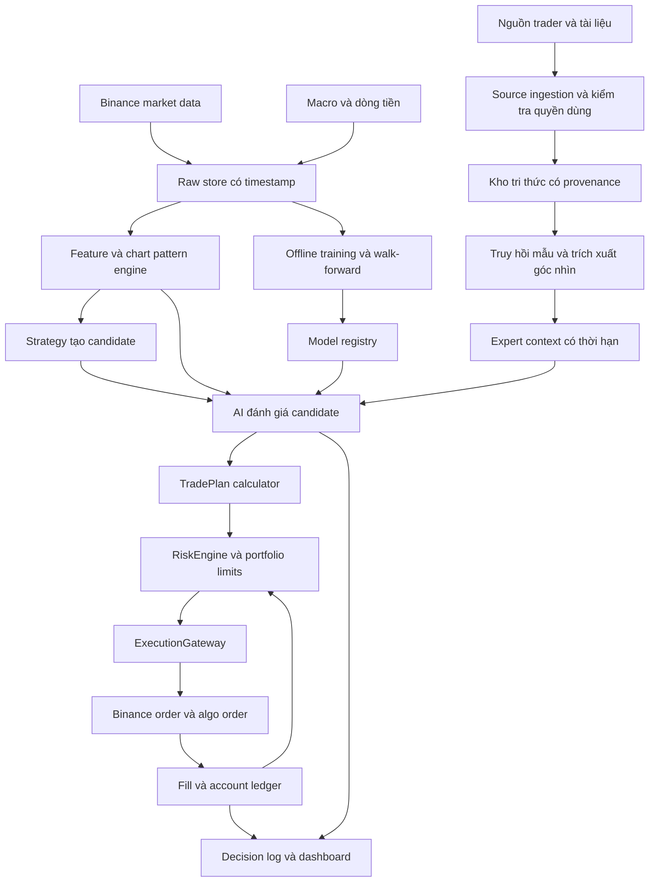

# Thiết kế bot Binance Futures độc lập — strategy, mô hình AI và thư viện research

Ngày chốt danh mục trader và strategy hypotheses: **07/10/2026**. Rà soát tích hợp admin/Telegram/data mới: **21/10/2026**, múi giờ **Asia/Saigon**. Trạng thái: thiết kế v1 để đọc và chỉnh; tài liệu này chưa phải bot đã triển khai hay kết quả backtest.

## 1. Mục tiêu và các quyết định

Xây một bot độc lập có strategy/model riêng, kế thừa cách chia thành phần và vòng đời strategy của Freqtrade. Bot nhận dữ liệu thị trường và dữ liệu công khai được phép dùng, nhận diện cấu trúc giá/tin tức/trending, đối chiếu mẫu phân tích và góc nhìn ex-ante, dùng AI đánh giá cơ hội, rồi tính giá vào/ra và khối lượng bằng công thức có thể kiểm tra. Admin có web đơn giản để cấu hình exchange, watchlist, nguồn, strategy, risk và người dùng; Telegram phục vụ thông báo và các thao tác vận hành hẹp theo quyền. AI được học và tạo chiến lược mới trong sandbox, đánh giá bằng replay/paper, sau đó phát hành theo promotion gate. Mọi tín hiệu, lệnh, thay đổi cấu hình và kết quả phải truy nguyên được.

Người dùng đã chọn hướng bot độc lập. Thiết kế dùng giao diện quen thuộc của Freqtrade làm mẫu cho **BaseStrategy của chính dự án**; runtime, lưu trạng thái, backtest, risk và kết nối Binance thuộc codebase mới. Việc chuyển strategy Freqtrade sang bot cần ánh xạ import, kiểu Trade/Order, dữ liệu và callback. Tài liệu tham khảo là checkout `freqtrade-develop`, nhánh `develop`, commit `01dc3d2`; code được sao chép nếu có cần được xử lý theo [giấy phép của repo](https://github.com/freqtrade/freqtrade/blob/01dc3d2ab794c23503f8e4e49561e0309144d160/LICENSE).

Các giả định thiết kế còn có thể chỉnh:

- Thị trường đầu tiên: crypto **USDⓈ-M, USDT perpetual**, isolated, One-way Mode; BTCUSDT và ETHUSDT trước. COIN-M, hedge mode, cross margin và TradFi perpetual là các capability mở rộng.
- Nến quyết định 15 phút; ngữ cảnh 1 giờ và 4 giờ đã đóng; dữ liệu 1 phút hoặc trade phục vụ mô phỏng lệnh. Đây là chọn lựa kỹ thuật cho MVP, chưa phải timeframe tối ưu.
- Nghiên cứu và paper trading dùng dữ liệu thị trường thật; Binance demo dùng để kiểm tra giao thức đặt/huỷ/đồng bộ lệnh. Thanh khoản demo không đại diện chất lượng khớp lệnh live.
- AI có quyền đánh giá và đề nghị `long`, `short`, `abstain`; RiskEngine kiểm tra TradePlan trước khi ExecutionGateway gửi lệnh.
- Phạm vi AI tự học gồm xây hypothesis có giới hạn, huấn luyện challenger, phân tích sai số và cải thiện paper strategy. Live strategy/risk không bị cập nhật trực tiếp bởi LLM hoặc online learner; promotion qua quyền admin và điều kiện đã cấu hình ở các mục 22–23.
- Danh mục 100–200 người là nguồn research có trạng thái kiểm chứng. Danh tiếng, số follower và kết quả một cuộc thi được lưu riêng; chúng không tự chứng minh hiệu suất tương lai.

Tiêu chí thành công là tái hiện được quyết định theo thời gian, mô phỏng được chi phí, khôi phục được trạng thái lệnh, và đo được phần cải thiện của AI so với cùng strategy khi tắt AI. Mục tiêu lợi nhuận chưa thể chốt khi chưa có dữ liệu và kết quả thực nghiệm.

## 2. Research đến năm 2026 thay đổi thiết kế như thế nào

Research được chia thành tài liệu sàn/API, nghiên cứu định lượng, phương pháp phân tích kỹ thuật, dữ liệu vĩ mô, và nguồn trader. Phạm vi thực tế gồm website chính thức, arXiv/tài liệu nghiên cứu, GitHub, TradingView, X, YouTube, blog/newsletter và các kênh công khai dẫn từ hồ sơ tác giả. Việc phát hiện một kênh không đồng nghĩa đã thu thập toàn bộ lịch sử hay được cấp quyền huấn luyện trên nội dung đó.

| Nguồn gốc | Phát hiện dùng trong thiết kế | Giới hạn suy luận |
| --- | --- | --- |
| [BTC ML dưới chi phí giao dịch, 2026](https://arxiv.org/abs/2606.00060) | Chuyển dự báo thành lệnh phải xét chi phí và turnover; so sánh cây boosting với mô hình neural | Kết quả trên mẫu của paper chưa xác nhận edge của bot này |
| [Dynamic Multi-Pair Trading, bản sửa 25/06/2026](https://arxiv.org/abs/2606.04574v2) | Pair selection và chính sách học máy có thể nằm trong giới hạn risk xác định | Bằng chứng bootstrap báo cáo mức 10%, chưa đạt 5%; RL dành cho research sau MVP |
| [Benchmark từ backtest đến real market, 28/09/2026](https://arxiv.org/abs/2609.34510) | Dùng ba chặng historical replay, prospective paper và live; đo khoảng cách giữa các chặng | Công bố mới, cần đọc và tái lập protocol; không lấy leaderboard làm bảo chứng |
| [Hai fleet LLM production, 04/09/2026](https://arxiv.org/abs/2609.05663) | Tách chính sách AI khỏi sizing/bracket và đo baseline cơ học | Quan sát hai hệ thống có cùng dòng thiết kế; không kết luận mọi LLM đều như vậy |
| [NBER: nhận diện mẫu kỹ thuật bằng thuật toán](https://www.nber.org/papers/w7613) | Chuyển hình dạng đồ thị thành điều kiện định lượng và kiểm định | Nghiên cứu cổ phiếu lịch sử; cần tái kiểm định trên crypto futures |

EMA, RSI, ATR, Donchian, VWAP và support/resistance là các phương pháp đã tồn tại từ trước. Các cập nhật 2026 được ghi bằng ngày, phiên bản và bằng chứng; một bài viết mới về indicator cũ không làm indicator đó thành strategy mới. Danh mục giả thuyết và bibliography chi tiết nằm ở [strategies-2026.md](../../research/strategies-2026.md).

## 3. Ánh xạ từ kiến trúc Freqtrade

| Thành phần tham khảo | Thành phần của bot mới | Trách nhiệm |
| --- | --- | --- |
| Worker và vòng lặp bot | Orchestrator | Điều phối lịch, trạng thái, deadline và đồng bộ |
| DataProvider | MarketDataService + FeatureStore | Nến, order book, mark/index, funding, OI và dữ liệu đã biết tại thời điểm quyết định |
| IStrategy | BaseStrategy + StrategyRegistry | Indicator, candidate vào/ra, rule và recipe |
| PairListManager | UniverseService | Watchlist có phiên bản, điều kiện thanh khoản và tình trạng model |
| Wallets, Protections | AccountLedger + RiskEngine | Equity, margin, hạn mức, exposure và circuit breaker |
| Exchange/Binance | ExchangeGateway + BinanceFuturesGateway | Chuẩn hoá thông số hợp đồng, đặt/huỷ/query lệnh và user stream |
| Trade/Order persistence | OrderLedger + EventStore | Vị thế, fill, phí, funding, outbox và khôi phục |
| Backtesting/Hyperopt | ReplayEngine + ExperimentRunner | Mô phỏng thực thi, chọn tham số và báo cáo |
| FreqAI | TrainingWorker + ModelRegistry + InferenceService | Huấn luyện, đánh giá, phát hành và suy luận |
| RPC/API | ControlAPI + Dashboard | Theo dõi, cấu hình watchlist, pause entries và xem lý do quyết định |

Các mốc đọc mã: [vòng lặp xử lý](https://github.com/freqtrade/freqtrade/blob/01dc3d2ab794c23503f8e4e49561e0309144d160/freqtrade/freqtradebot.py), [strategy interface](https://github.com/freqtrade/freqtrade/blob/01dc3d2ab794c23503f8e4e49561e0309144d160/freqtrade/strategy/interface.py), [adapter Binance](https://github.com/freqtrade/freqtrade/blob/01dc3d2ab794c23503f8e4e49561e0309144d160/freqtrade/exchange/binance.py), [pairlist](https://github.com/freqtrade/freqtrade/blob/01dc3d2ab794c23503f8e4e49561e0309144d160/freqtrade/plugins/pairlistmanager.py), [FreqAI](https://github.com/freqtrade/freqtrade/blob/01dc3d2ab794c23503f8e4e49561e0309144d160/freqtrade/freqai/freqai_interface.py). MCP knowledge graph không có trong tool của phiên nghiên cứu này nên khám phá mã dùng phương án dự phòng. Thiết kế độc lập không có phụ thuộc import từ checkout tham khảo.

## 4. Kiến trúc tổng thể và luồng dữ liệu



MVP có một process trading orchestration, một process ingestion và một worker training tách khỏi luồng lệnh. PostgreSQL chứa ledger, nguồn và trạng thái; Parquet chứa dữ liệu thị trường, DuckDB dùng cho research. Queue/outbox nằm trong DB trước; chỉ thêm streaming broker khi lưu tick/depth ở quy mô cần thiết.

Vòng quyết định:

1. Nhận nến đã đóng; kiểm tra gap, thời gian sàn, tuổi order book và trạng thái dữ liệu.
2. Đồng bộ fill/vị thế/stop đang tồn tại; xử lý điều kiện thoát và risk event ưu tiên.
3. Đọc snapshot watchlist và dữ liệu đa khung thời gian đúng `as_of`.
4. Tính feature/pattern, tạo candidate theo các strategy đang bật.
5. Lấy expert context hợp lệ từ cache; AI chấm candidate, chọn hướng hoặc abstain.
6. Tính TradePlan từ recipe, giá hiện tại và thông số hợp đồng; kiểm tra lại EV, sizing và risk.
7. Ghi intent vào outbox rồi gửi lệnh; mọi trạng thái và fill được lưu.

LLM phục vụ trích xuất và đối chiếu hoạt động ngoài vòng lệnh. Inference dùng feature đã chuẩn hoá và context có sẵn; deadline nội bộ đề xuất 2 giây cho mỗi candidate. Nếu deadline, model hoặc dữ liệu bắt buộc lỗi, candidate bị từ chối và có reason code. Các hạn mức này là mục tiêu kỹ thuật để đo khi triển khai.

## 5. Hợp đồng dữ liệu và lưu trữ

Mọi bản ghi có `schema_version`, `source_id`, `event_time`, `published_at`, `available_at`, `received_at`, `revision_id`, `quality_flags` và checksum khi phù hợp. UTC dùng để lưu và ghép dữ liệu; dashboard hiển thị Asia/Saigon. `event_time` có thể là kỳ thống kê; `available_at` mới quyết định dữ liệu có được dùng tại t hay không.

| Đối tượng | Trường bắt buộc quan trọng |
| --- | --- |
| InstrumentSpec | exchange_symbol, normalized_symbol, settle_asset, contract_type, underlying_type, contract_size, tick_size, step_size, min_qty, min_notional, trading_status, valid_from |
| Candle | symbol, timeframe, open_time, close_time, OHLCV, is_closed, available_at, revision_id |
| DerivativeSnapshot | mark_price, index_price, funding_rate, funding_interval, next_funding_time, OI, basis, timestamps, đơn vị của OI |
| MacroRelease | indicator, observation_period, release_time, actual_initial, consensus_snapshot_id, revision, vendor, available_at |
| ResearchSource | canonical_person_id, channel, identity_status, evidence_url, allowed_uses, last_checked, method_tags, conflicts |
| ResearchDocument | URL, author, version, content_hash, short_summary, publication/availability times, rights, source evidence |
| ExpertOpinion | symbol, market, direction, timeframe, horizon, condition, invalidation, explicit_levels, uncertainty, document_id, expiry |
| PatternObservation | pattern_id/version, confirmed_at, pivot refs, zones, confidence/quality, feature_snapshot_id |
| SignalCandidate | candidate_id, strategy_id/version, symbol, side, as_of, pattern_refs, invalidation_refs, entry_policy, exit_recipe, horizon, expires_at |
| ModelDecision | candidate_id, model_version, probabilities, calibration_version, uncertainty, approve/abstain, reasons, evidence_ids, training_cutoff |
| TradePlan | plan_id, entry band/type, stop, targets, quantity, leverage, estimated costs, expected_net_outcome, expiry, risk budget, price/spec snapshots |
| OrderEvent | intent/client/exchange/algo IDs, symbol, order status, quantity, fills, fee asset, timestamps, reconciliation state |

Join tại thời điểm t chỉ dùng hàng có `available_at <= t`. Dữ liệu sửa đổi không ghi đè phiên bản ban đầu. Dữ liệu không có timestamp công bố đáng tin cậy thuộc kho học phương pháp; việc dùng nó làm historical predictive feature cần protocol về availability riêng.

Bảng chính: instruments, candles_manifest, market_snapshots, macro_releases, universe_snapshots, sources, documents, opinions, pattern_observations, feature_snapshots, experiments, model_versions, decisions, trade_plans, order_intents, order_events, fills, positions, account_snapshots, cashflows, incidents. Kho raw chỉ giữ nội dung theo phạm vi quyền được cấp; rights/tombstone được truyền sang index và dataset downstream.

## 6. Watchlist có khả năng tái hiện

Watchlist là đối tượng có ID/version và lịch sử thành viên. Các nhóm: manual, liquid crypto perps, trend candidates, range candidates, event affected, model ready. Cặp đang có vị thế tiếp tục thuộc danh sách quản lý cho tới khi vị thế và lệnh bảo vệ được xử lý xong.

Universe filter theo thứ tự: loại hợp đồng/settle/underlying, trạng thái trading, tuổi niêm yết, dữ liệu đủ warmup, thanh khoản, spread, funding/volatility, mức tương quan, model readiness. Khi thêm cặp mới, tải dữ liệu và tạo feature/model trước khi cho phép candidate. Giới hạn paper đầu tiên là BTC/ETH, sau đó mở research universe 20–30 cặp đã có dữ liệu; danh sách thực tế không được bịa từ một snapshot hiện tại để backtest quá khứ.

Refresh đề xuất mỗi giờ; gắn snapshot tại thời điểm lịch sử. Backtest universe động cần dữ liệu thành viên/liquidity quá khứ, bao gồm cặp huỷ niêm yết. Với dữ liệu chưa đủ, báo cáo chỉ là nghiên cứu trên tập cố định và ghi rõ survivorship bias.

## 7. Dữ liệu ảnh hưởng giá và trend

| Nhóm | Feature muốn đo | Cách dùng |
| --- | --- | --- |
| Giá/volume | Return 1/4/16/64 bars, realized vol, ATR%, relative volume, breadth | Trend/range/vol regime và xác nhận cấu trúc |
| Phái sinh | Funding z-score, basis, biến động OI, taker imbalance, depth/spread, liquidation proxy | Crowding, chất lượng breakout, chi phí và stress |
| Macro | CPI/core CPI, PCE/core PCE, payrolls, unemployment, FOMC, lợi suất 2Y/10Y, USD | Event risk và phản ứng conditional theo regime |
| Liên thị trường | S&P/Nasdaq returns, volatility indexes, vàng, dầu, dollar indexes | Correlation/beta/lead-lag theo cửa sổ; tôn trọng giờ thị trường |
| Crypto flows | ETF holdings/flows với ngày công bố, stablecoin supply/flows, exchange flows | Ngữ cảnh và thay đổi thanh khoản theo thời hạn phù hợp |
| Nguồn trader | Phân tích có điều kiện, khung thời gian, invalidation, disagreement | Context bổ sung và corpus chart; cần kiểm định phần lợi ích |

Không cố định quan hệ “CPI tăng → BTC giảm” cho mọi thời kỳ. Feature tách actual, surprise và phản ứng của giá/rates sau công bố. Consensus cần snapshot của nhà cung cấp trước release; BLS/BEA công bố actual không tự cung cấp historical consensus. Dữ liệu daily/revised không dùng như feed intraday. Funding trả/nhận là dòng tiền của vị thế; OI tăng không tự cho biết bên long thắng.

Nguồn, khả năng truy cập, tần suất, độ trễ và revision được mô tả ở [macro-market-data.md](../../research/macro-market-data.md). DXY chính thức, dữ liệu sàn truyền thống, consensus và một số on-chain API có thể cần quyền sử dụng hoặc ngân sách riêng; dữ liệu proxy phải có tên riêng trong feature schema.

## 8. Strategy interface và rule engine

`BaseStrategy` của dự án có các hàm `populate_indicators(frame, context)`, `populate_entry_trend(frame, context)`, `populate_exit_trend(frame, context)`, `build_candidates(context)`, `custom_exit(position, context)` và `on_order_filled(fill, context)`. Rule thuần nhận immutable snapshot và trả candidate/reason; gửi lệnh đi qua gateway chung. `BaseSignalModel.fit(dataset, train_config)` và `predict(candidate, feature_snapshot, expert_context)` trả ModelDecision. Strategy ID, version, parameter hash và exit policy là một phần của model contract.

Rule có 4 tầng: eligibility → regime → setup → trigger. Sau AI là TradePlan/risk gate. Mỗi tầng có reason code độc lập để hiểu vì sao bỏ cơ hội. Khi long và short xung đột trên cùng cặp, allocator so sánh net expected outcome/uncertainty; nếu chưa phân giải được thì abstain. Không thực hiện nhiều engine cùng điều khiển một vị thế.

Ba baseline đầu tiên:

| Strategy | Candidate vào | Invalidation/thoát | Regime kém phù hợp |
| --- | --- | --- | --- |
| TrendPullback | Trend 1h, EMA slope, pullback 15m vào vùng rồi nến xác nhận trở lại hướng trend | Swing xác nhận + ATR buffer; target R và trailing | Choppy/range, trend quá kéo dài |
| DonchianBreakout | Close vượt kênh của nến trước, relative volume và spread hợp lệ | Opposite structure hoặc ATR; time stop | Fakeout, thanh khoản mỏng, tin mạnh |
| VWAPRangeReversion | Range regime; lệch VWAP/z-score và nến quay lại vùng | Range invalidation; về mean; horizon ngắn | Trend mạnh hoặc regime chuyển đột ngột |

Thư viện research bổ sung các giả thuyết momentum, volatility squeeze, support/resistance retest, funding/OI, liquidation stress, statistical pairs và event overlay trong tài liệu strategy. Chỉ bật một hypothesis vào paper khi có entry/exit xác định, feature point-in-time và báo cáo chi phí. Arbitrage hai chân và market making có yêu cầu execution riêng nên triển khai sau engine vị thế đơn.

## 9. Công thức chart pattern và xử lý repaint

Các công thức dưới đây định nghĩa building block của thiết kế. Tham số phải chọn trong train/validation và đóng băng trước test.

**ATR:** `TR_t = max(H_t-L_t, |H_t-C_(t-1)|, |L_t-C_(t-1)|)`; `ATR_t = RMA_n(TR_t)` với seed SMA n nến rồi cập nhật `(ATR_(t-1)*(n-1)+TR_t)/n`.

**EMA:** `EMA_t = alpha*C_t + (1-alpha)*EMA_(t-1)`, `alpha = 2/(n+1)`; quy định seed/warmup theo strategy version. Slope chuẩn hoá là `(EMA_t-EMA_(t-k))/(k*ATR_t)`.

**Donchian:** `Upper_t=max(H_(t-n)..H_(t-1))`, `Lower_t=min(L_(t-n)..L_(t-1))`; loại nến t khỏi kênh để tín hiệu breakout không tự thay đổi ngưỡng.

**VWAP:** `VWAP = sum(price_i*volume_i)/sum(volume_i)` trong session/window/anchor xác định. Session UTC/anchor sự kiện thuộc recipe; anchored VWAP chỉ bắt đầu tại sự kiện đã xác nhận lúc đó. Bar VWAP với typical price là xấp xỉ, ghi khác biệt với trade-level VWAP.

**Pivot:** pivot high tại i khi H_i lớn nhất trong [i-l, i+r], tie-break earliest; pivot low tương tự. Chỉ phát sự kiện khi nến i+r đóng; lưu cả `pivot_time=i` và `confirmed_at=i+r`. Đường vẽ có thể đặt tại i để xem lịch sử, feature/entry phải dùng thời điểm xác nhận. [TradingView mô tả vấn đề khác biệt historical/realtime và pivot vẽ lùi](https://www.tradingview.com/pine-script-docs/concepts/repainting/).

**Support/resistance:** gom các pivot đã xác nhận theo khoảng cách giá chuẩn hoá ATR. Một zone có center, width, số lần chạm đã biết, recency và rejection strength. Zone không bị chỉnh ngược thời gian khi có pivot mới.

**Breakout/retest:** breakout long khi close vượt upper zone + b*ATR và candle body/volume đủ; retest nằm trong vùng tolerance trong tối đa M nến, sau đó close trở lại trên zone. Short đối xứng. Mỗi điều kiện tính từ nến đã đóng.

**Trendline/triangle:** fit các pivot có cùng hướng theo thời gian chuẩn hoá, kiểm tra residual/ATR, số điểm chạm và slope. So sánh slope hai biên để định nghĩa channel/triangle. Tự vẽ đường đi qua điểm tương lai không được dùng trong replay.

**Double top/bottom và head-and-shoulders:** chuỗi pivot có thứ tự, khoảng cách theo số nến, mức chênh lệch chiều cao theo ATR, neckline và nến xác nhận phá neckline. Measured move chỉ là một target hypothesis để backtest. Pattern được gắn phiên bản cùng ngưỡng; label bởi người/LLM được lưu với uncertainty và đối chiếu bằng dữ liệu giá.

**BOS/CHoCH/FVG:** dùng định nghĩa của riêng strategy version vì cách gọi giữa cộng đồng khác nhau. Ví dụ bullish FVG ở t nếu `L_t > H_(t-2)` sau close t; vùng [H_(t-2), L_t] không tự chứng minh có lệnh tổ chức hay việc giá chắc chắn quay lại. BOS là close vượt swing đã xác nhận theo trend; CHoCH là phá swing bảo vệ ngược trend. Các feature này là giả thuyết kiểm định, không mang nhãn edge mặc định.

### 9.1 Recipe hình học để có thể triển khai và đối chiếu

Các ngưỡng sau là **đề xuất của dự án**, chưa tối ưu hoặc kiểm chứng lợi nhuận. `A_ref` là ATR tại lúc pattern đủ pivot xác nhận; giá trị này được khóa cho phiên bản observation. Thời gian pivot và thời gian đủ thông tin là hai trường khác nhau. Pattern có TTL riêng và bị vô hiệu khi cấu trúc hoặc dữ liệu không còn hợp lệ.

| Pattern version đề xuất | Điều kiện định lượng | Trigger/invalidation |
| --- | --- | --- |
| Zone-v1 | Tại mỗi pivot confirmation, gán vào zone gần nhất nếu khoảng cách tới center <=1 A_ref; không có thì tạo zone mới. Center cập nhật bằng trung bình pivot price đã gán, lưu version mới. Half-width=max(2 tick, 0.25 A_ref). Ít nhất 2 pivot touches cách nhau >=3 bars | Close phá biên ngoài +0.1 ATR mới tạo breakout; retest tối đa 8 bars, tolerance 0.25 ATR, close xác nhận lại hướng breakout. Không cập nhật ngược center trong historical snapshot |
| DoubleTop-v1 | Chuỗi high-low-high đã xác nhận; hai high lệch <=0.5 A_ref; khoảng hai high 5–60 bars; chiều cao từ high thấp hơn tới low >=1.5 A_ref | Short khi close < neckline low -0.1 ATR. Invalidation trên high lớn hơn +0.25 ATR. Double bottom đảo dấu và loại pivot |
| HeadShoulders-v1 | Chuỗi high-low-high-low-high đã xác nhận; head cao hơn cả shoulders >=0.75 A_ref; shoulders lệch <=0.75 A_ref. Neckline là đường qua hai low, được khóa lúc shoulder phải xác nhận | Short sau close dưới neckline tại t -0.1 ATR. Invalidation trên shoulder phải +0.25 ATR; bộ risk có thể từ chối stop quá gần. Inverse pattern đảo dấu |
| Triangle-v1 | Hai đường fit ít nhất 3 high pivots và 3 low pivots đã xác nhận; OLS `price=a+b*bar_index`, residual RMS <=0.5 A_ref. Khoảng hai đường tại t dương và <60% khoảng ở đầu mẫu; slope upper < slope lower | Close ngoài đường biên +0.1 ATR và volume gate của strategy. Stop theo swing đối diện/ATR recipe; nếu biên đã giao nhau trước confirmation thì loại |

Việc pivot ở biên zone được đếm là touch không đủ chứng minh rejection; feature rejection có định nghĩa riêng như `abs(close-zone_center)/ATR` sau số bars đã quan sát. Tie/threshold dùng một quy ước nhất quán. Zone, đường trend và neckline đã phát ra được lưu immutable; dữ liệu mới chỉ tạo observation/version mới.

Measured move của double top là khoảng neckline tới vùng hai high; H&S là khoảng head tới neckline tại head. Target này chỉ là recipe ứng viên để so với fixed-R/trailing. Dataset/model phải biết recipe nào đang đánh giá; không chọn target thuận lợi sau khi đã thấy outcome. Các rule tự nhận “SMC”, “Wyckoff” hay “Elliott” chưa có định nghĩa quyết định tương ứng vẫn ở MethodCard nghiên cứu, chưa trở thành signal executable.

## 10. AI học và đối chiếu trước quyết định tín hiệu

### 10.1 Các mô hình và vai trò

- **RegimeModel:** baseline rule rồi classifier cho trend/range/stress; đầu vào giá/vol, derivatives và macro context.
- **OpportunityModel:** classifier hoặc regressor đánh giá một candidate với recipe cụ thể. M0 dùng logistic/calibrated tree; M1 dùng LightGBM/XGBoost. Trả xác suất thắng/thua/time-out, expected return, uncertainty và trạng thái out-of-distribution.
- **ResearchExtractor:** LLM trích ý kiến có điều kiện, timeframe, chart pattern, evidence và mức chắc chắn từ tài liệu. JSON phải qua schema validator và kiểm tra số liệu.
- **PatternRetriever:** tìm các trường hợp giống theo features/pivot geometry/chuỗi return, rồi đính nguồn giải thích. Image embedding và vision là thành phần bổ trợ để hiểu mẫu tham chiếu.

LLM không có tool đặt lệnh hay sửa hạn mức. Một câu trong bài trader được coi là dữ liệu nguồn chưa tin cậy; chỉ dẫn nhúng trong bài không được thực thi. Model confidence tự khai báo của LLM được lưu như feature riêng; xác suất giao dịch cần calibration bằng dữ liệu held-out.

### 10.2 Hai kho học

1. **Kho phương pháp:** sách/tài liệu/strategy descriptions có quyền dùng phù hợp. Rút thành MethodCard: giả định, logic, công thức, thị trường/timeframe, invalidation, nguồn và failure regime. MethodCard chuyển thành hypothesis do dự án diễn đạt, kiểm thử bằng giá độc lập.
2. **Kho tình huống:** mẫu chart và ý kiến đã lưu trước outcome. PatternCase chứa symbol/exchange/timeframe, as_of, cửa sổ nến đã đóng, các mức tác giả nói rõ, điều kiện, ảnh được phép lưu và provenance. Future outcome gắn trong partition đánh giá; index phục vụ quyết định t lọc theo as_of và loại phần outcome tương lai.

Nếu ảnh thiếu symbol/timeframe/as_of hoặc mức giá không đọc rõ, dùng cho học phương pháp; không tạo giá giao dịch. AI vision có thể gợi ý loại mẫu, còn ChartPatternEngine kiểm tra shape và levels trên OHLCV. Học pattern normalization theo log-return/ATR và pivot distances; không giả định mọi biểu đồ có hình giống đều có payoff giống.

### 10.3 Labels, chống leakage và huấn luyện

Candidate phải gắn entry recipe, stop/targets, partial-exit, trailing, opposing-signal rule và horizon trước khi dự báo. Label replay toàn bộ policy đã gắn đó với giá fill, phí, funding và fill assumptions; kết thúc policy trả realized net outcome/exit cause. Triple barrier chỉ dùng khi policy giao dịch thực sự là cùng một stop/target/horizon fixed-barrier recipe. Không lấy label của fixed triple-barrier để ước lượng payoff cho policy có trailing/partial exit khác. Nếu không biết thứ tự chạm stop/target trong cùng nến, dùng trade/tick data hoặc đánh ambiguous, không tự chọn kết quả có lợi. Với OHLCV-only replay, ambiguous fills được tính theo quy ước bảo thủ và sensitivity được báo riêng.

Split theo thời gian. Purge các training sample có label interval chồng lên validation/test; embargo tối thiểu horizon tối đa đang đánh giá và tăng nếu feature overlap cần. Fit scaler/feature selector/calibrator trong train/validation, lưu cutoff; train label kết thúc sau cutoff không được tham gia. Model được huấn luyện sau t không được dùng quyết định ở t.

Retraining đề xuất hằng tuần cho paper và theo drift có dữ liệu đủ; tạo candidate model mới. Model promotion yêu cầu walk-forward, cost stress và paper evidence. Registry giữ champion/challenger và rollback. RL/continual learning thuộc nhánh nghiên cứu; môi trường reward phải phản ánh chi phí, giới hạn exposure, thời gian nắm giữ và execution thực tế.

### 10.4 AI và góc nhìn trader

Đối chiếu theo cùng symbol, market, timeframe, horizon và điều kiện. Hai ý kiến bullish 4h/bearish 15m có thể cùng hợp lệ. Gom repost/narrative cùng nguồn thành một origin group; loại cộng nhiều phiếu từ cùng một ý tưởng.

Các feature đề xuất: agreement/disagreement theo horizon, mức giá tác giả nói so với zone bot tính, tuổi bài/expiry, quality of evidence, điều kiện đã kích hoạt, độ độc lập của origin, số mẫu dự báo ex-ante đã ghi nhận. Follower count không vào model trading MVP.

Ban đầu expert context ở shadow mode và weight trading bằng 0. Sau khi có dữ liệu ex-ante, so sánh technical-only với technical+macro, technical+expert và cả ba. Context chỉ được bật vào model paper khi cải thiện bền qua nhiều cửa sổ và không làm calibration/cost/drawdown tệ hơn. Chưa có đủ lịch sử nguồn thì dùng shrinkage về trọng số thấp; không suy xác suất đúng từ danh tiếng.

## 11. Danh mục 100–200 trader và chính sách nguồn

Registry hợp nhất có mỗi người/pseudonym một canonical ID, nguồn evidence và các kênh. Vai trò được phân biệt: trader, systematic practitioner, technical analyst, educator, macro/on-chain analyst, historical author. Các nhóm cuối hỗ trợ học phương pháp/ngữ cảnh; không được cộng thành “trader đang giao dịch có track record đã xác minh”.

Trạng thái source lifecycle: discovered → identity_checked → channel_checked → sample_reviewed → rights_checked → admitted_reference → admitted_features/train khi đủ quyền và validation. Hai thao tác identity/channel check không xác nhận khả năng sinh lời. Activity chưa kiểm chứng và historical/deceased được ghi riêng. Link giới thiệu, báo cáo của chính tác giả hoặc kết quả cuộc thi chỉ chứng minh đúng phạm vi của nguồn đó.

Ưu tiên research dựa trên: identity/provenance, mức công khai phương pháp, timestamp/invalidation, relevance với crypto futures, khả năng lấy mẫu ex-ante và tính độc lập của góc nhìn. Nếu có kết quả thực tài khoản được kiểm chứng, lưu venue/kỳ/fees/drawdown/evidence trong trường performance riêng. Việc chọn 100–200 nguồn không làm bot poll tất cả ở tần suất cao; chọn pool theo phương pháp và mở dần sau kiểm chứng.

Danh mục và mức kiểm chứng được tổng hợp ở [trader-source-directory.md](../../research/trader-source-directory.md) và [trader-source-registry.csv](../../research/trader-source-registry.csv). Không có bằng chứng cho một bảng xếp hạng toàn cầu “top 100–200” khách quan trong research này.

Snapshot v1 có **132 cá nhân/pseudonym** sau loại trùng: **116 verified_channel**, **16 discovered_candidate**, và **0 hồ sơ PnL kiểm toán được xác minh**. Một số nguồn là tác giả/analyst/educator hoặc archive; không mô tả cả danh mục là 132 trader đang hoạt động có lợi nhuận hàng đầu.

### 11.1 Các platform và cách nhập

| Platform | Cách vào hệ thống | Điều kiện vận hành |
| --- | --- | --- |
| Website/blog/RSS | Feed/link chính thức, nội dung cho phép; hash/version | Lưu publication time, quyền reference/training, giới hạn truy cập |
| X | API được cấp quyền hoặc dataset đúng phạm vi | Budget/rate/retention; source identity và bản sửa/xoá |
| TradingView | Link đọc phương pháp thủ công; code/data import chỉ trong phạm vi quyền phù hợp | [Policies](https://www.tradingview.com/policies/) hạn chế non-display automated trading/decision use; quyền của tác giả không tự thay quyền nền tảng/data provider. Bot tự tính chart từ feed được phép |
| YouTube | Metadata API, transcript tác giả cung cấp hoặc đã được cấp quyền | Caption download API yêu cầu quyền edit video; video công khai chưa đủ quyền tải phụ đề bằng API |
| Newsletter/Substack | Link tham khảo; feed/export được phép theo nguồn cụ thể | [Terms](https://substack.com/tos) hạn chế crawling/scraping/storage; đăng ký trả phí không tự cấp quyền training |
| GitHub | Repo/releases/docs public, pinned commit và license | Ví dụ code được đọc như dữ liệu; review trước khi thực thi |
| Telegram/Discord | Bot/connector trong kênh được chủ quản cấp quyền | Public URL không đồng nghĩa bot đọc được lịch sử; Bot API cần được ở kênh |
| Reddit | API và phạm vi được cho phép | Training trên user content cần quyền rightsholder theo điều khoản API; source này default reference review |

Nguồn kiểm tra khả năng: [TradingView API](https://www.tradingview.com/support/solutions/43000474413-i-need-access-to-your-api-in-order-to-get-data-or-indicator-values/), [YouTube captions download](https://developers.google.com/youtube/v3/docs/captions/download), [Telegram bot message access](https://core.telegram.org/bots/faq), [Reddit Data API Terms](https://redditinc.com/policies/data-api-terms), [GitHub release API](https://docs.github.com/en/rest/releases/releases).

Field `allowed_uses` có các giá trị metadata, reference, embedding, training, redistribution kèm evidence; mặc định chỉ metadata/reference review. Thiếu quyền training thì vẫn học phương pháp thông qua MethodCard được diễn đạt và dữ liệu thị trường độc lập, không đưa nguyên corpus vào training.

## 12. Công thức chung tính entry, exit và position size

“Chung” là một bộ tính toán thống nhất nhận recipe từ strategy và quyết định AI. Entry trigger/invalidation vẫn phụ thuộc setup; ép mọi mô hình vào cùng một mức EMA/stop sẽ làm mất định nghĩa strategy.

Ký hiệu: `s=+1` cho long, `s=-1` cho short; E là giá vào ước lượng từ snapshot hợp lệ, I là invalidation theo structure, A là ATR, Q là số lượng base asset, Eq là equity có điều chỉnh dòng tiền, r là fraction risk, k/b/m là tham số đã đóng băng. Công thức đầu tiên dành cho linear USDT perpetual; contract multiplier/quantity chuyển đổi nằm ở adapter.

### 12.1 Entry

Breakout long có trigger `R+b*A`, short `S-b*A`, R/S là zone đã xác nhận. Sau nến trigger, EntryPolicy chọn marketable limit/limit retest, band và TTL. Limit dùng giá/lượng có thể thực hiện và đúng tick size; chưa fill thì chưa coi là vị thế. Giá chạy vượt band hoặc snapshot hết hạn thì bỏ candidate, không đuổi giá ngoài recipe.

### 12.2 Stop và target

Kiểm tra I đúng phía rủi ro. Khoảng stop theo recipe structure+ATR: `D=max(|E-I|+b*A, k*A)`; `SL=E-s*D`; `TP_j=E+s*m_j*D`. Strategy có thể dùng ATR-only hoặc structure-only nhưng phải có ID riêng. Stop quá gần so với tick/spread hoặc quá xa so với `max_stop_fraction` khiến plan bị từ chối.

Trailing long chỉ nâng stop, short chỉ hạ stop; có minimum interval/debounce. Time stop theo horizon; phần thoát theo opposing signal cần xác nhận nến. Partial targets dùng quantity từ số còn lại sau fill; stop cover quantity hiện hữu được đồng bộ sau từng fill. Stop không được nới để giữ một vị thế đang sai.

### 12.3 Chi phí, expected value và sizing

Ước lượng loss per base unit tại stop:

`U = D + f_entry*E + f_exit*|SL| + slip_entry + slip_stop + funding_adverse_per_unit`

Trong đó phí là commission phù hợp tài khoản; slippage/funding là ước lượng conservative theo horizon, depth và trạng thái thị trường. Dòng tiền thực tế được ledger ghi lại; stop có thể khớp xấu hơn U trong gap/stress nên đây là budget planning, không bảo đảm loss tối đa.

`risk_cash = Eq*r`

`Q_risk = risk_cash/U`

`Q = floor_to_step(min(Q_risk, Q_margin, Q_notional, Q_liquidity, Q_portfolio))`

Kiểm tra min quantity/notional và rounding xong tính lại actual planned risk; không tự làm tròn tăng Q để vượt minimum. `initial_margin ≈ Q*E/leverage` còn phải cộng reserve theo quy tắc sàn và account mode. Leverage được chọn sau Q/risk budget và phải thoả liquidation distance; leverage không được dùng để tự tăng Q.

ModelDecision được condition trên `candidate_id`, `entry_recipe_hash`, `exit_recipe_hash`, feature/time snapshot và execution cost model version. Outcome classes phải loại trừ nhau và bao phủ mọi exit cause của đúng policy, ví dụ target, stop, time, opposing signal và administrative/emergency exit. Theo class `j`, `p_j` là calibrated probability và `mu_j_net` là historical conditional PnL **đã tính commission, funding và execution fill**, cùng đơn vị trên một base unit. Khi đó:

`EV_net_unit = Σ_j p_j * mu_j_net`

Kết quả không khả dụng/không có dữ liệu tới expiry có class missing riêng, không âm thầm gán timeout. Nếu model thay vào một profit/loss classifier, payoff và công thức phải học từ đúng policy/cost version; không trừ expected cost lần hai khi label/payoff là net.

Giá `E0` dùng trong sizing ở đây là reference mid/mark snapshot trước entry, chưa gồm slippage. Entry fill estimate long là `E0+slip_entry`, short là `E0-slip_entry`; stop trigger `SL=E0-s*D`, adverse stop fill estimate là `SL-s*slip_stop`. Planned unit loss:

`U = D + slip_entry + slip_stop + f_entry*abs(E0+s*slip_entry) + f_exit*abs(SL-s*slip_stop) + funding_adverse_per_unit`

Nếu EntryPolicy có limit price/fill distribution, thay estimate bằng conservative fill scenario đã được version. Ledger tính PnL trực tiếp từ fill prices, phí và funding thực tế; đã hiện thực slippage trong giá fill thì không trừ một khoản slippage khác lần nữa.

`TradePlan` được tạo từ recipe ứng viên và reference snapshot; khi đó AI đã chấm đúng hash của recipe/geometry/cost. RiskEngine được phép tính Q nhỏ hơn, không được lặng lẽ dời E/SL/TP. Nếu execution band, stop, target, partial schedule hoặc cost regime đổi vượt tolerance, tạo plan/candidate version mới và chấm lại model hoặc abstain; không dùng lại p của candidate cũ. Với case fixed two-barrier, không timeout, và giả định dùng gross payoff `G,D` cùng expected cost `C` riêng một lần, ngưỡng hoà vốn là `p_min=(D+C)/(G+D)`. Không trộn công thức gross với label/payoff net. Calibration và uncertainty giúp đặt margin phía trên `p_min`; “AI nói confidence 90%” không thay được calibration theo mẫu held-out.

Kiểm tra liquidation: khoảng từ stop đến liquidation giá hiện tại phải vượt buffer được cấu hình, tính theo mark-price trigger, leverage bracket, quantity và margin của sàn. Query giá liquidation/account risk và xác nhận lại sau fill. Thay đổi số tiền ký quỹ/bracket có thể làm giá thay đổi; không dùng một công thức giản lược `E*(1-1/L)` để ra lệnh live.

### 12.4 Ví dụ tính toán giả định

Ví dụ long paper: Eq=10.000 USDT, r=0,25%, E=60.000, I=59.550, ATR=200, b=0,25, k=2. D=max(450+50,400)=500; SL=59.500; target 2R=61.000. Nếu tổng fee/slippage/adverse funding ước lượng 60 USDT trên một BTC thì U=560, Q_risk=25/560≈0,04464 BTC, notional≈2.679 USDT trước rounding/portfolio limits. Với p_win=0,45 và nhị phân 2R, EV_unit=0,45*1000-0,55*500-60=115 USDT/BTC. Các số chỉ minh hoạ algebra, không phải giá hay commission thị trường hiện tại.

## 13. Risk và portfolio

Thông số **đề xuất riêng cho sandbox/paper đầu tiên**, chưa tối ưu hay được chọn cho live: risk/position 0,25% Eq; open planned stop-risk tối đa 1% Eq; gross notional tối đa 100% Eq; 2 cặp mở cùng lúc; leverage cap 2x; daily loss breaker 2% equity đầu ngày có điều chỉnh nạp/rút. Các cấu hình này phải được lưu trong experiment manifest; chỉnh một tham số tạo version mới.

Equity/risk bao gồm unrealized PnL theo mark, phí và funding. Daily breaker dùng mốc UTC nhất quán với ledger và hiển thị giờ người dùng; nạp/rút không bị tính nhầm thành PnL. Cụm tương quan BTC/ETH/alt có cap riêng và danh sách vị thế đối nghịch không tự coi là hedge hoàn hảo.

Hạn chế vào mới khi dữ liệu stale/gap, tài khoản chưa đồng bộ, stop thiếu, event window bị bật, spread/depth không đạt, funding cost làm EV âm hoặc có tài sản/lệnh ngoài quyền điều khiển. Khi breaker kích hoạt, strategy không mở vị thế; các lệnh bảo vệ và logic giảm exposure tiếp tục hoạt động. Emergency flatten là hành động cấu hình riêng có ledger và điều kiện rõ ràng.

## 14. Binance Futures và execution cập nhật 2026

Gateway ban đầu dùng CCXT cho các capability phù hợp đã xác nhận; Binance-specific REST/user streams/algo methods được chuẩn hoá bởi adapter. Pin SDK/CCXT version và lưu capability manifest. Mọi giá/lượng dùng Decimal và tick/step/minimum thực từ InstrumentSpec; capability không được giả định vì method tồn tại trong thư viện.

Các thay đổi API đã kiểm chứng đến cutoff:

- Conditional TP/SL/trailing được chuyển sang Algo Service từ 09/12/2025; endpoint hiện hành `POST /fapi/v1/algoOrder` và sự kiện `ALGO_UPDATE`. Cần lưu algo ID và actual order ID theo vòng đời. [Binance Trade API](https://developers.binance.com/en/docs/catalog/core-trading-derivatives-trading-usd-s-m-futures/api/rest-api/trade)
- Changelog 2026 chỉ rõ các đường dẫn WebSocket `/public`, `/market`, `/private`; cần đăng ký đúng stream và cập nhật parser theo schema. [Binance changelog](https://developers.binance.com/en/docs/products/derivatives-trading-usds-futures/change-log)
- 503 với execution status UNKNOWN có thể đã đặt lệnh thành công; query/stream reconciliation trước khi gửi lại. `429/418` và order/account limits cần backoff/rate budget. Demo REST được tài liệu hiện tại ghi là `https://demo-fapi.binance.com`. [General Info](https://developers.binance.com/en/docs/products/derivatives-trading-usds-futures/general-info)
- User stream cần lifecycle/keepalive/reconnect và snapshot reconciliation, sử dụng đường dẫn private hiện hành. [User Data Streams](https://developers.binance.com/en/docs/products/derivatives-trading-usds-futures/user-data-streams)

Trạng thái lệnh: planned → persisted → submitted → acknowledged/unknown → partially_filled → filled/cancelled/rejected/expired. Unknown không thành rejected do hết timeout. Algo trạng thái đi cùng các actual order/fill; parser không kết luận fill từ một event kích hoạt trailing.

Intent ID là duy nhất theo account/strategy/candidate/action/version; DB unique constraint, durable outbox và client order IDs giúp chống duplicate. Một writer điều khiển account/symbol. Startup sync balance, position, normal open orders, algo open orders và fills từ checkpoint; nếu không khớp ledger thì chặn entry tới reconciliation. Không tuyên bố exactly-once network; sử dụng idempotent workflow và khôi phục để xử lý at-least-once events.

Sau entry partial fill, đặt protection cho lượng đã fill và cập nhật theo fills. Nếu protection bị reject: dừng entry tiếp theo, query lại vị thế/lệnh rồi thực hiện quy trình giảm exposure theo cấu hình. Cancel/replace stop phải được kiểm tra khả năng overlap/reduceOnly của sàn; đo khoảng trống bảo vệ thay vì giả định atomic bracket. Normal-order cancel-all và algo-order cancel-all cần capability riêng.

Market streams mất sequence phải snapshot/resync order book. Các fill/account events có thể nhận lặp, reconnect hoặc khác độ trễ; dedupe bằng key phù hợp và cập nhật monotonic state. API secrets chỉ có ở execution service, log redaction và quyền tài khoản phù hợp; source ingestion/LLM không đọc credential.

## 15. Replay, validation và điều kiện phát hành model

ReplayEngine dùng cùng Feature/Strategy/TradePlan/Risk code với paper, chỉ thay gateway/clock. Candidate tạo sau closed candle; fill sớm nhất ở dữ liệu kế tiếp với latency đã mô tả. Mô phỏng limit queue bằng conservative fill policy, partial fill khi có dữ liệu; OHLC-only run ghi rõ không mô phỏng queue thật. Tính fees hai đầu, slippage/impact, funding đúng thời điểm giữ vị thế, mark-price risk, precision, margin và universe snapshots.

Chuỗi đánh giá: deterministic baseline → walk-forward train/validation/test → cost/latency stress → prospective shadow → paper → demo protocol checks → live allocation sau quyết định riêng. Backtest và demo phục vụ hai loại bằng chứng khác nhau; ít fill demo không đủ kết luận performance.

Trong từng experiment giữ hash dữ liệu/features/strategy/model/risk/config, train cutoff, fold intervals, seed, attempt count và all candidates kể cả abstain. Chọn nhiều strategy/tham số dễ tạo backtest overfitting; xem [Probability of Backtest Overfitting](https://www.davidhbailey.com/dhbpapers/backtest-prob.pdf). Số trial và tiêu chí chọn được đóng băng trước final holdout.

Metrics: net return và drawdown; expected shortfall, exposure, turnover, funding/fee share; calibration/Brier/log loss và precision theo regime; abstention coverage; MAE/MFE; execution slippage/rejection/unknown durations; kết quả có và không expert context. Confidence intervals/block bootstrap phải tôn trọng phụ thuộc chuỗi, không annualize một mẫu cực ngắn thành bằng chứng dài hạn.

Gate paper/model đề xuất: không phát hiện leakage/repaint trong protocol; net edge bền trên nhiều fold và stress costs; đủ số trade/holding duration theo power analysis cho hypothesis; uncertainty/calibration phù hợp; không vi phạm portfolio limits; so sánh với baseline cùng exposure/turnover. Ngưỡng số trade, thời gian paper và drawdown cụ thể chốt theo dữ liệu đo, trước việc xét phát hành; không lấy một lần win rate cao làm gate.

## 16. Dashboard và khả năng giải thích

Các màn cần có: watchlists và trạng thái dữ liệu/model, chart với zones/pivots đã xác nhận, strategy registry, source directory và rights, model/experiment comparison, decision detail, trade/order ledger và incidents. Decision detail hiển thị as_of, setup, AI score đã calibration, evidence có link, các source mâu thuẫn, entry/SL/TP/Q/chi phí/risk và reason từ chối. Giá trị dự đoán được gắn nhãn dự đoán; tài khoản và fill lấy từ ledger đối chiếu sàn.

Controls ban đầu: bật/tắt research strategy, quản lý manual watchlist, pause new entries, xem paper run. Live mode và emergency actions thuộc cấu hình/vận hành riêng, mọi thay đổi risk có version và người thực hiện.

## 17. Cấu trúc code đề xuất

```text
src/trading_bot/
  domain/           # Instrument, Candle, Candidate, Decision, TradePlan, events
  data/             # Market feeds, point-in-time joins, Parquet manifests
  universe/         # Watchlist/filter snapshots và model readiness
  features/         # Indicators, macro/derivatives features, versioning
  patterns/         # Pivots, zones, trendlines, pattern definitions
  strategies/       # BaseStrategy, registry và từng strategy
  research/         # Source/document/opinion ingestion, rights, retriever
  models/           # Regime, opportunity, extraction, calibration
  training/         # Datasets, labels, splits, experiment/promotion
  planning/         # Entry/stop/target/cost/sizing formulas
  risk/             # Account/portfolio limits và circuit breaker
  execution/        # Gateway, Binance adapter, outbox, reconciliation
  persistence/      # Ledger, migrations, immutable event records
  replay/           # Clock, simulated fills/costs/funding
  orchestration/    # Runtime services, scheduling và deadlines
  api/              # Control/dashboard API
configs/            # Versioned paper/research settings; secrets ngoài repo
docs/research/      # Bibliography, strategy hypotheses, sources và gaps
docs/superpowers/specs/
```

Tech stack đề xuất: Python 3.12, pandas/numpy, typed domain + Pydantic, asyncio, PostgreSQL, Parquet/DuckDB, CCXT + adapter Binance, LightGBM/XGBoost và calibration. Model artifact có JSON manifest + checksum; có thể thêm MLflow/pgvector khi volume và workflow cần. UI có thể dùng FastAPI và chart frontend ở chặng sau. Version cụ thể pin khi thực hiện compatibility check; thiết kế này không cài dependency.

## 18. Các chặng phát triển và acceptance của từng chặng

| Chặng | Deliverable | Bằng chứng trước khi sang chặng tiếp |
| --- | --- | --- |
| A — lõi deterministic | BTC/ETH data, 3 baseline, pattern engine, TradePlan, replay | Point-in-time; formula/risk invariants; báo cáo net cost; replay tái hiện |
| B — paper/execution | Ledger/outbox/reconciliation, normal/algo orders qua demo, market paper | Partial fill, timeout UNKNOWN, stop reject, restart, stream gap và duplicate được xử lý |
| C — research sources | Directory 100–200 candidates, pool admitted, MethodCard/Opinion/PatternCase | Identity/channel evidence, source timestamps, rights, review mẫu và source provenance |
| D — AI candidate scoring | Labels/calibration/registry, macro và expert ablations | OOS và prospective evidence so baseline; không future data; model rollback |
| E — mở rộng | Dynamic universe, thêm hypothesis/model, paired-leg/RL research | Mỗi phần có benchmark/capability/risk protocol độc lập |

Research nguồn diễn ra song song với lõi; dữ liệu source được tích luỹ ex-ante ngay khi có quyền dùng. Không cần chờ 200 nguồn đủ điều kiện rồi mới đo deterministic baseline. Tuỳ chất lượng danh mục, active reference pool có thể nhỏ hơn discovery directory và phải được báo cáo riêng.

## 19. Các điểm cần chốt trước implementation/live

Đã chốt hướng codebase độc lập và corpus trader/strategy. Chưa chốt loại tài khoản cụ thể ngoài giả định USDT perpetual, phạm vi live, vốn/risk, ngân sách API/LLM/data, quyền nội dung, môi trường VPS/Windows, và yêu cầu UI. Những thông tin này điều khiển config/deployment; thiết kế vẫn đủ để bắt đầu lập kế hoạch chặng A sau khi đọc tài liệu.

Giới hạn của research v1: chưa tái lập các paper, chưa backtest strategy trên dữ liệu dự án, chưa kiểm toán PnL các nguồn trader và chưa thu thập corpus social lịch sử. Danh mục có evidence URL và trạng thái kiểm chứng thay cho một lời khẳng định tất cả đều là trader có hiệu suất hàng đầu. Các API/giá/điều khoản cần kiểm tra lại tại lúc integration.

## 20. Tài liệu đi kèm

- [Strategy hypotheses và nguồn 2026](../../research/strategies-2026.md)
- [Macro/market data và điểm biết thông tin theo thời gian](../../research/macro-market-data.md)
- [Danh mục nguồn tổng hợp và phân loại](../../research/trader-source-directory.md)
- [Registry CSV có evidence](../../research/trader-source-registry.csv)
- [Research kỹ thuật execution và platform ingestion](../../research/execution-and-ingestion-2026.md)

Tự review bản thiết kế: hợp đồng AI gắn exit recipe; macro dùng availability/vintage; pivot chỉ dùng sau confirmation; user stream/outbox giải quyết unknown và duplicate; registry phân biệt danh tính/kênh/hiệu suất/quyền; công thức minh hoạ độc lập với giá thị trường hiện tại. Các nguồn research bổ trợ ghi rõ phạm vi và chưa được coi là kết quả của bot.

## 21. Kiến trúc tổng thể từ nguồn thông tin tới bot được đánh giá

Phần này mở rộng thiết kế v1 theo yêu cầu về AI tự học, nguồn tin/trending, web admin và Telegram. Tại ngày **21/10/2026**, các tài liệu Telegram được rà soát cho biết Mini Apps cần gửi `initData` cho backend xác minh HMAC/auth_date, webhook có thể gửi `X-Telegram-Bot-Api-Secret-Token`, và Bot API 10.1 đã được ghi trong changelog vào 11/06/2026. Tham chiếu: [Mini Apps](https://core.telegram.org/bots/webapps), [Bot API](https://core.telegram.org/bots/api), [Bot FAQ](https://core.telegram.org/bots/faq), [Bot tutorial/token handling](https://core.telegram.org/bots/tutorial).

```mermaid
flowchart LR
    MKT[Binance data: price, book, funding, OI] --> IN[Connectors, schema and rights gates]
    MAC[Macro calendar and official releases] --> IN
    NEWS[Licensed news, project and regulator feeds] --> IN
    SOCIAL[Permitted analyst/social feeds] --> IN
    IN --> RAW[Immutable source and market store]
    RAW --> ENT[Entity/event resolution, dedup, provenance]
    ENT --> FEAT[Point-in-time features and trend scores]
    FEAT --> WL[Versioned watchlist]
    WL --> STRAT[Strategy registry and deterministic candidate engine]
    STRAT --> AI[Regime/opportunity model, calibrated abstain]
    AI --> PLAN[Common entry/exit/cost calculator]
    PLAN --> RISK[Risk and permission gate]
    RISK --> EXE[Isolated execution gateway]
    EXE --> BN[Binance demo/live]
    BN --> LED[Order/trade ledger and audit events]
    LED --> REVIEW[Review, behavior analytics, labels]
    REVIEW --> TRAIN[Trainer and experiment registry]
    TRAIN --> CAND[Strategy/model challenger]
    CAND --> PROMO[Replay → shadow → paper → approval gate]
    PROMO --> STRAT
    ADMIN[Admin web: users, secrets, config, promote/rollback] --> CONFIG[Versioned signed configuration]
    CONFIG --> WL
    CONFIG --> STRAT
    CONFIG --> RISK
    TG[Telegram gateway: allowlisted alerts/commands] --> RBAC[Authorization and audit]
    RBAC --> CONFIG
    RBAC --> RISK
```



Execution, learning and configuration are separate trust boundaries. Inference receives point-in-time features and a candidate; it has no exchange credential. A generated challenger cannot call Binance or mutate runtime strategy code. Admin web applies typed configuration, while a narrow command gateway authenticates each Telegram action and routes it through the same server-side authorization/configuration service. The operator can trace a trade from source item and market snapshot to candidate, model decision, plan, risk approval, order/fill and eventual review.

Quyết định kiến trúc là để trainer tự tìm/thử phương pháp, nhưng giữ live strategy và risk bound trong change-control. Cách cho LLM tự sửa strategy/risk ngay trên tài khoản live cho phản ứng nhanh nhưng khiến hành vi khó tái hiện và lỗi prompt/data có thể thành lệnh; cách chỉ cho người viết mọi strategy giảm tự học và chậm cập nhật. Đường chọn là constrained strategy DSL + challenger/replay/paper, paper tự promote, live mặc định chờ admin publish; auto-promotion live chỉ là tính năng cấu hình tùy chọn trong ranh giới đã duyệt ở mục 22.

### 21.1 Dữ liệu nào có thể tạo candidate

1. **Market/exchange:** OHLCV, mark/index, funding schedule/settlements, OI, taker flow, spread/depth, trades, contract metadata, exchange status/listing/delisting. Dữ liệu nào không point-in-time hoặc sai đơn vị chỉ tạo quality flag, không quyết định entry.
2. **Macro và quy định:** lịch/số liệu từ cơ quan gốc, giờ thông báo và revision; SEC/CFTC hoặc regulator theo jurisdiction; ngân hàng trung ương, Treasury, BLS/BEA. Actual, consensus đã chụp trước khi công bố và phản ứng giá/lợi suất là trường riêng. Dữ liệu revised không đi ngược về snapshot quá khứ.
3. **Tin crypto gốc:** thông báo exchange/status/listing, issuer/project/custodian/chain, GitHub release có commit/timestamp, security incident và governance proposal. Lưu URL/hash/author và phân biệt `rumor`, `reported`, `primary_confirmed`, `corrected`, `retracted`.
4. **News và tìm kiếm:** nhà cung cấp tin có license; GDELT có dữ liệu tin đa ngôn ngữ cập nhật 15 phút nhưng là công cụ tổng hợp sự kiện, không phải feed execution có SLA; [Google Trends API](https://developers.google.com/search/apis/trends) hiện mô tả quyền alpha giới hạn, nên chỉ bật sau entitlement. Trending search attention không phải buy signal.
5. **Tài khoản trader/analyst trong registry:** bắt đầu từ danh mục [132 nguồn](../../research/trader-source-directory.md). Nguồn được chia `practitioner`, `technical`, `macro/on-chain`, `educator`, `historical`; attribution và hoạt động kiểm tra riêng. Chọn một pool nhỏ có quyền và phương pháp phù hợp để đọc ex-ante, không poll tất cả 132 kênh như nhau.
6. **Social:** X qua API/nguồn được cấp quyền và giới hạn chi phí; Telegram chỉ qua bot được thêm vào kênh/nhóm cho phép; YouTube captions chỉ khi có quyền; Substack/newsletters/Reddit theo quyền từng nguồn. Các giới hạn cụ thể và policy hiện hành nằm trong [execution-and-ingestion-2026.md](../../research/execution-and-ingestion-2026.md).

Connector không gọi trực tiếp LLM cho từng message không lọc. Pipeline chuẩn hóa nguồn và thời gian → deduplicate repost/cùng sự kiện → resolve coin/project/exchange (bắt buộc disambiguation ticker mơ hồ) → classify loại/độ mới/tính xác nhận → lưu trích đoạn hợp lệ → tạo feature đã biết đúng thời điểm. LLM chỉ trích xuất schema; link và bằng chứng gốc đi theo mọi kết luận. Prompt injection từ bài viết, README, PDF, Telegram hoặc web được coi là dữ liệu không tin cậy và không thể gọi công cụ/đổi config.

Event ontology ban đầu: `macro_release`, `regulatory_action`, `court_or_policy`, `ETF_flow_report`, `exchange_listing/delisting/status/security`, `protocol_upgrade/hack/governance`, `token_unlock/supply`, `issuer_or_stablecoin`, `funding/OI/liquidation stress`, `market_structure` và `unverified_rumor`. Cho mỗi event lưu entity resolution confidence, geography/jurisdiction, primary/source URL và trạng thái xác nhận. Xếp hạng nguồn là thuộc tính loại bằng chứng, không phải kết luận đúng tuyệt đối; primary confirmation có thể được sửa/thu hồi.

Với opinion ex-ante, lưu `author/source_group`, side hoặc neutral, conditional thesis, symbol, timeframe, horizon, explicit entry/levels, invalidation, timestamp/expiry và original source ID. Nếu không có mức hay điều kiện, nguồn giúp học cách nghĩ và macro context; không tự tạo giá vào/ra. Historical quality có thể được ước lượng bằng Brier/log loss và calibration trên toàn bộ ý kiến đã snapshot theo source/timeframe/regime, shrink về baseline khi mẫu nhỏ. Không sử dụng số bài đúng chọn lọc, follower count hoặc danh tiếng như weight trader. Reposts/cùng trích dẫn là một origin group.

### 21.2 Tin và trending có thể đổi cách hiểu market

Tin có thể gây đổi regime, volatility, spread và thanh khoản; sentiment một mình không xác định được hướng. Event record cần: `event_id`, `event_type`, `entity_ids`, `source_tier`, `published_at`, `first_seen_at`, `available_at`, `confirmation_state`, `severity`, `geography/jurisdiction`, `expected_effect`, `observed_market_response`, `expiry`, `correction_of`, evidence URL/hash và extractor version. Mô hình phân biệt thời điểm event xảy ra với lúc bot nhận được tin.

Các feature trending mặc định là **attention/novelty**, không là buy/sell: tăng tốc số bài unique, số nguồn độc lập, độ tập trung nguồn, chất lượng evidence, độ mới và sự phù hợp token. Một công thức baseline để kiểm định là:

`attention_z(symbol,t) = robust_z(log1p(unique_mentions in window), history of same time-of-day)`

`independent_sources = count_distinct(origin_group with sufficient identity/evidence)`

`trend_context = attention_z + news_severity_z + search_interest_z + exchange_volume_z + return_z`

Mỗi thành phần được chuẩn hóa trong cửa sổ quá khứ cùng timeframe, có missing/age/coverage flags; hệ số ban đầu mặc định bằng nhau hoặc fit trong train-only rồi khóa. Cần ablation từng thành phần, ngôn ngữ và nguồn; duplicate clusters, bot bursts, paid promotion, tickers trùng từ và coordinated posts bị cap/downweight. Không huấn luyện để thưởng số lượng bài; không coi giá tăng + bài đăng tăng là hai bằng chứng độc lập nếu cùng phản ánh một biến động đã xảy ra.

Signal từ sự kiện trở thành candidate chỉ khi rule có thể kiểm tra thời gian và điều kiện vô hiệu: ví dụ exchange xác nhận halted deposits rồi feed mark có spread tăng, chặn entry mới; hoặc event macro đã công bố, spread trở về trong quantile train và range sau công bố bị phá bằng close đã nhận. LLM không tự đặt stop, suy ra giá từ văn bản mơ hồ, hoặc biến rumor thành confirmed fact.

## 22. Vòng AI tự học và cập nhật strategy

“Tự học” có bốn đầu ra khác nhau: (a) cập nhật thống kê thị trường và độ calibration; (b) tạo hypothesis/strategy version mới; (c) huấn luyện challenger cho candidate strategy; (d) đề xuất promotion. Bot có thể tự động chạy (a)–(c) trong sandbox/paper và tự chọn hành động trong tập strategy đã được duyệt. Live chỉ nhận artifact immutable qua promotion policy. Live rule được chọn bởi admin; auto-promotion nếu bật chỉ nằm trong strategy/range/gate đã ký duyệt. Risk caps, leverage cap, exchange mode và account permissions không nằm trong không gian tự học.

### 22.1 Học từ mỗi vòng quyết định, cả khi không có lệnh

Snapshot cần ghi mọi decision cycle, gồm cả “không có candidate”, candidate bị regime gate/risk từ chối, AI abstain, entry không fill, partial fill và trade đóng. Các cột lifecycle nối bằng IDs bất biến:

`Source/Event → RawSnapshot → FeatureSnapshot → WatchlistVersion → Candidate/RuleVersion → ModelDecision → TradePlan → RiskDecision → Intent/Order/Fill → Position → Outcome/Review`

Ghi `as_of`, feature/input hashes, policy/model version và training cutoff. Nội dung raw chỉ được lưu theo `rights_status`; nếu không có quyền lưu thì giữ allowed metadata/hash/link, không giữ bản copy. Giữ cả những analyst opinions đã ghi trước khi biết outcome. Không lọc corpus sau này chỉ còn nhận định đúng.

Với mỗi executed candidate, evaluation replay lại chính `EntryPolicy` và `ExitPolicy`, fills, fees, funding, limit TTL, time stop, partial exits và thứ tự barrier. Kết quả lưu PnL gross, commission, funding, slippage-in-fill, net, MAE/MFE, regime, latency, rule adherence, quality flags. Candidate không fill có outcome riêng (missed/no-fill), không bịa thành thắng/thua. Counterfactual chỉ là replay với assumptions nêu rõ, không nhập nhằng với tài khoản thực.

### 22.2 Sinh chiến lược theo DSL an toàn

AI đề xuất strategy manifest có schema kiểm soát: `id/version/parent`, danh sách feature đã đăng ký, regime, side, timeframe, biểu thức entry/exit trong AST allowlist, recipe thoát, horizon, TTL, symbol scope, tham số kèm khoảng search, giả thuyết/failure regime và nguồn tham khảo. Chỉ toán tử so sánh, boolean, cross, rolling feature và hàm đã cho phép được compiler chấp nhận. Cấm `eval/exec`, import module, I/O, network, lệnh shell và truy cập file trong strategy do AI tạo.

Ví dụ ý tưởng hợp lệ: “thử Donchian đã dịch 24 bar, spread percentile dưới ngưỡng và volume gate”, với `lookback ∈ [20,32]` trong phép tìm kiếm đóng băng. Model trả diff manifest, lý do, hash và link evidence; nó không ghi đè champion. Trường `base risk`, leverage, open exposure, max drawdown shutdown và stop-protection không thể xuất hiện trong DSL.

### 22.3 Trainer, challenger và promotion gates

Training chạy tách process/credential; dữ liệu có `available_at` và rights gate. Split theo thời gian, purge toàn bộ label interval chồng fold, embargo theo horizon, fit normalizer/calibrator trong fold. Walk-forward phải giữ final holdout kín; report tất cả experiment/thử nghiệm kể cả bị loại để ước lượng selection bias. Baseline cần gồm deterministic strategy, no-AI, fee/slippage stress, unlevered benchmark phù hợp.

Pipeline lifecycle: `proposed → schema_validated → offline_replay → stressed → shadow → paper → demo_protocol_checked → approval_ready → promoted → retired/rollback`. Chỉ tiếp tục khi có sample đủ cho power/uncertainty, kết quả net sau phí/funding, khoảng tin cậy trên nhiều cửa sổ, drawdown/exposure trong budget, calibration và coverage đạt ngưỡng đã ghi trước, không leak/lookahead, dữ liệu/licensing hợp lệ và ablation cho thấy thành phần mới giúp ích. Không đặt ngưỡng số trade lạc quan trước khi có thống kê baseline.

Trainer tự tìm drift theo rolling calibration/error, slippage và regime coverage; drift báo retraining hoặc tắt candidate strategy liên quan, không tự nới risk. Mỗi release là bundle có model/strategy/config/data-manifest hashes, feature schema, training cutoff, metrics, reviewer, approval IDs và rollback target. Giai đoạn đầu retrain challenger mỗi tuần trong paper hoặc khi drift trigger; lịch là đề xuất để đo, không phải tự động phát hành live.

**Cấp tự động hóa:** mặc định auto-promote đến paper; live cần nút publish của admin. Admin có thể bật auto-promotion live sau này cho một allowlist strategy/model và khoảng tham số đã ký duyệt, nhưng chỉ với gate định trước, canary size nhỏ không vượt cap, rollback tự động khi health/performance breach và audit event cho từng thay đổi. Live risk limits là hard ceiling, model không thể sửa. Đề xuất ban đầu cho MVP là **không bật auto-promotion live**.

## 23. Web admin và Telegram vận hành

### 23.1 Web console đơn giản

Web admin là control plane; execution engine/API private không được mở internet chỉ vì dashboard có đăng nhập. MVP có các màn:

| Màn | Trường/chức năng |
| --- | --- |
| Tổng quan | mode PAPER/DEMO/LIVE, health feed/DB/user stream, active model/config version, vị thế, lệnh protection, circuit breakers |
| Exchange | venue, USDⓈ-M, account mode, credential reference, validate key/quyền, test connectivity, rotate/revoke |
| Telegram | BotFather token, getMe, webhook URL/test, chat/user binding, quyền command, cấp độ/quiet hours notification |
| Data sources | nguồn/adapter, watch accounts, topic/event class, language, rate/cost cap, rights status, freshness/quota/error |
| Universe/watchlist | manual/systematic lists, symbols, điều kiện liquidity/age, snapshot/refresh và lý do add/remove |
| Strategies/models | chọn version, bật ở paper/demo/live, bounds tham số, champion/challengers, train/paper schedule, promote/rollback |
| Risk/mode | per-trade, aggregate exposure, leverage ceiling, daily loss, max pairs, circuit breakers; chỉ values trong cho phép |
| Members/roles | invitation, role, Telegram account binding, MFA state, key rotation/revoke, pending approvals |
| Trades/reviews | lịch sử decision/order/fill/fee/funding, source/model/rule, đánh giá và outcome; export có redaction |
| Audit/alerts | cấu hình thay đổi, approvals, đăng nhập/lỗi quyền, source/model/risk incidents và health events |

Setup wizard đề xuất: tạo owner/MFA → chọn PAPER/DEMO → nhập exchange credential có quyền trade cần thiết và **không có withdrawal** → test quyền/read position và precision → link Telegram bằng one-time code → thêm chat/role → chọn strategy/watchlist → đặt hard risk ceiling → kiểm tra report “sẽ hoạt động như thế nào” → apply config version. LIVE là bước riêng, bị khóa cho tới khi demo protocol/risk acceptance đạt và được cấp role; không được kích hoạt chỉ bằng cách điền key.

Credential input gửi thẳng tới secret service; chỉ hiển thị cuối/mask, không trả giá trị về browser sau khi lưu. Dùng envelope encryption với KMS/Vault hoặc OS-keystore theo cách triển khai; DB chứa secret reference/ciphertext không chứa khóa giải mã. Chỉ isolated Exchange Gateway được nhận quyền resolve exchange secret. Telegram token và model-provider token cũng là secret riêng và role riêng. Không ghi token/header/secret/order signature hoặc raw key vào browser logs, exception, audit payload hay prompt AI. Có test kết nối credential mà không in secret.

Admin API dùng TLS, MFA/passkey hoặc TOTP cho write, secure cookie, CSRF defense, CSP, session rotation/expiry, explicit allowlist origins, rate limit và login throttling. Không bật đăng ký công khai; tài khoản mới qua invite, audit. Mọi endpoint server enforce quyền theo function lẫn object thuộc về account, không tin role/amount/symbol gửi từ form. Admin history là append-only cho thay đổi/action; lưu redacted before/after, actor, thời gian UTC, nguồn web/Telegram, approval và config hash. Đây là các nguyên tắc thiết kế phù hợp với [OWASP API5 function-level authorization](https://api-security.owasp.org/editions/2023/en/0xa5-broken-function-level-authorization/) và [NIST key management guidance](https://csrc.nist.gov/Projects/Key-Management/key-management-guidelines).

Config thay đổi thành draft, validation, approval nếu cần, rồi versioned apply; không sửa live object tại chỗ. JSON/YAML config được schema kiểm tra, giới hạn numeric/enum, checksum và rollback. Strategy hot reload chỉ khi position state tương thích; nếu policy exit của position đang mở thay đổi, vị thế giữ snapshot exit recipe gốc trừ khi admin thực hiện migration được audit.

### 23.2 RBAC: ma trận mặc định

Default deny; mỗi action có scope account/mode/resource. Tài khoản local/paper đơn người dùng có thể cấp role Owner, nhưng vẫn audit. Nhiều user hoặc live thì tách nhiệm vụ và yêu cầu hai người cho sensitive actions.

| Quyền | Viewer/Analyst | Operator | Strategy Admin | Risk Admin | Owner |
| --- | --- | --- | --- | --- | --- |
| Đọc health, trade và decision | Có | Có | Có | Có | Có |
| Đánh nhãn/review trade | Có | Có | Có | Có | Có |
| Pause mở lệnh mới | Không | Có | Có | Có | Có |
| Resume mở lệnh mới | Không | yêu cầu MFA/web | không | MFA + approval policy | MFA + approval policy |
| Sửa manual watchlist/nguồn | Không | không | Có, không cấp quyền nguồn mới | không | Có |
| Tạo strategy DSL/train challenger | Không | không | Có, chỉ paper | không | Có |
| Apply strategy cho paper/demo | Không | không | Có | có thể veto vì risk | Có |
| Apply strategy cho live | Không | không | đề nghị | duyệt risk gate | phê duyệt/publish |
| Sửa risk cap | Không | không | không | có, không vượt org ceiling | Có, sensitive change có dual approval |
| Thêm user/role, đổi key, đổi LIVE | Không | không | không | approve một phần | Có, dual approval khi multi-user/live |
| View secret raw / withdraw funds | Không | Không | Không | Không | secret không hiển thị; withdrawal API không được cấp |

Risk Admin có thể đặt cap chặt hơn account hard ceiling; tăng cap cần policy approval/version riêng, thời gian có hiệu lực và báo động. RBAC API là căn cứ; ẩn nút trên UI không thay authorization. `pause new entries` không huỷ stop/algo protection hay đóng vị thế. Lệnh làm giảm risk và circuit breaker có đường thực thi hoạt động ngay cả khi control plane mất kết nối.

### 23.3 Tích hợp Telegram: bind identity, command allowlist, không lẫn với model

Telegram bot phục vụ: thông báo mở/đóng trade, lỗi connector, drift/promotion chờ duyệt, health; command tối thiểu `/status`, `/positions`, `/risk`, `/pause_entries`, `/help`. `resume_entries` chỉ cho role được cấp, yêu cầu xác thực web/MFA hoặc approval policy và có confirm hết hạn; không mở lại sau circuit breaker cứng nếu chưa xử lý nguyên nhân. Không có command mặc định để gửi token/API secret, chỉnh leverage/risk, chạy SQL, upload arbitrary code, tạo strategy live, mở/đóng thủ công không kiểm duyệt, hoặc nhận lệnh trading từ group công khai.

Link Telegram bằng challenge ngắn hạn do admin tạo trong web, gửi trong DM với bot; bind cặp immutable `(telegram_user_id, chat_id, account_id, role)`. Ghi user ID số nguyên 64-bit; không tin username/display name và không cấp quyền chỉ nhờ biết tên bot/chat. Group chỉ được bind theo chat ID + danh sách user ID/command cụ thể. Khi thêm/sửa/removal user/chat phải re-auth và log event.

Dùng webhook HTTPS với `secret_token` riêng, xác minh header ở ingress, kiểm tra payload/schema, giới hạn body/rate và deduplicate `update_id`; `update_id` đã xử lý không thực hiện lại thao tác. Bot API cũng hỗ trợ long polling, nhưng không đồng thời `getUpdates` khi webhook bật. Chỉ đăng ký loại update cần thiết; webhook secret khác bot token. Nếu làm Telegram Mini App, backend xác minh HMAC trên raw `initData` và freshness `auth_date`; bỏ `initDataUnsafe` trước khi xác minh. [Telegram Mini Apps spec](https://core.telegram.org/bots/webapps) mô tả HMAC và ngày xác thực, [Bot API](https://core.telegram.org/bots/api) mô tả header secret của webhook.

Bot thông báo không tự đăng nhập qua kênh Telegram; secret không xuất hiện trong reply hoặc callback. Hành động điều khiển luôn qua authorization service, idempotency key, audit event và response tối thiểu. Bot mất kết nối thì cảnh báo/command có thể trễ; exchange stops tiếp tục sống ở sàn và entry mới tuân theo run-state đã persist.

## 24. Nhật ký, phân tích trade và hành vi strategy

Dashboard phân biệt **kết quả** với **kỷ luật thực thi**. Một lệnh có PnL âm vẫn có thể theo đúng rule; PnL dương vẫn có thể vi phạm risk. AI tạo review draft, người có role xác nhận nhãn; review không sửa raw event, fill hay quyết định lúc đó.

Mỗi decision record lưu tối thiểu: timestamp as-of; market/universe snapshot; nguồn/news event IDs được dùng; indicator và pattern versions; strategy/parameter hash; candidate và lý do loại; model/calibration version, probability/uncertainty/OOD; entry/SL/TP/Q/fee/funding/slippage estimates; risk evaluation và reason; admin/model override; order/algo/fill IDs; realised fees/funding/net; exit reason; config/approval IDs. Log source excerpt chỉ theo rights, fallback link/hash. Giá bí mật/tài khoản riêng chỉ hiển thị theo role.

| Báo cáo | Metrics cần hiển thị |
| --- | --- |
| PnL/trade | Net và gross return, phí/funding, max adverse/favorable excursion, holding, exit reason, actual vs plan |
| Strategy | OOS/paper/live net return, max drawdown, expected shortfall, turnover, exposure, long/short, capacity/stress và trade count |
| AI quality | Brier/log loss, reliability diagram, hit/payoff theo confidence bin, abstain coverage, OOD rate, calibration drift và feature/model version |
| Regime/source | Net outcome và calibration theo volatility/regime/event type/source origin group, coverage/missingness; không rank trader bằng vài lời gọi đúng |
| Hành vi bot | Entry ngoài band, order duplicate, stop missing/late, position size vs cap, stale feature trade attempts, exit sai recipe, unapproved config, reconciliation lag, circuit-breaker response |
| Thực thi | Intended vs actual fill, spread/slippage/latency, maker/taker, partial fill, reject/timeout UNKNOWN, order protection gap, funding schedule và data gap |
| Con người/control plane | Login/MFA/failed auth, quyền bị từ chối, config before/after masked, approval, secret rotation event, Telegram command/user/chat và outcome |

Trade review có form gắn `good_process/bad_process`, setup nhận dạng đúng chưa, dữ liệu đầy đủ, market regime, source hữu ích/sai, execution quality và ghi chú. “Bot thắng/thua” là outcome; không tự dùng để tăng/giảm độ uy tín của một trader nếu prediction không được snapshot ex-ante cùng horizon/invalidation. Các review labels manual được phiên bản và có user attribution; feedback sửa phương pháp cho hypothesis kế tiếp, không sửa lịch sử mẫu đã dùng để train.

## 25. Vận hành lỗi và deploy an toàn

MVP dùng modular monolith cho admin/config/ledger nhưng chạy process boundary riêng cho: execution gateway; market/news ingestion; model training/research; Telegram notifier/control. Network policy chỉ cho Exchange Gateway tới endpoint giao dịch. Trainer/inference không mount API key và không có quyền write bảng position/order. Dashboard không giữ API key trong process/log.

| Sự cố | Phản ứng đề xuất |
| --- | --- |
| Feed stale, timestamp lệch, order book sequence gap | Ngăn candidate cần feed; không xoá vị thế/lệnh stop; resync và log duration |
| User stream hoặc REST state không đồng nhất | Chặn entries và reconciliation; giữ protection đã xác nhận trên sàn |
| 503 UNKNOWN/timeout đặt lệnh | Query theo client ID/stream/trade; không gửi lệnh mới trùng khi trạng thái còn unknown |
| Stop protection reject/mất | Chặn entry thêm; phát incident khẩn; reconcile và giảm exposure theo policy paper/demo/live được cấu hình |
| DB/control plane/admin web offline | Runtime dùng config gần nhất đã ký, chưa hết hạn; cấm thay config; execution bảo vệ vị thế vẫn chạy |
| Telegram mất mạng/token invalid | Alert qua fallback dashboard/log; không làm thay đổi strategy/risk state |
| AI timeout/OOD/source breach | `abstain`, đi theo deterministic fallback đã được duyệt hoặc no trade; không bỏ RiskEngine |
| Hỏng key/suspected leak | Disable credential reference/revoke key, pause entries, audit incident và yêu cầu admin rotate |
| Loss/latency/data circuit breaker | Stop mở mới; reconcile; protective exits vận hành theo policy; re-enable chỉ sau health gate/authorized action |

Chế độ riêng biệt `PAPER`, `BINANCE_DEMO`, `BINANCE_LIVE`; mỗi mode có credential reference, watchlist, risk caps, log badge và environment endpoint riêng. Không tự chuyển mode khi API key fail. Live keys scoped/allowlisted IP nếu được hạ tầng hỗ trợ, không có withdrawal. Encrypted backup/migrations, restore drill, NTP clock sync, rotation/revocation, retention/delete theo rights và incident runbook là acceptance vận hành.

## 26. Cấu hình minh hoạ và các mốc mở rộng

```yaml
mode: paper
venue: binance_usdm
symbols: [BTC/USDT:USDT, ETH/USDT:USDT]
active_strategy_bundle: {id: baseline-trend, version: 1.0.0}
ai_policy: {score_candidates: true, abstain_on_timeout: true}
learning: {train_challenger: weekly, auto_promote_to_paper: true, auto_promote_live: false}
risk_caps: {per_trade_pct: 0.25, total_open_risk_pct: 1.0, leverage_max: 2}
secrets: {exchange: secretref://binance/paper, telegram: secretref://telegram/ops}
telegram_permissions: {status: [viewer, operator], pause_entries: [operator, owner], resume_entries: [owner]}
source_policy: {default_use: reference, training_requires_evidence: true}
```

Ví dụ chỉ mô tả shape và mode paper; giá trị risk là research baseline, không recommendation vốn. Credentials thật không xuất hiện trong YAML/check-in.

| Mốc | Phần việc mới | Acceptance |
| --- | --- | --- |
| 0. Nền xác định | Replay, market snapshots, 3 baseline, công thức/risk, paper ledger | Tái tạo cùng decision; có chi phí/funding và audit feature/recipe |
| 1. Demo và control plane | Exchange gateway, RBAC web, secrets reference, Telegram alert/status/pause | Role tests và action audit; xử lý update duplicate; credential redacted; demo restart/UNKNOWN/reconcile |
| 2. Nguồn/tin/trending | Event/News connector, official feeds, limited analyst pool, watchlist events | Rights & timestamp, dedup/source group, correction handling, stale flags, no duplicate origin |
| 3. Self-learning paper | Review labels, DSL/compiler, trainer, registry, challenger/replay/paper automation | Holdout sealed, policy output reproducible, failed promotion explained, rollback restores prior bundle |
| 4. Live permission readiness | Admin approval/policy, canary, monitoring, backup/incident drills | Demo checklists, risk limits hard-bound, secret restricted, alert tests, sustained prospective evidence |

Thời gian triển khai/chi phí không ước tính khi chưa chốt host, database, market data entitlement, AI model provider, số tài khoản admin và lượng X/news ingestion. MVP có thể bắt đầu với nguồn thị trường Binance, tin chính thức/RSS được phép, manual watchlist và trader pool nhỏ; không cần crawl toàn mạng.

## 27. Quyết định còn mở và ranh giới

Đã cụ thể hoá một thiết kế tổng thể để review. Những quyết định có thể điều chỉnh ở bước tiếp theo là single-admin hay multi-user live, host self-managed hay cloud, credential vault sẵn có, role approval hai người, pool nguồn được cấp quyền ban đầu, ngân sách news/LLM, retention, risk caps paper và có bật auto-promotion bounded sau khi có benchmark hay không. Giá trị ví dụ của cấu hình chỉ dành cho paper sandbox.

MVP design mặc định: một owner ban đầu, web/private admin, Telegram status/alert/pause entries, `PAPER`, BTC/ETH USDT-M, AI chấm candidate và abstain, trainer tự tạo challenger paper hàng tuần, không tự publish live. Những defaults này có thể cấu hình nhưng cố tình không trao quyền quản lý vốn cho LLM. Nghiên cứu hiệu suất chưa được tái lập; nguồn và dữ liệu lịch sử chưa được ingest; tài liệu này là thiết kế cần người dùng review trước khi lập implementation plan.

Tài liệu mở rộng đi kèm: [connector và quyền nguồn](../../research/execution-and-ingestion-2026.md), [directory 132 nguồn](../../research/trader-source-directory.md), [registry CSV](../../research/trader-source-registry.csv), [macro/futures timestamps](../../research/macro-market-data.md) và [17 strategy hypotheses/8 nguồn 2026](../../research/strategies-2026.md).

## 28. Bộ đặc tả sản phẩm và kế hoạch kỹ thuật

Thiết kế đã được chuyển thành bộ tài liệu có traceability từ hành vi sản phẩm đến database và lộ trình triển khai:

- [Danh mục use case và luồng thay thế/lỗi](../../product/use-cases.md)
- [Sequence diagrams cho giao dịch, Telegram, ingest, AI, reconcile và admin](../../product/sequence-diagrams.md)
- [Product backlog: user stories, acceptance criteria và release groups](../../product/user-stories.md)
- [Thiết kế kỹ thuật: Python stack, process boundaries, ERD/schema, API, risk, security](../../architecture/technical-design.md)
- [Kế hoạch triển khai theo stage/task và verification gates](../plans/2026-10-21-independent-binance-futures-bot.md)
- [Từ điển thuật ngữ chiến lược giao dịch và AI EN→VI](../../research/glossary-vi.md)
- [Quy ước: code identifier tiếng Anh; comments/tài liệu tiếng Việt](../../standards/language-policy.md)
- [Mục lục tài liệu và bản đồ plan theo module](../../README.md) · [implementation plan theo từng phần](../../implementation/README.md)

Các file trên là tài liệu thiết kế cho review. Chúng chưa tạo hệ thống chạy được và chưa thực hiện kiểm thử implementation. Phiên bản package/framework ở technical design là snapshot tại 21/10/2026, cần xác nhận compatibility và pin lại khi bắt đầu code.

## 29. Quy ước ngôn ngữ và quy hoạch tài liệu

- Tên file/module/class/function/biến/API/DB field trong code dùng tiếng Anh để nhất quán với Python và hệ sinh thái tích hợp.
- Comment, docstring, hướng dẫn setup, README, runbook, giải thích UI, tiêu chí nghiệm thu và implementation plan dùng tiếng Việt có dấu. Tên method/field giữ nguyên trong backtick và được giải thích ngắn bằng tiếng Việt.
- Thuật ngữ strategy/AI có bản dịch thống nhất, định nghĩa, giới hạn và link nguồn tại [glossary EN→VI](../../research/glossary-vi.md); danh mục chiến lược H01–H17 có [bảng dịch ngay trong research document](../../research/strategies-2026.md#bảng-dịch-nhanh-các-chiến-lược-và-thuật-toán-trong-tài-liệu).
- Cấu trúc thư mục gốc `docs/` và thứ tự đọc nằm tại [docs/README.md](../../README.md). Các plan chi tiết theo module tại [docs/implementation/](../../implementation/README.md); [master plan](../plans/2026-10-21-independent-binance-futures-bot.md) giữ sequencing/phụ thuộc tổng thể.
