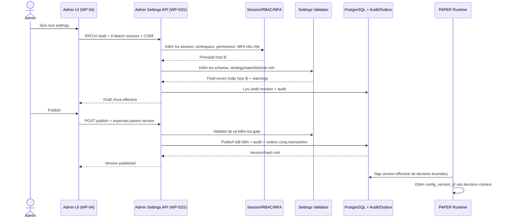
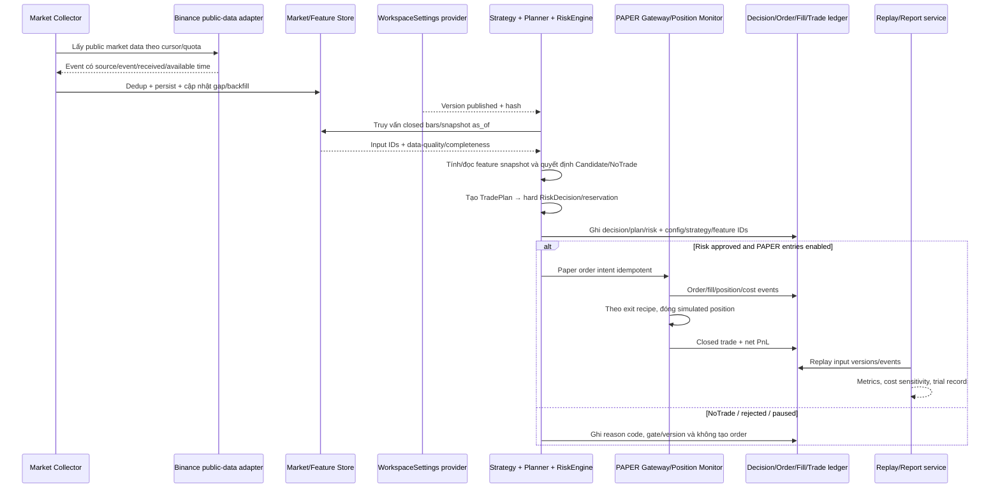

# Thiết kế WP-02 — Trading core, PAPER và cấu hình workspace

**Ngày:** 2026-10-22  
**Trạng thái:** Spec được người dùng duyệt ngày 2026-10-22; WBS đang chờ review  
**Phạm vi:** hoàn thiện WP-02A–F và thêm WP-02G cho root WorkspaceSettings/Admin API  
**Kết nối venue:** chỉ đọc dữ liệu công khai Binance USDⓈ-M sau khi adapter được nghiệm thu; tuyệt đối không gửi lệnh sàn trong WP-02  
**Ngôn ngữ:** identifier/API tiếng Anh; comment, docstring và tài liệu hướng dẫn tiếng Việt; thuật ngữ mới có EN→VI và nguồn trong glossary.

## 1. Hiểu yêu cầu và tiêu chí thành công

Người dùng muốn một bot Binance Futures độc lập, dùng cấu trúc Python rõ ràng, có vòng xử lý từ dữ liệu thị trường theo đúng thời điểm → feature/pattern → strategy candidate → hard risk decision → mô phỏng PAPER → lịch sử và báo cáo có thể replay. Cấu hình phải được quản lý tập trung ở một root settings section, có thể chỉnh qua Admin API đã xác thực, được version/audit và không làm thay đổi runtime khi mới lưu draft.

WP-02 chỉ hoàn tất khi có thể chạy một kịch bản PAPER offline từ fixture qua candidate, risk, simulated orders/fills, vị thế đóng và báo cáo net PnL; có config version được ghim vào mọi quyết định; cùng input/config tạo cùng kết quả; toàn bộ acceptance criteria và unit/E2E test đạt. Chưa nối account Binance, chưa tạo lệnh thật, chưa bật Demo/Live, chưa triển khai model tự học.

Sau WP-02 sẽ có một đợt brainstorm riêng về multi-bot: một control plane, nhiều bot/account với strategy/risk/report tách riêng, nhưng market data/research/knowledge và corpus/feature knowledge được chia sẻ theo workspace. Thiết kế WP-02 giữ decision/trade ownership có thể mở rộng sang bot ID, nhưng không thêm bot-instance lifecycle hoặc chạy nhiều bot trong phạm vi này.

## 2. Giả định và ranh giới cấu hình

### 2.1 Root settings duy nhất

Sản phẩm có một cây cấu hình gốc, `WorkspaceSettings`, do API `/api/v1/settings` quản lý. Các section nghiệp vụ nằm trong root và được schema-versioned:

```yaml
schema_version: 1
runtime:
  mode: PAPER
  timezone: UTC
market_data:
  venue: BINANCE_USDM
  symbols: [BTCUSDT, ETHUSDT]
  timeframes: [5m, 1h, 4h]
  max_age_seconds: 30
features:
  formula_version: crypidian-features-v1
  sessions_timezone: UTC
strategy:
  default_release: H01
  parameters: {}
  entry_timeframe: 1h
  confirmation_timeframe: 4h
risk:
  profile_version_id: <UUID>
paper_execution:
  quote_asset: USDT
  starting_equity: "10000"
  fee_schedule_version: paper-fees-v1
  fill_model: next_bar_with_adverse_costs
```

Đây là ví dụ minh họa; schema/enum/range thực sẽ được pin trong WBS và Pydantic model. Config JSON chỉ chứa giá trị cấu hình và opaque version/reference IDs; không chứa API key, secret, cookie, Telegram token hoặc raw private message. Risk caps được sở hữu bởi RiskProfileVersion hiện có; root settings chọn một phiên bản profile, không copy hard limits sang hai nơi.

Environment bootstrap (`.env`, mounted secret files) chỉ chứa thông tin cần để khởi động process, secret path và kết nối dịch vụ. Strategy choice, watchlist selection, feature policy, PAPER fill assumptions và profile references không được nhân bản thành biến môi trường cho từng strategy. Runtime nhận một `WorkspaceSettings` đã publish bất biến; draft không được nạp vào vòng quyết định.

### 2.2 Lưu trữ và version

Schema hiện có `config_version` gắn với `trading_account_id`; schema đó không dùng làm root workspace config. Thêm `workspace_settings_version` có `workspace_id`, `version`, `parent_version_id`, `schema_version`, `settings_json`, `settings_hash`, `status`, `created_by`, `approved_by`, `created_at`, `published_at`, `effective_at` và optimistic-lock revision. Draft có thể sửa, nhưng khi publish phải khóa bất biến ở tầng service và DB. Publish phải dùng `If-Match`/expected parent version để hai admin không thể ghi đè lẫn nhau.

`workspace_settings_version` liên kết các policy/version hiện có bằng ID (strategy release, watchlist, risk profile, fill model). Mọi `decision_cycle`, candidate, trade plan và paper trade lưu chính xác `workspace_settings_version_id`, strategy release ID, feature schema/hash và source snapshot IDs.

### 2.3 Kết nối Admin

WP-02G cung cấp Admin API và service; UI đầy đủ thuộc WP-04, theo lựa chọn của người dùng. API yêu cầu session, CSRF cho mutation, permission server-side và audit. Đề xuất permission: `SETTINGS_READ`; `SETTINGS_WRITE` cho section strategy/data; section `risk` cần `RISK_PROFILE_WRITE` và MFA mới; publish config chứa risk change cần policy phê duyệt phù hợp. Operator/Analyst không được sửa hoặc publish.

Endpoint contract sơ bộ (final path/schema pin trong WBS):

- `GET /api/v1/settings/current` — version đang effective, hash và actor publish.
- `GET /api/v1/settings/versions` — danh sách version, trạng thái, diff metadata.
- `POST /api/v1/settings/drafts` — tạo draft từ version hiện hành.
- `PATCH /api/v1/settings/drafts/{draft_id}` — sửa theo section và revision/ETag.
- `POST /api/v1/settings/drafts/{draft_id}/validate` — trả lỗi field-level, warnings và dependency checks.
- `POST /api/v1/settings/drafts/{draft_id}/publish` — validate lại, audit, publish nguyên tử và phát event sau commit.
- `POST /api/v1/settings/versions/{version}/rollback` — tạo version mới từ nội dung cũ; không sửa/xóa lịch sử đã publish.

Không có lệnh “apply now” bỏ qua phê duyệt. Runtime chỉ chuyển version tại decision boundary và giữ protective/exit recipe đang chạy theo config version đã ghim; semantics đổi strategy giữa vị thế mở cần được WBS cố định.

## 3. Thành phần và trách nhiệm

| Thành phần | Trách nhiệm trong WP-02 | Không được làm |
| --- | --- | --- |
| Market data adapter/collector | Nạp instrument rules, OHLCV, funding và OI công khai; lưu source/event/receive/available time, dedup, gap/backfill state. | Đọc account secret hoặc gửi order. |
| Market store/replay port | Truy vấn data `as_of`, kiểm tra range completeness và lineage. | Cho phép future/unclosed data vào decision snapshot. |
| Feature calculator | Tính feature versioned; tạo immutable feature snapshot với input IDs, formula version, quality flags. | Thay missing/stale/warm-up bằng giá trị giả định có lợi. |
| Strategy registry/engine | Evaluate versioned deterministic rule/geometry, trả Candidate hoặc NoTrade cùng reason/evidence. | Gọi Binance, đọc secret, vượt risk gate hoặc học online. |
| Planner/RiskEngine | Tạo TradePlan, adverse-cost sizing, hard cap và atomic reservation. | Cho AI/strategy sửa limit hoặc phát order. |
| PAPER gateway/position monitor | Mô phỏng order/fill/cost/position theo policy đã pin; quản lý stop/TP/exit và pause entries. | Gửi side effect tới venue. |
| Backtest/evaluation | Replay cùng semantics, tính hiệu suất sau chi phí và kiểm tra leakage/sensitivity/trial count. | Gọi fill thật hoặc tự promote strategy. |
| Workspace Settings/Admin API | Quản lý draft, validation, version, publish/rollback và RBAC/audit. | Lưu raw credentials hoặc để draft tác động runtime. |
| Common domain/event/outbox | Nối các bước bằng ID, workspace scope, config version và idempotency; không phát event trước commit. | Ghi secret/payload nhạy cảm vào event/log. |

## 4. Luồng chính và sequence diagram

### SD-WP02-01 — Thay đổi, kiểm định và phát hành root settings



### SD-WP02-02 — Market-to-paper lifecycle



## 5. WBS/work-package scope và acceptance summary

WBS task-by-task, file-by-file, thứ tự TDD và lệnh xác minh được lập thành implementation plan sau khi spec này được duyệt; không viết code trước bản WBS. Mỗi WP có unit tests, integration/E2E boundary tests, migration checks nếu đổi schema, memory update/readback và review.

| WP | Deliverable | Điều kiện nghiệm thu chính |
| --- | --- | --- |
| 02A — Market contracts/store/adapter | Canonical instrument/bar/funding/OI; Binance public read adapter; immutable raw lineage/cursors; dedup, backfill completeness, quality and as-of repository. | Fixture và mocked transport xác nhận parser/precision/rate-limit/error path; không gọi private endpoint; query không trả future/unavailable/unclosed data; thiếu nến/clock skew/stale đều làm decision input unusable; DB migration + repository integration pass. |
| 02B — Features/snapshots/regime | Existing SMA/EMA/TR/ATR/RSI/ADX/DMI/Bollinger/RV/ER/z-score/VWAP; immutable snapshot/hash/source IDs; trend/range/high-volatility labels và quality flags. | Golden fixtures đối chiếu công thức/seed/warm-up; missing/stale/flat/zero denominator pinned; replay snapshot trả đúng formula/schema version; không lookahead. |
| 02C — Strategy/geometry | Versioned interface/registry, deterministic Candidate/NoTrade, geometry and initial H01 trend/H03 Donchian/H06 mean-reversion hypotheses, recipes/exit rules. | Same snapshot+release deterministic; every candidate has evidence/reason/expiry/recipe and no future data; trend/range gates correct; config release is the one referenced by settings. |
| 02D — TradePlan/RiskEngine | Decimal plan/sizing, adverse costs, margin/leverage, aggregate exposure/loss caps, freshness gates, reservation atomicity and reject reasons. | Unit/property/PG concurrency test demonstrates no risk overrun; duplicate intent idempotent; reserved/unknown outcomes retain budget; stale account/risk config rejects; strategy cannot change hard caps. |
| 02E — PAPER execution/ledger | Simulated order/fill/cost, position monitor, protection/exit recipe and decision-to-trade report. | Full offline E2E opens and closes PAPER trade; fee/funding/slippage included exactly once; ambiguous bars are conservative/flagged; pause blocks entries but not protective exits; replay reconstructs ledger. |
| 02F — Backtest/evaluation | Event-driven replay/backtest, time splits, lookahead/leakage checks, cost sensitivity, metrics and strategy trial ledger. | Runtime and backtest share rule/fill semantics; point-in-time feature check rejects leakage; metrics include trade count, coverage, net PnL, drawdown, expectancy/cost breakdown and uncertainty; run reproducible from manifest. |
| 02G — Root settings/Admin API | WorkspaceSettings schema and version persistence; draft/validate/publish/rollback API; role/MFA/CSRF/audit/outbox; runtime version pinning. | Published versions immutable; stale concurrent draft conflicts; invalid refs/schema cannot publish; risk mutations require proper role/MFA; draft has no runtime effect; every decision/trade binds settings hash/version; API E2E uses PostgreSQL and existing auth. |

### WP-02 non-negotiable gates

1. No real exchange order endpoint or credential resolution is imported into WP-02 runtime. Only public market-data read is allowed for 02A; default tests and full vertical slice are fixtures/offline.
2. `LIVE` and Binance Demo are not valid runtime modes in WP-02. The only execution mode is `PAPER`.
3. A model/strategy candidate cannot change risk profile hard caps, request secret lease or publish itself.
4. Every decision/plan/order/fill/trade/replay record references immutable input/config/strategy versions and timestamps.
5. Any stale, incomplete, out-of-order, unclosed or future data leads to `NO_TRADE`/rejection, never an implicit fill or favorable default.
6. Test scope per WP includes unit tests and one or more integration/E2E tests for modified trust/data boundaries; all unit and all E2E run before WP-02 completion.

## 6. Data ownership and database additions

| Entity group | Scope/owner | Key fields / invariant |
| --- | --- | --- |
| `workspace_settings_version` | Workspace/control plane | Version/hash/schema/status/parent/actor/times. Published rows immutable; risk references validated server-side. |
| `market_instrument`, `market_bar`, `market_funding`, `market_open_interest` | Workspace-shared market data | Canonical contract/symbol/timeframe/open time/source; immutable versions/quality; unique dedup key within feed; point-in-time timestamps. |
| `ingestion_cursor`, `ingestion_gap`, `market_event_raw_ref` | Workspace-shared collector | Source/cursor/backfill interval/checksum/object ref; no silent gap closure. |
| `feature_snapshot` | Workspace-shared derived knowledge | `as_of`, feature schema/code hash, exact source event IDs, quality/freshness and values; immutable. |
| `decision_cycle`, `candidate`, `trade_plan`, `risk_decision`, `risk_reservation` | Workspace decision ledger | Settings/strategy/snapshot IDs and deterministic reason; unique cycle/idempotency key; atomic risk. |
| `order_intent`, `exchange_order`, `fill`, `position_event`, `trade`, `trade_cost` | Shared execution ledger with `mode=PAPER` | PAPER adapter uses the same lifecycle/domain contract planned for later Demo; venue IDs remain null and simulated fills/cost entries are immutable and mode-tagged. Synthetic account is initialized with configured quote asset/starting equity and has no secret reference. |
| `backtest_run`, `trial_record`, `evaluation_report` | Workspace evaluation | Input manifest, config/strategy hashes, period/time splits, metrics, cost model and run seed/version. |

Shared market/research/knowledge ownership is workspace-wide. WP-02 does not add `bot_instance` or account-to-bot relationships. After completion, the multi-bot brainstorm will decide whether per-bot config is a child overlay of root `WorkspaceSettings`, how signal/research/features are shared, how trades/reports partition by `bot_id`, and how multiple accounts consume shared knowledge without crossing workspace/security boundaries.

## 7. Use case/story traceability

| Design slice | Existing use cases | Existing stories |
| --- | --- | --- |
| Root settings/admin API | UC-01, UC-06, UC-07 | US-01, US-06, US-07 |
| Instrument/watchlist/market data | UC-08, UC-10 | US-08, US-10 |
| Features, candidate and strategy | UC-14, UC-15 | US-14, US-15 |
| Planner, hard risk, PAPER execution | UC-16–18 | US-16–20 |
| Trade history/report/replay | UC-20, UC-21, UC-23 | US-22, US-24, US-25, US-26 |

Existing product use cases/story documents remain canonical; this spec adds WP-02 implementation contracts and acceptance mapping. Product backlog updates are included in WBS tasks so status is not claimed complete until tests show acceptance.

## 8. Rủi ro và giới hạn

- Dữ liệu Binance public REST có quota và retention; adapter phải đọc limit hiện hành và cache metadata, không giả định mọi historical stream có cùng thời lượng.
- OHLCV bar không mô tả thứ tự nội bar, queue position hay fill certainty; PAPER report phải công khai mô hình fill và ambiguous outcomes.
- Indicator convention có thể khác thư viện; project formula version và golden fixtures mới là contract runtime. ER phẳng của dự án là 0, TA-Lib ER có thể trả 1 để phục vụ KAMA; không trộn.
- Feature snapshot và event schema có thể tăng kích thước; WBS cần index/partition/retention acceptance nhưng chưa chốt policy production.
- Shared market/research data không được làm mất workspace isolation. Multi-bot không đồng nghĩa dùng chung credential/account hay báo cáo.
- Backtest không chứng minh edge hoặc lợi nhuận tương lai; threshold là hypothesis và phải chịu out-of-sample/cost sensitivity.

## 9. Self-review trước chuyển sang implementation plan

- [x] Scope tách rõ WP-02A–G, PAPER-only và multi-bot brainstorm sau WP-02.
- [x] Root settings không dùng sai `config_version` vốn account-scoped; secret loại khỏi config JSON.
- [x] Admin draft/validate/publish/rollback có auth, RBAC, MFA, CSRF, audit và concurrency contract.
- [x] Trace từ use case/story, sequence, DB, risk gate, replay và acceptance criteria có mặt.
- [x] Failure classes gồm future/out-of-order data, gaps/backfill, duplicate, concurrent config publish, risk reservation race, fill ambiguity, stale config và strategy leakage được giao cho WBS/test.
- [x] Người dùng đã review/duyệt spec và chọn root WorkspaceSettings + Admin API, UI theo WP-04.
- [ ] Người dùng review/duyệt WBS implementation plan trước code.
