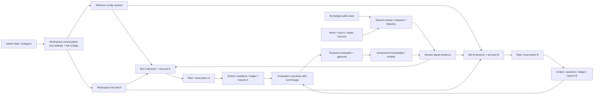
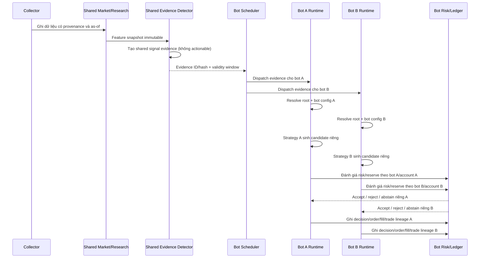

# Brainstorm kiến trúc Multi-Bot

**Trạng thái:** Design và WBS được người dùng duyệt ngày 2026-10-24; MB-00 contract freeze đang thực hiện.
**Ngày:** 2026-10-24
**Phụ thuộc:** WP-02 trading core/PAPER đã nghiệm thu tại commit `cadf447` trên nhánh `dev`.

## 1. Ý định và lý do

Mở rộng một workspace quản trị để vận hành nhiều trading bot, mỗi bot có strategy, ngân sách risk, trạng thái, trade history và báo cáo riêng; đồng thời dùng chung market data, research, feature snapshots và kho kiến thức/model AI. Mục tiêu là tái sử dụng phần hiểu thị trường mà không trộn lẫn quyền quyết định, vốn, giao dịch hay kết quả của các bot.

Tài liệu này so sánh các hướng kiến trúc và ranh giới cho bản đầu. User đã duyệt hướng kiến trúc và các quyết định trong mục 15, đồng thời duyệt WBS ngày 2026-10-24. Contract freeze MB-00 nằm tại [hợp đồng kiến trúc Multi-Bot](../../architecture/decisions/2026-10-24-multibot-contracts.md); các WP source phụ thuộc chỉ bắt đầu sau khi contract được review.

## 2. Hiện trạng và ràng buộc kế thừa

- `WorkspaceSettings` là cấu hình gốc được version hóa theo workspace; Admin API quản lý draft, validate, publish và rollback.
- `TradingAccount` đã có `workspace_id`, mode/status và giới hạn notional; database cho phép nhiều account trong cùng workspace.
- `PaperRuntimeBootstrap` khởi tạo một gateway/lifecycle theo account enabled trong workspace deployment hiện tại. `PaperRuntimeApplicationService` tra runtime bằng account ID.
- Ledger, reservation, order intent, trade và phần lớn khóa unique được scope theo `(workspace_id, account_id, ...)`. Chưa có `bot_id` hoặc bot-scoped report API.
- Effective settings hiện ở cấp workspace. Settings strategy/risk mới cần một lớp chọn cấu hình theo bot mà vẫn chịu root guardrails.
- Market/research/features và candidate signals là dữ liệu có thể chia sẻ trong workspace; intent, risk decision, reservation, vị thế, trade, PnL và report phải có lineage riêng của bot.
- PAPER/replay MVP hiện không tự dispatch market event và không gọi Binance order API. Multibot không được mô tả như tính năng live trước khi WP-03 và runtime worker được xây.

Tham chiếu: [WP-02 PAPER core](../../implementation/02-trading-core-paper.md), [WP-02 integration gates](../../implementation/wp02-integration-gates-wbs.md), [technical design](../../architecture/technical-design.md), [product stories](../../product/user-stories.md).

## 3. Mục tiêu, ngoài phạm vi và nguyên tắc

### Mục tiêu

1. Một workspace quản lý nhiều bot và nhiều account qua cùng Admin API/control plane.
2. Mỗi bot chọn strategy/release/parameters riêng và có risk budget riêng, nhưng không thể vượt hard limits cấp workspace.
3. Chia sẻ market observations, research records, features, candidate signals và AI knowledge có provenance/as-of rõ ràng.
4. Tách quyết định, reservation, orders, positions, ledger, trade outcomes và báo cáo theo bot.
5. Cho phép pause/resume bot riêng, có workspace-wide kill switch và trạng thái readiness hiển thị rõ.
6. Giữ mọi version/config/model/strategy reference có thể tái dựng lại một quyết định lịch sử.

### Ngoài phạm vi của bản thiết kế đầu

- Gửi lệnh Binance Demo/Live, credential rotation thật hoặc exchange reconciliation; đây là WP-03.
- Tự sửa strategy, risk limits hoặc promote model mà không có approval.
- Nhiều bot dùng chung một exchange account trong lần phát hành đầu (hướng C ở phần 4).
- Bảo đảm lợi nhuận/edge cho bất kỳ strategy hoặc AI model nào.

### Nguyên tắc

- **Đã chốt:** một bot / một trading account trong phiên bản đầu. Tách account ở sàn cũng là ranh giới vốn và reconcile dễ hiểu.
- **Đã chốt (2026-10-24):** account được bind là exclusive cho bot: bot này là writer duy nhất; manual/foreign-client order hoặc position được xem là hoạt động lạ. Phát hiện hoạt động lạ thì khóa entry của account/bot cho tới khi reconcile. Protective monitoring/exits vẫn tiếp tục cho vị thế PAPER/bot đã biết; không tự nhận ownership hoặc đóng vị thế lạ.
- **Đã chốt:** root settings sở hữu hard caps/chính sách workspace; bot overlay chỉ được chọn/thắt chặt trong phạm vi được phép, không được nới risk limit.
- **Đã chốt:** shared signal là evidence/setup trung lập; từng bot chạy strategy riêng để tạo `StrategyCandidate`. Quyết định đủ điều kiện giao dịch luôn tính riêng theo bot, account, risk state, strategy version và thời điểm.
- Không chia sẻ API key, session, private account state hoặc raw account event giữa bot.
- Dữ liệu dùng chung chỉ được đọc trong cùng workspace và phải giữ source/license, time availability, transform/model version và as-of lineage.
- Mọi kết quả thực thi và report phải lọc được bằng bot ID và vẫn trace ngược về shared market/research inputs.

## 4. Các hướng kiến trúc đã cân nhắc

### A. Một bot gắn một account, shared workspace core — **đề xuất**

Thêm `BotInstance` trong workspace và ràng buộc một trading account duy nhất. Workspace chia sẻ ingestion/research/feature/AI services; từng bot có config version, lifecycle, decision pipeline identity và reports riêng. Worker có thể chạy nhiều bot trong cùng process ở PAPER, sau đó chuyển thành worker pool có concurrency limit mà không đổi model dữ liệu.

**Ưu điểm:** phù hợp mục tiêu nhiều account; định danh rủi ro và lịch sử rõ; dễ tính report và ownership; giảm nguy cơ hai strategy tranh cùng vị thế/vốn.
**Đổi lại:** một account không được chia cho nhiều bot ở bản đầu; thêm bot configuration resolver và bot-scoped indexes/API.

### B. Một runtime/process riêng cho mỗi bot

Control plane và knowledge service vẫn dùng chung, nhưng mỗi bot có deployment/worker/process độc lập.

**Ưu điểm:** cô lập crash, resource và rollout tốt.
**Đổi lại:** tốn tài nguyên vận hành; cần scheduler, deployment orchestration, secret lease, service health và rollout coordination sớm hơn; không cần thiết để mở multibot PAPER đầu tiên.

### C. Nhiều bot cùng một account, risk allocator chung

Bot có strategy/ledger riêng nhưng account balance, positions và venue orders dùng chung. Cần một account-level allocator/reservation layer phân phối vốn, deduplicate/conflict-resolve lệnh và reconcile position ownership.

**Ưu điểm:** linh hoạt khi người dùng chỉ có một tài khoản sàn.
**Đổi lại:** PnL/position ownership không còn tương đương state ở sàn; phải định nghĩa netting/hedging, lệnh đối nghịch giữa bot, fee allocation và account-level kill switch. Đây là thay đổi lớn cho risk semantics, nên để phase sau.

**Đề xuất lựa chọn:** A. Hướng B có thể là quyết định triển khai/scale sau này, không cần là model ownership khác. Hướng C chỉ thêm sau khi có design riêng và account-level risk acceptance.

## 5. Bức tranh thành phần

Candidate signal là đầu vào dùng chung, không phải lệnh dùng chung: mỗi bot tự áp strategy eligibility và hard risk gates, nên cùng một candidate có thể được Bot A nhận, Bot B từ chối hoặc abstain.

## 6. Phân chia dữ liệu và đề xuất schema

Các tên dưới đây là entities đề xuất, chưa phải migration đã duyệt. Tất cả bảng bot-scoped dùng composite foreign key/unique key theo workspace để ngăn tham chiếu chéo tenant.

| Entity | Dữ liệu chính | Ranh giới |
| --- | --- | --- |
| `bot_instance` | `id`, `workspace_id`, `name`, `status`, `mode`, `trading_account_id`, timestamps | Một account duy nhất trong v1; unique `(workspace_id, trading_account_id)` và `(workspace_id, name)`; account phải cùng workspace. |
| `bot_config_version` | `bot_id`, `workspace_id`, parent version, overlay JSON/hash, author/approver, effective time | Immutable sau publish; optimistic concurrency; audit/outbox qua Admin API. |
| `bot_runtime_state` (hoặc event/checkpoint hiện có mở rộng) | readiness, pause/breaker, heartbeat, last decision watermark, safe diagnostic | Không chứa secret; tenant/bot-scoped. |
| `shared_signal_evidence` | market/feature/research/model lineage, symbol, setup annotations, validity window, evidence hash | Workspace-scoped và chưa actionable; không gắn bot strategy, account decision, quantity hay order. |
| `bot_strategy_candidate` / `bot_decision` | bot, shared evidence, bot-selected release/parameters, effective config IDs/hashes, eligibility/veto/abstain, reason | Bot-scoped. Strategy tạo candidate riêng cho bot; idempotent theo bot + evidence + config + evaluation window. |
| `bot_risk_reservation` / ledger link | bot, account, decision, risk profile version, reservation, state | Reservation atomically tính account và bot scope; vì v1 1:1, các tổng này phải bằng nhau và consistency được kiểm tra. |
| Order/position/trade/report lineage | bot ID cùng các IDs hiện có | Mọi lịch sử/báo cáo được truy vấn theo bot; không đổi shared market tables thành bot copy. |
| `knowledge_artifact` / `model_release` | source/license/provenance, dataset cutoff, feature/model code hash, training run, approval state | Workspace-shared; immutable release; bot chỉ tham chiếu release đã approved trong config. |

### Effective configuration

`EffectiveBotConfig = WorkspaceSettings + BotConfigVersion overlay + referenced immutable releases`.

- Workspace giữ hard risk cap, shared data/research policies, AI governance, allowed venues/modes, global pause. Workspace aggregate cap là tỷ lệ trên tổng account equity của các bot enabled, quy đổi về USDT.
- Bot overlay giữ strategy release/parameters, timeframe/universe subset, bot risk budget thấp hơn hoặc bằng root cap, per-bot pause/alert preferences.
- Equity và risk được tính bằng Decimal tại cùng một `as_of`; account quote/collateral khác USDT được quy đổi bằng shared point-in-time conversion observation có provenance và giới hạn tuổi dữ liệu. Nếu equity/rate thiếu, stale, không cùng mốc hợp lệ hoặc không thể quy đổi thì không tạo entry/reservation mới.
- Workspace open-risk cap được tính trên tổng worst-case stop risk của open positions cộng pending reservations và so với `workspace_max_open_risk_fraction × total_equity_usdt`. Từng account đồng thời chịu `account_max_open_risk_fraction × account_equity_usdt`; mỗi bot overlay có thể đặt giới hạn thấp hơn. Tất cả phải đạt trong cùng transaction trước khi reservation được commit.
- Equity dùng cho risk budget gồm balance/seed + realized PnL + unrealized PnL của vị thế mở tại point-in-time mark. PAPER phải bổ sung mark-to-market cho risk snapshot từ fills và market mark; Demo/Live dùng fresh venue equity snapshot có unrealized PnL/available margin. Thiếu/stale market mark hoặc venue snapshot làm fail-closed; không thay thế bằng realized-only equity khi có vị thế mở. Báo cáo vẫn hiển thị realized/unrealized riêng.
- Resolver xác minh workspace/bot/account scope, immutable root version/hash, bot overlay hash, model/strategy release status, risk ceiling và effective timestamp.
- Mỗi decision, plan, reservation, order intent, trade và report ghi lại `bot_id`, `workspace_settings_version_id/hash`, `bot_config_version_id/hash`, `strategy_release_id/hash`, `model_release_id/hash` nếu có.
- Publish config mới chỉ áp dụng cho decisions mới. Active positions tiếp tục sử dụng pinned strategy/execution policy; emergency workspace kill switch có thể chặn entry và yêu cầu hành vi exit đã được định nghĩa/duyệt riêng.

### RLS, indexes và idempotency cần thiết

- Bảng bot-scoped có `workspace_id` và `bot_id`; RLS kiểm workspace, repository thêm bot scope tường minh.
- Index list/report tối thiểu: `(workspace_id, bot_id, created_at desc)`, `(workspace_id, bot_id, status)`, `(workspace_id, bot_id, symbol, opened_at)`.
- Unique decision idempotency key bao gồm bot ID; không dùng chung idempotency namespace giữa bots.
- Shared data lookup giữ khóa `(workspace_id, source, symbol, timeframe, event_time/as_of)` và provenance; không nhân bản một market event cho từng bot.
- Composite FK bảo đảm `bot_instance.trading_account_id`, decisions, reservations và ledger records cùng workspace/account.
- Root kill-switch event và bot pause event có audit identity, actor, reason, time và correlation ID.

## 7. Luồng hoạt động đề xuất

1. Collector ghi market/research artifacts vào shared workspace store, kiểm tra quyền nguồn, revision, freshness và availability time.
2. Feature pipeline tạo immutable point-in-time snapshots; shared detectors/model tạo `shared_signal_evidence` cùng source/evidence lineage. Evidence chung không phải `StrategyCandidate` của WP-02 và không thể trực tiếp tạo lệnh.
3. Scheduler lấy danh sách bot active theo policy/concurrency budget, resolve effective root + bot config tại evaluation time.
4. Mỗi bot chạy strategy release/parameters riêng trên shared evidence và feature snapshots để sinh `StrategyCandidate` riêng; sau đó kiểm tra candidate còn hạn, universe, account state, bot/workspace pause, freshness và model policy.
5. Per-bot risk engine kiểm tra budget bot, account margin/open positions, reservation đang chờ và root hard caps; ghi decision và reservation nguyên tử.
6. PAPER gateway (sau này Demo/Live adapter riêng) xử lý order/fills theo account, bot ID và idempotency; ledger lưu lineage bất biến.
7. Reporter đọc bot-scoped ledger; workspace dashboard chỉ aggregate theo quyền và không đổi ownership của trade.
8. Evaluation job tổng hợp outcome theo bot/strategy/model trên cùng knowledge base, nhưng split theo thời gian và tránh một bot nhìn outcome tương lai của bot khác khi tạo decision lịch sử.
9. Candidate model/strategy mới được đánh giá và approved/published; bot chỉ đổi release ở config version mới, active positions giữ pin cũ.

## 8. Sequence: candidate chung, quyết định riêng

## 9. Admin, Telegram, reporting và quyền

- Admin UI/API dùng một workspace control plane: bot list/detail, create/disable, account binding, config draft/validate/publish/rollback, health/pause/resume, per-bot report.
- Quyền `bot.read`, `bot.configure`, `bot.operate`, `bot.report.read` tách khỏi role workspace; owner có thể cấp theo bot hoặc nhóm bot. Risk config/high-impact action yêu cầu recent MFA như root settings.
- Telegram command phải gắn identity đã xác minh, workspace và `bot_id`; command không chỉ định bot bị từ chối khi có nhiều bot. Có thể hỗ trợ nhóm lệnh workspace-wide như `/pause_all` cho owner/operator được phép.
- Report API yêu cầu `bot_id` hoặc rõ ràng `scope=workspace`; default không được âm thầm aggregate toàn bộ bot.
- Mỗi report thể hiện strategy/config/model/evaluation versions, capital/fee assumptions, realized/unrealized PnL phân biệt, drawdown/window semantics, rejected/abstained signals và completeness của market data.
- Kill switch: global block entry cho mọi bot; bot pause độc lập; thứ tự exit/open-position behavior phải được product chốt và audit.

## 10. AI knowledge dùng chung nhưng quyết định có giới hạn

- Shared knowledge gồm licensed source documents, normalized events, analyst/trader opinions có provenance, market/feature snapshots, labels và approved model/strategy releases.
- Knowledge artifact giữ `workspace_id`, source/license terms, captured/available time, content hash, parser/schema version, retention/consent status và source quality.
- Training dataset là immutable snapshot với cutoff time, bot outcome lineage, label definition, data split và exclusions; không lấy tương lai hoặc sửa quá khứ trong replay.
- Shared model có thể tạo score/candidate evidence chung; decision threshold/risk eligibility vẫn do bot config và hard guardrails quyết định.
- Không để model tự sửa `WorkspaceSettings`, bot risk budgets, order sizing hard limits hoặc tự publish strategy. Promotion có temporal/walk-forward evaluation, per-bot impact analysis, approver và rollback release.
- Một workspace dùng chung knowledge không đồng nghĩa chia sẻ dữ liệu giữa workspace khác; cross-workspace pooling cần consent, de-identification, licensing và governance review riêng.

## 11. Rủi ro, failure behavior và vận hành

- **Candidate stale/partial data:** bot abstain, ghi reason; shared pipeline degradation không biến thành tín hiệu mặc định. Shared evidence không được nâng thành strategy candidate nếu rule/model bot không xác nhận.
- **Root/bot config mismatch:** không nhận entry mới; active state tiếp tục exit bằng pinned policy nếu lineage hợp lệ.
- **Một bot lỗi:** đánh dấu bot unhealthy/paused, không làm sập sibling bots; workspace kill switch vẫn có quyền dừng toàn bộ.
- **Reservation race:** khóa/transaction theo account+bot+workspace policy; unique idempotency; timeout/unknown order giữ reservation cho tới reconcile.
- **Account hoạt động ngoài bot:** exclusive account binding là điều kiện vận hành; phát hiện lệnh/vị thế không có bot lineage thì khóa entry, phát audit/diagnostic và yêu cầu reconcile. Không tự adopt hoặc đóng vị thế lạ. Protective exits vẫn chạy với vị thế đã biết. Adapter/reconcile để kiểm tra activity ownership thuộc WP-03.
- **Một account có nhiều owners/processes:** lease/fencing token theo account trước khi bật nhiều worker; chỉ một execution writer sở hữu account tại một thời điểm.
- **AI/data source outage:** giữ model release đã approved, làm rõ stale knowledge và từ chối nếu policy yêu cầu freshness tối thiểu.
- **Lệch report:** reconciliation report với append-only ledger; correction là event mới có actor/reason, không sửa trade lịch sử.
- **Resource overload:** scheduler giới hạn concurrency/backpressure theo workspace, không để bot nhiều hơn làm trễ freshness mà không báo.

## 12. Di trú từ WP-02

1. Tạo BotInstance mặc định cho mỗi `TradingAccount` đang chạy PAPER; preserve workspace/account IDs.
2. Tạo bot config version ban đầu trỏ tới root `WorkspaceSettings` version đang effective và strategy release hiện hành.
3. Gắn `bot_id` vào existing account-scoped ledger entities; với bảng append-only, backfill bằng join account→bot rồi validate counts/hashes trước khi enforce `NOT NULL`.
4. Giai đoạn chuyển tiếp repository có thể nhận `account_id` và resolve bot ID nội bộ; sau khi callers chuyển xong, API mới bắt buộc bot ID.
5. Upgrade/downgrade rehearsal trên database snapshot; verify RLS, composite FK, report counts, idempotency collision và restart recovery.
6. Rollout theo workspace flag: legacy single-bot mapping → multi-bot PAPER shadow mode → selected PAPER bots → Demo sau WP-03.

Không sửa hoặc xóa root `WorkspaceSettings` để thay bằng cấu hình riêng từng bot. Bot overlay là child version được Admin API quản lý trong cùng root control plane.

## 13. Hướng WBS

WBS chi tiết đã được người dùng duyệt tại [Multi-Bot Implementation Plan](../plans/2026-10-24-multibot-implementation-plan.md). Contract freeze MB-00 được ghi tại [hợp đồng kiến trúc Multi-Bot](../../architecture/decisions/2026-10-24-multibot-contracts.md); WP source tiếp theo bắt đầu theo phụ thuộc và cổng nghiệm thu trong WBS.

WBS riêng cần chia acceptance/test gates tối thiểu:

1. Bot identity/account binding, ownership constraints, migration/backfill/RLS.
2. Versioned bot overlay và root+bot effective config resolver/Admin API.
3. Runtime registry/scheduler, per-bot lifecycle, pause/breaker, lease/fencing và restart recovery.
4. Bot-scoped risk/reservation/idempotency/ledger, aggregate workspace caps và two-bot concurrency tests.
5. Shared signal contract, per-bot eligibility/decision, point-in-time provenance.
6. Per-bot reporting/history, explicit workspace aggregate, RBAC/Telegram commands.
7. Shared research/AI knowledge lineage, immutable datasets, per-bot evaluation, approval/promotion/rollback.
8. Migration rehearsal, load/failure tests, operations dashboard and readiness gates.

Mỗi WBS item cần unit tests; DB/RLS/race/migration cần PostgreSQL Compose E2E; UI/API cần browser/API E2E; implementation-memory phải ghi kết quả, lỗi gốc, quyết định và giới hạn rồi được đọc lại trước khi commit.

## 14. Thuật ngữ EN→VI và tài liệu liên quan

- **Multi-tenancy — đa thuê bao:** nhiều workspace dùng chung dịch vụ nhưng dữ liệu được cô lập bằng scope/RLS. [Technical design: database schema](../../architecture/technical-design.md#database-schema).
- **Bot instance — thực thể bot:** một cấu hình/runtime identity có vòng đời, account binding, strategy và reports riêng trong workspace.
- **Configuration overlay — lớp cấu hình kế thừa:** phần cấu hình bot ghi đè các giá trị được phép trên cấu hình gốc; resolver tạo ra cấu hình hiệu lực có version/hash rõ.
- **Signal candidate — ứng viên tín hiệu:** mô tả cơ hội và evidence chung, chưa phải quyết định đặt lệnh. [User stories US-14–US-17](../../product/user-stories.md).
- **Risk reservation — khoản risk được giữ chỗ:** giới hạn risk/margin tạm được giữ trước hoặc trong khi lệnh đang xử lý để tránh cấp vốn trùng. [Glossary](../../research/glossary-vi.md).
- **Fencing token — mã hàng rào quyền sở hữu:** token tăng dần dùng để ngăn worker cũ tiếp tục ghi sau khi lease/account ownership đã chuyển.
- **Point-in-time / as-of — đúng thời điểm / tại thời điểm:** chỉ dùng dữ liệu đã khả dụng ở thời điểm quyết định lịch sử. [Technical design](../../architecture/technical-design.md) và [glossary](../../research/glossary-vi.md).
- **Temporal leakage — rò rỉ theo thời gian:** thông tin tương lai vô tình lọt vào feature, label hoặc train/evaluation của quyết định trước đó. [WP-06 learning plan](../../implementation/06-ai-learning.md).
- **Promotion / rollback — phát hành / quay lui phiên bản:** quy trình duyệt một model/strategy version mới làm phiên bản được sử dụng và tạo version mới để quay về release trước nếu cần. [WP-06 learning plan](../../implementation/06-ai-learning.md).

## 15. Các quyết định đã được người dùng duyệt

1. **Đã chốt (2026-10-24):** hướng A, một bot / một exchange account ở bản đầu.
2. **Đã chốt (2026-10-24):** bot overlay chỉ được siết root risk limits, không được nới.
3. **Đã chốt (2026-10-24):** workspace aggregate open risk tính theo tỷ lệ trên tổng equity các account, quy đổi về USDT bằng dữ liệu point-in-time; thiếu/stale conversion thì fail-closed. Account vẫn có risk cap riêng.
4. **Đã chốt (2026-10-24):** pause/kill switch chặn entry mới, hủy lệnh chưa khớp và tiếp tục protective monitoring; flatten-all riêng, cần quyền cao/MFA.
5. **Đã chốt (2026-10-24):** shared evidence trung lập; từng bot tạo `StrategyCandidate` bằng strategy/config riêng.
6. **Đã chốt (2026-10-24):** owner/admin xem mọi bot; role khác cần bot-scoped grant.
7. **Đã chốt (2026-10-24):** account gắn bot exclusive; lệnh/vị thế lạ khóa entry đến khi reconcile, không tự adopt/close; protective exits cho vị thế bot đã biết tiếp tục hoạt động.
8. **Đã duyệt:** toàn bộ hướng thiết kế ngày 2026-10-24; các lựa chọn này là product decisions. Schema/API/file names và implementation details vẫn là đề xuất để WBS chốt.
